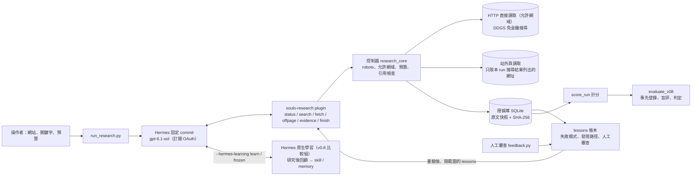

# Hermes SEO 競爭情報 Agent

用官方 NousResearch Hermes（固定 commit `311155fade43d1993ea968909a2ad36762345bbc`，不改原碼）加一個唯讀研究 plugin，讓模型自主研究競爭者 https://2030.tw 在「娛樂城」「3A娛樂城」的 SEO 策略，並提出我方可採取的行動。模型決定查什麼、用哪個工具、何時修正與收斂；程式負責預算、robots、允許網域、證據完整性與學習帳本。

## 給審查者

| 項目 | 現況 | 去哪裡看 |
|---|---|---|
| 自主研究 | 真實 Hermes + gpt-6.1-sol 跑過 33 次完整研究（v0.5 五次、v0.6 六次、v0.7 四次、v0.8 十八次）；不帶經驗時 Agent 也能自己從首頁找到 `/wordcup/` 娛樂城目錄與兩個目標詞頁 | [v0.8 帳本組第 5 次的報告](evaluation/v08/runs/ledger-series/d8594fca7f904132a15b9f868b38353a-report.md)、`evaluation/v08/runs/` |
| 學習（正式結果，v0.8） | 事先登錄的學習序列：三組從空白狀態各跑 5 次。lessons 帳本 **improved**：學到兩個目標頁的位置，讀到目標頁前的工具呼叫 8 → 1（不學習的對照組 8–9）；總呼叫與耗時沒有減少，省下的預算轉去讀證據與站外頁，成本與盲評品質不變，保留站沒有傷害。Hermes 原生學習 **regression**：學到 1 個研究方法 skill、0 條記憶，沒有變快，第 5 次成本是對照中位數的 1.48 倍（門檻 1.3 倍），比自己的第 1 次多 30%。原生對帳本 **ledger_better** | [判定](evaluation/v08/VERDICT.md)、`evaluation/plan-v08.json`、[設計說明](evaluation/plan-v08-design.md) |
| 前幾版 | v0.5 記憶是負結果；v0.6、v0.7 依各自的登錄計畫判定 learning not_proven（v0.7 off-page not_achieved），照登錄保留 | 下方「評估」、[v0.6 判定](evaluation/v06/VERDICT.md)、[v0.7 判定](evaluation/v07/VERDICT.md) |
| Demo | 4 分 50 秒，v0.7 帶經驗組的真實執行錄影（tmux 擷取，研究段實際速度，只快轉長的模型等待），附字幕；片尾列出判定後的快取分析（2030.tw 約少 20%、保留站約多 11%）並註明 v0.8 結果見文件；v0.8 沒有錄影 | `demo/v07/Hermes_Task02_Demo_v07.mp4`、[錄製說明](demo/v07/RECORDING.md) |

最快的核對方式（Windows 或 Linux，Python 3.10 以上，只用標準函式庫）：

```bash
python -m unittest discover -s tests -v        # 159 tests（Windows 略過 1 項需要 symlink 的測試），含對封存真實 trace 的回歸檢查
python scripts/evaluate_memory.py              # lessons 帳本的合成元件檢查，寫到新的 runs/ 目錄
python scripts/evaluate_v08.py --verify        # v0.8 計畫雜湊與程式指紋一致，23 步都已結算
```

`evaluate_v06.py`、`evaluate_v07.py` 的 `--verify` 在目前程式上會回報程式已變更，這是預期結果：每份計畫鎖定當時的程式，重驗舊版要取出對應的 commit。

## 架構



模型只能透過六個工具行動：`research_status`（預算與 lessons）、`research_search`（公開索引摘要，標示是否為目標站）、`research_fetch`（允許網域內讀頁，回傳含關鍵字的錨文字與網址，以及出站連結摘要 `outbound_hosts`）、`research_offpage`（讀搜尋結果列出的站外頁，只回傳連到目標站的連結與提及上下文）、`research_evidence`（讀已存快照的片段）、`research_finish`（提交主張與行動，程式檢查引用與 on-page／off-page 段落）。沒有 shell、寫入外部系統或付費能力。Hermes 原生學習只在比較時開啟，平常的研究不載入 Hermes 的記憶與 skill 工具。

## 執行

離線測試與合成檢查如上，不需要 Hermes、網路或登入。

真實研究需要 Linux 或 WSL2、GNU timeout、網路與自己的 OAuth profile（`.runtime/user`，不進 Git、不交付）。Windows 使用者照 [docs/WSL_RUNBOOK.md](docs/WSL_RUNBOOK.md) 操作；Linux 直接：

```bash
bash scripts/setup_research.sh                                   # 安裝固定版 Hermes，不呼叫模型
bash scripts/run_research.sh --root runs/readiness --check-only  # 未登入回 exit 2
bash scripts/login_hermes.sh --new                               # 使用者在瀏覽器完成裝置登入
bash scripts/run_research.sh --model gpt-6.1-sol --root runs/smoke --smoke-only
bash scripts/run_research.sh --model gpt-6.1-sol --root runs/research --mode baseline
```

`--mode memory` 讓同一個 `--root` 的 run 累積 lessons；`--no-learn` 凍結帳本；`--target`、`--keyword`、`--allow-host` 換研究對象。`--hermes-learning learn` 開啟 Hermes 原生學習（需搭配 `--hermes-home` 指定隔離的 profile home），`frozen` 只能讀學到的 skill。未登入、工具清單不符、模型失敗或沒交報告都不算成功。

## Architecture Decisions

1. **真 Hermes、不改 core**：plugin 以官方 `register(ctx)` 註冊工具，固定 commit 讓結果可重現。自主權邊界由「只給六個唯讀工具」決定，而不是靠 prompt 約束。
2. **判斷交模型，規則交程式**：robots、允許網域、私人位址、請求／工具／時間／大小上限、引用是否為本輪且雜湊相符，都由程式直接阻擋；模型負責假設、取捨與修正。
3. **證據庫**：每個來源存 URL、方法、時間、HTTP 狀態、SHA-256 與完整原文。報告的 observation/inference 必須引用本輪證據；失敗頁或失敗搜尋只能用在 `topic=access` 的主張。
4. **控制 context 成本**：fetch 只回前 60 個連結、8,000 字與最多 20 個含關鍵字的「錨文字 + 網址」；需要時用 `research_evidence` 以關鍵字讀片段。完整快照不減少。
5. **學習只收量測與人工輸入**：lessons 由控制器從事件與 HTTP 結果產生，或由人工審查寫入；模型沒有寫入路徑。每條 lesson 有範圍、效期、來源 run、證據與狀態歷史。
6. **評估先登錄再跑**：計畫、判定標準與保留站選擇規則在真實 run 前寫死並雜湊；程式改動後評估腳本拒絕執行。
7. **站外讀取以搜尋結果為界**：off-page 需要讀第三方頁面，但開放任意網址等於讓模型或頁內注入的指令能向任何伺服器發請求。`research_offpage` 只接受本 run 搜尋結果列出的網址，加上 robots、公開 IP、同站轉址、每 run 4 頁的限制，並只回傳結構化結果（連到目標站的連結、錨文字、rel、提及上下文），降低注入面與 token 成本。代價是覆蓋取決於免金鑰索引列出什麼，永遠不是完整 backlinks。
8. **lesson 只寫作法，不寫發現**：報告只能引用本 run 的證據，lesson 若帶著過去的發現，模型就得重查才能用。發現路徑 lesson 因此交出控制器本輪重抓的 evidence_id，讓模型直接讀取引用；過去的 sitemap 次數、錨文字只留在帳本資料供稽核。
9. **學習機制用 lessons 帳本，Hermes 原生學習只當比較組**：早期 runner 關掉 Hermes 內建的記憶與回顧，沒有實測過；照預設的回顧間隔，一次研究只有一個使用者回合，原生學習根本不會觸發。v0.8 把間隔設為 1，在同一份登錄計畫下比較：Hermes 的回顧照它的提示把經驗寫成通用的研究方法 skill、不記網站事實，研究更仔細但成本超標；帳本記的是使用前重驗的網站事實，第 2 次起直接讀到目標頁。
10. **成本指標計入提示快取**：每次模型呼叫都重送整段對話，命中快取的部分不需要重新處理。v0.8 起主指標是未命中快取的輸入＋輸出（`src/scoring.py` 的 `token_fields`），總 tokens 照列。

## 學習機制（lessons 帳本）

| 類型 | 何時學 | 何時提供 | 何時撤銷 |
|---|---|---|---|
| 失敗模式 | 同一做法在 2 個以上 run 失敗：搜尋索引回報沒有結果（依是否含 `site:` 分類），或控制器以固定清單內的規則拒絕（例如引用失敗來源） | 之後所有 run，寫成「不要用 site:，改用…」這類指引；只在一個網站觀察到時，換網站只標為「待驗」 | 同類搜尋有結果一次即撤銷；7 天沒有新支持即到期 |
| 發現路徑 | run 真的讀到目標詞頁：HTTP 200，且網址最後一段或 title/H1 的一段等於關鍵字 | 只限同一網站；提供前由控制器重抓確認，並把該次快照的 evidence_id 交給模型直接讀取引用 | 重抓得到 404/410、標題不符或 robots 禁止即撤銷；7 天到期 |
| 人工審查 | `scripts/feedback.py` 把報告某項標為 unsupported 或 scope_error | 下一個 memory run 的 `research_status`，標為要套用的審查標準 | 人工否決 |

任何 lesson 都可由人工否決（veto），否決後不再自動恢復。只有 runner 判定完成（research_complete）的 run 才會學習，評估重試不會重複累積支持。不學的東西：競品結論本身、URL 數量、模型自評、頁面內的指令、報告裡的任何欄位、逾時與限流等基礎設施失敗。lesson 的名稱只來自固定清單，頁面或模型文字無法命名或建立 lesson。站內搜尋頁、tag 頁與網址查詢參數含關鍵字的頁面不算目標詞頁，因為標題只是回顯查詢；控制器重驗抓到的頁面也不算模型讀到。

原題列的五類經驗：成功對應發現路徑；失敗對應失敗模式；錯誤判斷對應人工 unsupported/scope_error 與被程式退回的 finish；有效／無效研究方式記在失敗模式（附同批替代查詢的成功數）與發現路徑（附讀過幾份 sitemap、幾份列出目標頁）；Human Feedback 由 `feedback.py` 進入。

學錯的修正方式：反例自動撤銷、使用前重驗、7 天到期、人工否決；評估中的 run 一律凍結帳本，避免保留案例回流。v0.8 的五次學習中，帳本記下 3 條候選失敗經驗，沒有一條達到採用門檻，其中兩條遇到反例撤銷。已知弱點：模型避開某種失敗做法後就不會再產生反例，這類 lesson 只能靠到期或人工否決重新開放。

**Hermes 原生學習（比較組）**：`--hermes-learning learn` 載入 Hermes 的 `memory` 與 `skills` 工具集，開啟記憶與背景回顧，profile home 的 `memory.nudge_interval`、`skills.creation_nudge_interval` 設為 1；每次 run 用 `.runtime/user/profiles/<name>` 的隔離 home，OAuth 由 Hermes 的 profile 機制讀根 home，不複製憑證。`frozen` 只給 `skills_list`、`skill_view`，凍結的記憶照常進 system prompt，不回顧。`src/hermes_homes.py` 在每一步前後記錄所有 home 的學習內容雜湊，只有該組自己的儲存可以改變。

## 評估

### v0.8：從空白學起，第 5 次比第 1 次好嗎（正式結果）

計畫 `evaluation/plan-v08.json`（SHA-256 `e2b95aabbaa5cbd1a5464d8a0518551a8f6a96227a0e045895fd2624b8c3607b`）在任何 v0.8 run 前登錄，鎖定 16 個程式檔與 Hermes commit；登錄前經兩輪獨立審查，修正都寫在 [設計說明](evaluation/plan-v08-design.md)。三組（不學習的對照、lessons 帳本、Hermes 原生）從空白狀態在 2030.tw 各跑 5 次，逐輪交錯並輪替順序；第 1 輪後兩個學習組收到同一則人工審查；凍結後在保留站 casinobase.tw 各跑一次，只檢查傷害。23 步在 2026-10-16 19:21–20:15 UTC 依序執行，每步第一次就結算，隔離檢查全部通過；Session 用量 1% → 46%，沒有使用 banked resets 或 credits。公開 repo 不含 git 歷史：計畫檔記錄登錄時間與雜湊，所有執行紀錄的時間都晚於它；這是自我紀錄，不是第三方時間戳。

成本是未命中快取的輸入＋輸出；呼叫數是第一次讀到目標頁之前的工具呼叫數（所有工具都算）。三組 15 次都讀到兩個目標詞頁。

| 第幾次 | 對照：呼叫／成本 | 帳本：呼叫／成本 | 原生：呼叫／成本（研究＋回顧） |
|---:|---|---|---|
| 1 | 9／63,792 | 8／59,227 | 7／63,285（71,991） |
| 2 | 9／55,721 | 1／54,424 | 9／80,770（87,933） |
| 3 | 8／50,956 | 1／47,150 | 8／73,416（80,173） |
| 4 | 8／60,368 | 1／44,081 | 9／82,225（89,268） |
| 5 | 8／50,960 | 1／54,368 | 9／82,543（89,513） |

| 判定 | 結果 | 依據 |
|---|---|---|
| lessons 帳本 | **improved** | 讀到目標頁前的呼叫 8 → 1，第 4、5 次都低於對照範圍 8–9；總呼叫 13 → 16–18（對照 13–16），省下的找頁呼叫轉去讀證據與站外頁；成本 59,227 → 54,368（−8.2%，在對照範圍 50,956–63,792 內）；盲評缺陷 0、覆蓋 7 不變；失敗條件 F1–F6 與保留站 H1–H4 都不成立 |
| Hermes 原生 | **regression** | F2 成立：第 5 次成本 82,543 是對照中位數 55,721 的 1.48 倍，超過 1.3 倍（72,437）；呼叫 7 → 9 沒有變快；6 個 session 都保留了回顧內容 |
| 原生對帳本 | **ledger_better** | 呼叫、成本、研究＋回顧成本都是帳本較好；品質、保留站、學習內容相同 |
| 學到的內容 | 兩組都 **clean** | 沒看過分數的 agent 分類 22 項（帳本 3、原生 19），全部有支持，沒有源自網頁的文字或指示 |

原生組 6 次回顧都寫 skill：第 1 次建立 `public-evidence-seo-research`，之後 5 次都修補同一個 skill，記憶一條都沒寫。Hermes 的記憶指引寫「Skills come first」、一週內會過時的事實不該進記憶，回顧提示要求不帶事件細節的類別層級規則，所以它學到的是通用研究方法，沒有記下目標頁在哪裡，也就沒有變快；載入 skill 與照 skill 多做的查核（每次讀 7–8 頁，對照組 5–6 頁）讓成本上升，盲評覆蓋分數則一樣是 7。逐條判準、保留站、學習內容與成本拆解見 [evaluation/v08/VERDICT.md](evaluation/v08/VERDICT.md)。

### 前幾版（判定照登錄保留）

**v0.7：learning not_proven，off-page not_achieved，沒有退步**（[判定](evaluation/v07/VERDICT.md)，計畫 SHA-256 `937980e83d1e38c8ce718bc5da2548dc622843e8da9c6072a90b38a77e143d7a`）。新增 `research_offpage`，並把發現路徑 lesson 改寫成交出控制器本輪重抓的 evidence_id。記憶組從 v0.6 累積的帳本複本開始、對照組從空帳本開始，兩組都凍結。

| run（計分檔） | 兩個目標詞頁 | 首次讀到前的工具呼叫 | tokens | 盲評缺陷 | 覆蓋分數（滿分 8） |
|---|---|---:|---:|---:|---:|
| 2030.tw，記憶組（`R4`） | 是 | 1 | 225,174 | 0 | 8 |
| 2030.tw，對照組（`B2`） | 是 | 8 | 194,206 | 0 | 7 |
| casinobase.tw，對照組（`HB2`） | 否 | —（共 18） | 139,990 | 1 | 7 |
| casinobase.tw，記憶組（`HM2`） | 否 | —（共 18） | 139,800 | 0 | 6 |

記憶組第 2 次工具呼叫就讀到目標頁、沒有重抓也沒有讀 sitemap，但登錄的成本指標是總 tokens，記憶組多 15.9%（L4 不成立），保留站覆蓋分數 6 < 7（H1 不成立）。判定後扣掉提示快取命中重算（`scripts/token_breakdown.py`），記憶組在 2030.tw 少 20.3%、保留站多 11.0%；這是看到結果後才換的指標，判定不變，v0.8 改在執行前登錄計入快取的成本。站外讀取四個 run 共讀 6 頁、違規 0，只有一頁有品牌文字提及，沒有一頁連到目標站。保留站讀中文網址時 `research_offpage` 編碼失敗，模型改讀其他候選；v0.8 已修正（路徑與查詢以 UTF-8 百分比編碼、非 ASCII 主機以 IDNA 送出），v0.8 所有執行的編碼錯誤為 0。

**v0.6：not_proven，沒有退步**（[判定](evaluation/v06/VERDICT.md)，計畫 SHA-256 `90f562aa9f4426926a24a179add2dd661b98f76c61a8e08d73338719cafbb849`）。lessons 帳本第一次真實評估：凍結後的 R3 首次讀到目標頁只要 3 次呼叫（R1 7、同版對照 B1 6），不再用 `site:`，人工審查的標準也出現在報告裡；但 tokens 比 B1 多 2.3%、失敗搜尋沒有歸零。原因：模型把發現路徑當成需要重驗的線索，又依 lesson 中的 sitemap 敘述反覆查 sitemap。

**v0.5：記憶未證明改善（負結果）**。三組（無記憶、原始歷史、sitemap 記憶）各一次，只有無記憶組讀到目標詞頁；sitemap 記憶組 743,896 tokens、成本最高。原因：記憶以「sitemap 列出多少 URL」當採納訊號，兩次沒讀到目標頁的 run 仍被判有效；fetch 只回網址不回錨文字，模型看得到「線上娛樂城推薦」卻對不上網址。重算結果在 `evaluation/v05-rescore.json`。

### 合成元件檢查

`scripts/evaluate_memory.py` 用假網站與固定腳本策略（不含模型）檢查帳本行為：穩定網站上 memory 首次讀到前 2 次呼叫、baseline 5 次；目標頁搬家時重驗多花 1 個請求後正常回退；`site:` 恢復可用時避開它不造成損失。這只證明機制行為，不代表模型研究品質。

## 可靠性與自主權邊界

| 失效情境 | 處理 |
|---|---|
| 模型引用不存在、他輪或被竄改的證據 | finish 拒收，模型需修正後重交；原始被退紀錄保留。v0.8 的 18 份報告都在第一次提交就被接受 |
| 外部頁面含指令或錯誤內容 | 標為不可信資料；模型沒有能執行指令的工具；錨文字與標題只當資料顯示；站外頁只回傳連結與短上下文，不回傳全文 |
| 站外讀取被濫用（任意網址、內網、繞過 robots） | 只接受本 run 搜尋結果列出的網址（host 須完全相同）；目標站拒絕；轉址只限同 host 或 www. 對應；本機 DNS 與實際連上的位址都必須是公開 IP；robots 未知即停止；每 run 4 頁；站外快照只能以關鍵字讀片段；計分另稽核每個站外請求，含未完成的嘗試。v0.8 共讀 23 頁、違規 0 |
| 工具失敗（403/429、逾時、robots 未知、程式錯誤） | 保存狀態、不自動重試、不繞過；預算到限即停止 |
| 學到錯誤經驗 | 反例撤銷、使用前重驗、到期、人工否決；評估時凍結。v0.8 學到的內容另交盲評分類 |
| 學習寫到別組或凍結後被改 | 每一步前後核對所有 Hermes home、根 home 與帳本的雜湊；對照組看到 lesson 或成功執行 Hermes 記憶／skill 工具判 invalid；凍結內容在保留站跑完後必須雜湊不變 |
| 需要人類決定 | 登入、任何對外發布或網站修改、付費、人工審查與盲評 |

直接 HTTP 最多 30 次（含 robots、轉址與站外頁）、站外頁 4 頁、工具 40 次、900 秒、單回應 2MB（壓縮回應解壓後計）、同站間隔 2 秒；搜尋最多 5 次。沒有總 token 硬上限，usage 逐 run 保存；訂閱額度內的估計費用不等於實際扣款。

## 限制

- **學習改善的證據範圍有限。** 只在 2030.tw 一個網站、每組每個點各跑一次、比到第 5 次（原題問第 10 次）；對照組的 5 次是唯一的雜訊估計。改善的內容是找頁變快、預算轉去讀證據與站外頁，總呼叫、耗時與品質分數都沒有變好。
- **帳本的加速只限同一網站。** 它學到的是目標頁在哪裡；保留站沒有目標詞頁，只能確認兩種學習都沒有傷害，不能證明轉移後會變好。
- **兩種學習的條件不完全對等。** 帳本 lesson 的呈現方式在 v0.6–v0.7 看過 trace 後改寫過，研究 prompt 也寫明照 `research_status` 的 lessons 行動；Hermes 原生學習用它自己的提示，沒有調整。原生組被設成每次研究後都回顧，比預設頻繁；以天為單位整理 skill 的 curator 不在測試內。
- **品質維度沒有鑑別力。** v0.8 九份盲評報告的覆蓋分數都是 7；每份只有一位 AI 審查者，人工審查也由 Claude 在使用者授權下代審。人工審查標準的效果分不出來，因為對照組的報告也常寫出相同判斷。
- **只有公開資料。** 沒有競爭者 Search Console、排名、流量、轉換或完整 backlinks。off-page 只能用出站連結、搜尋摘要與少量實際讀到的站外頁佐證，覆蓋取決於免金鑰索引；v0.8 九份盲評報告都沒有找到連到目標站或提及它的站外頁。網域字串常撞到同名股票代號或年份，品牌名查詢較有效。
- live 網頁與搜尋會漂移，任何對照都不能主張因果或統計顯著。
- 引用檢查保證來源存在且未被改動，不保證語意支持；語意靠盲評。
- 直接抓取限操作者允許的網域，站外頁限搜尋結果；DNS 由執行環境解析，解析與連線之間仍有時間差，不是完整網路沙箱。

## 再有 4 週

1. **補上真正的 off-page 資料源**：免金鑰搜尋找不到連到目標站的頁面，這是資料問題，不是推理問題。加入可合法取得的資料（我方 Search Console 的連結報表、Common Crawl 的網站連結圖或付費反向連結索引的匯出），與現有的出站摘要、搜尋摘要、站外頁讀取並列，維持證據分級。
2. **把學習序列做到原題的規模**：每組重複 3 次以上、跑到第 10 次、擴到 3 個以上的網站，讓對照範圍來自更多次執行；把搜尋供應商失敗與研究方法失敗分開計分，盲評每份兩位審查者並細化評分表，讓品質維度分得出高低。
3. **學可以轉移的作法**：帳本的發現路徑只對同一網站有用。把跨站成立的作法（例如哪類查詢在免金鑰索引常失敗、哪類頁面結構值得先讀）和網站事實分開記錄，各自在保留站驗證後才採用。
4. **讓研究方法類的學習先過評估再生效**：Hermes 原生學到的研究方法沒有錯，但讓研究變貴。方法類的修改（不論來自 Hermes skill 或人工）先在凍結的對照上量成本與品質，通過門檻才進入下一次研究；同時讓 lessons 定期小量重測被避開的失敗做法，解決「避開後無反例」的問題。

## 其他文件

[v0.8 判定](evaluation/v08/VERDICT.md)、[v0.8 設計說明](evaluation/plan-v08-design.md)、[v0.8 帳本組第 5 次的研究報告](evaluation/v08/runs/ledger-series/d8594fca7f904132a15b9f868b38353a-report.md)、[v0.5 研究結果摘要](docs/RESEARCH_RESULTS.md)、[設計細節](docs/DESIGN.md)、[開發紀錄](docs/DEVELOPMENT_LOG.md)、[WSL 執行步驟](docs/WSL_RUNBOOK.md)、對外文件稿 `deliverable/doc.md` 與簡報稿 `deliverable/slides.md`。`scripts/make_figures.py` 從評估資料重畫對外稿的圖；`scripts/evaluate_agent.py` 是產生 v0.5 三組對照的原腳本，保留供追溯，不適用 lessons 帳本。
