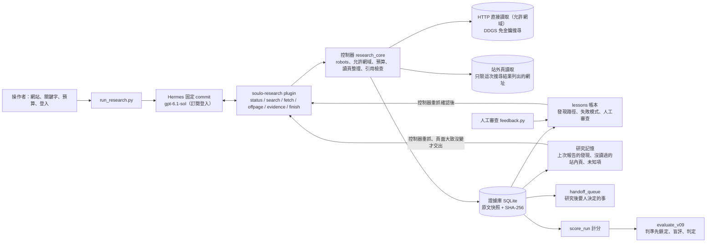

# Hermes SEO 競爭情報 Agent

用官方 NousResearch Hermes（固定 commit `311155fade43d1993ea968909a2ad36762345bbc`，不改原碼）加上一個唯讀研究 plugin，讓模型自己研究競爭者 https://2030.tw 在「娛樂城」「3A娛樂城」的 SEO 做法，並提出我方可採取的行動。模型決定讀什麼、用哪個工具、何時修正與收斂；程式負責範圍、預算、robots、證據完整性與經驗的寫入；目標、授權與審查留給人。

## 給審查者

**1. 2030.tw 怎麼做，我們從哪裡切入。** 帶經驗的組（發現路徑、審查回饋與研究記憶都開啟）第 10 次研究的結論，範圍是它讀的 8 個站內頁：2030.tw 用體育資訊站當入口，經 `/wordcup/` 主題樞紐連到「娛樂城」與「3A娛樂城」核心頁；兩個核心頁與抽查的品牌頁共用同一套六段落加五題 FAQ 的模板，長尾優惠頁另有一套較短的模板；抽查的品牌頁註冊按鈕都導向同一個帶追蹤參數、標成 nofollow 的外部網址，連到同一網址的側欄橫幅，替代文字卻是另一個品牌「WG娛樂城」；頁首另有一則 WG 廣告連到第二個註冊網域，第 10 次的報告沒有寫到。它的破綻是說了但沒有附紀錄或來源：自稱實玩數月、出金半小時至一小時卻沒有紀錄；優惠頁沒有交代資格、期限與流水；結構化資料混入無關的 MLB 新聞，日期也對不上。所以我建議比可查證、不比頁數；Agent 沒有排名資料，這是要用搜尋結果抽樣與試點驗證的假設。站外沒有找到任何連回它的頁面（免金鑰搜尋常被同名股票代號 2030.TW 干擾）。報告原文：[`evaluation/v09/runs/ledger-series/2f7174e7c3f04f35bd74b4c1d2c29af4-report.md`](evaluation/v09/runs/ledger-series/2f7174e7c3f04f35bd74b4c1d2c29af4-report.md)。

**2. 研究品質。** 控制器只保證引用存在、沒被改過，語意由三位沒看過分數與計畫的 Claude agent（非 SEO 專業人員）盲評判斷：他們逐條打開 6 份報告引用的頁面快照，沒有找到與頁面不符的事實；缺點是說太滿、追不到出處，以及把歸納判斷放在「已知」裡，都輕微。最弱的是站外：讀到的站外頁都是雜訊，沒有一份找到連回 2030.tw 的頁面。讀頁工具修正後，這一版 20 份報告都寫到結構化資料，14 份明確寫到圖片替代文字或橫幅上的「WG娛樂城」；前一版 6 份報告都漏看這兩件事，因為工具沒把它們交給模型。

**3. 第 10 次是否比第 1 次好：明顯較好；對不學習組只些微勝出。** 判準先鎖定：帶經驗的組與不學習的對照組從空白開始，在 2030.tw 各跑 10 次、交錯執行；帶經驗的第 10 次要勝過自己的第 1 次，第 10 輪與第 9 輪也要各自勝過同一輪不學習的報告，三項都成立才算成品變好。

| 盲評比較（三位 Claude 評審） | 結果 | 強度 |
|---|---|---|
| 帶經驗：第 10 次對第 1 次 | 第 10 次 3:0 | 三位都標明顯 |
| 第 10 輪同輪：帶經驗對不學習 | 帶經驗 3:0 | 三位都標些微 |
| 第 9 輪同輪：帶經驗對不學習 | 帶經驗 3:0 | 三位都標些微 |
| 不學習：第 1 次對第 10 次（不在判準內） | 第 1 次 3:0 | 三位都標些微 |

不學習的兩次研究之間也有 3:0、些微的差距，所以勝過不學習組只在單次差異的量級內；第 9、10 輪又是同一條記憶序列。主要證據是第一列，以及跨 9 次一致的廣度：十次累積讀過的不重複站內頁，帶經驗的組 24 頁，不學習的組 13 頁。評審點名的四項主要優勢（長尾優惠頁的另一套模板、3A 缺點頁這個反證、另一個品牌頁、一個放著世足內容的科技主題舊網址），都是研究記憶交給第 10 次的頁面。

找頁、效率與品質分開看：找頁變快（第 2 次起 1 次工具呼叫，不學習每次 7 到 9 次）是帳本記住目標頁位置的效果，v0.8 就有，本身沒有讓報告變好；整體效率兩組相近（每次的 HTTP 請求含控制器重抓，帶經驗 7 到 15 次、不學習 8 到 14 次），成本（沒命中提示快取的輸入加輸出）第 8 到 10 次的中位數 70,843，沒有超過不學習組中位數 85,572 的 1.3 倍，但帶經驗的組在第 1 次、記憶還是空的時候就比較低，這個差距不能歸因於研究記憶；品質的依據是上面的盲評與讀得更廣。Hermes 內建的學習和自製的帳本、研究記憶從沒有同時開啟：v0.8 比不學習、帳本、Hermes 內建記憶與 skill 三組，v0.9 比不學習與帶經驗（帳本＋研究記憶）兩組。

**4. 交還人類的設計。** 永遠由人決定的事（登入與額度、付費、對外發布或修改網站、研究對象與預算、否決經驗）不靠模型記得要問：Agent 只有六個唯讀工具，越界的請求由控制器直接拒絕。研究後才知道要不要人看的事，`scripts/handoff_queue.py` 可以對任一次執行列成清單（目前要在研究後另外執行，還沒接進研究流程）。最弱的一點是經驗啟用不等人核准，人只能事後否決。

最快的核對方式（Windows 或 Linux，Python 3.10 以上，只用標準函式庫）：

```bash
python -m unittest discover -s tests -v        # 191 項（Windows 略過 1 項需要 symlink 的測試）
python scripts/evaluate_v09.py --verify        # 計畫雜湊與程式指紋一致，21 步都已結算
python scripts/evaluate_v09.py --compare       # 由已存分數與三份盲評答案重算判定，不呼叫模型
```

## 架構



Agent 只能透過六個工具行動：

| 工具 | 做什麼 |
|---|---|
| `research_status` | 剩餘預算、適用的經驗與研究記憶 |
| `research_search` | 公開索引摘要，每筆標示是否為目標站；每次研究最多 5 次 |
| `research_fetch` | 在允許網域內讀頁：可見文字、title、H1、canonical、robots、含關鍵字的錨文字與網址、結構化資料（JSON-LD）摘要、圖片連結的替代文字與檔名、出站連結的網域與 rel |
| `research_offpage` | 讀這次搜尋結果列出的站外頁，只回傳連到目標站的連結、錨文字、rel 與提及的上下文 |
| `research_evidence` | 回查已存的快照，可用關鍵字取片段；HTML 頁同樣回傳結構化資料、圖片連結與出站連結摘要 |
| `research_finish` | 提交報告；已知與推論必須引用這次存下、HTTP 200 的證據，on-page 與 off-page 各至少一項 |

沒有 shell、寫入外部系統或付費的能力。

## 執行與重現

離線測試不需要 Hermes、網路或登入，見上方。真實研究需要 Linux 或 WSL2、GNU timeout、網路與自己的 ChatGPT 登入（`.runtime/user`，不進 Git、不交付）。Windows 使用者照 [docs/WSL_RUNBOOK.md](docs/WSL_RUNBOOK.md)；Linux 直接：

```bash
bash scripts/setup_research.sh                                   # 安裝固定版 Hermes，不呼叫模型
bash scripts/run_research.sh --root runs/readiness --check-only  # 未登入回 exit 2，不呼叫模型
bash scripts/login_hermes.sh --new                               # 在瀏覽器完成裝置登入
bash scripts/run_research.sh --model gpt-6.1-sol --mode memory --root runs/research --research-memory   # 帶經驗研究
python scripts/handoff_queue.py runs/research                    # 這次研究後要人決定的事
```

- `--mode memory` 讓同一個 `--root` 的研究累積 lessons；加 `--research-memory` 再累積研究記憶；`--no-learn` 凍結帳本。
- `--target`、`--keyword`、`--allow-host` 換研究對象與允許網域。
- `--hermes-learning learn` 開啟 Hermes 內建的記憶與回顧（v0.8 的比較組），要搭配 `--hermes-home` 指定隔離的 Hermes home。
- 未登入、工具清單不符、模型失敗或沒交報告都不算成功。

評估依鎖定的計畫一步一步執行：`python scripts/evaluate_v09.py --status` 顯示下一步，`--step <名稱>` 或 `--run-all` 執行，`--score` 計分，`--pairwise-packet <資料夾>` 產生盲評包，`--compare` 判定；`python scripts/render_v09.py` 印出結果表。每一步前後讀 ChatGPT 用量，Session 或 Weekly 到 90% 就不開跑，等額度重置。

Demo 的錄製與轉檔方式見 [demo/v09/RECORDING.md](demo/v09/RECORDING.md)。

## Architecture Decisions

1. **用真正的 Hermes、不改原碼。** plugin 以官方 `register(ctx)` 註冊工具，固定 commit 讓結果可重現。
2. **自主權邊界由工具清單決定。** Agent 只拿到六個唯讀工具；robots、允許網域、私人位址、請求／工具／時間／大小上限、引用是否為這次且雜湊相符，都由程式直接阻擋。判斷交給模型，能明確判定的規則交給程式。
3. **證據存原文與雜湊。** 每個來源存網址、方法、時間、HTTP 狀態、SHA-256 與完整原文；報告的已知與推論必須引用這次的證據，失敗頁或失敗搜尋只能用在 `topic=access` 的主張。
4. **讀頁工具決定模型看得到什麼。** 模型讀不到原始 HTML，只讀控制器整理後的內容，所以整理時保留 SEO 訊號：結構化資料摘要、圖片連結的替代文字、出站連結的 rel。內容有大小上限（每次讀頁 8,000 字、60 個連結），完整快照留在證據庫；頁面文字一律當資料，不當指令。
5. **經驗只收能重新確認的事，使用前重驗。** lessons 由控制器從量測結果產生，或由人工審查寫入；研究記憶只收引用站內頁、雜湊有效的發現，下一次交給模型前由控制器重抓頁面，頁面變了或消失就不交出。控制器的重抓另有 10 次額度，不占模型的 30 次。
6. **判準先鎖定再執行。** 計畫、判定規則與程式雜湊在任何一次執行前寫死；程式改了，評估腳本就拒絕執行，要再評估就寫新計畫。品質交給沒看過分數與計畫的評審兩兩盲評。
7. **站外讀取以搜尋結果為界。** 開放任意網址等於讓模型或頁內注入的指令向任何伺服器發請求。`research_offpage` 只接受這次搜尋結果列出的網址，加上 robots、公開 IP、同站轉址、每次 4 頁的限制，只回傳結構化結果。代價是覆蓋取決於免金鑰索引，永遠不是完整的 backlinks。
8. **成本計入提示快取。** 每次模型呼叫都重送整段對話，命中快取的部分不需要重新處理；主指標是沒命中快取的輸入加輸出（`src/scoring.py` 的 `token_fields`），總 tokens 照列。

## 學習機制

經驗分兩種，都存在研究目錄的 `research.sqlite`，模型沒有寫入路徑。Hermes 內建的記憶與 skill 學習在研究時關閉（`--hermes-learning off`，預設值）：v0.8 實測開啟它的組學到一份越寫越長的研究方法 skill，找頁沒有變快，第 5 次成本是對照中位數的 1.48 倍，依規則判為退步。

| 經驗 | 什麼時候學 | 怎麼用 | 怎麼撤銷 |
|---|---|---|---|
| 發現路徑（目標頁在哪裡） | 該次真的讀到目標詞頁：HTTP 200，且網址最後一段或 title／H1 的一段等於關鍵字 | 只限同一網站；交給模型前控制器重抓確認，交出這次的證據編號，模型直接讀取引用 | 重抓得到 404／410、標題不符或 robots 禁止；7 天到期 |
| 失敗模式 | 同一做法在 2 次以上研究失敗（搜尋沒有結果，或控制器依固定清單拒絕） | 寫成「不要用 site:，改用…」這類指引 | 同類做法成功一次即撤銷；7 天到期 |
| 人工審查 | `scripts/feedback.py` 把報告某項標為沒有依據或範圍錯誤 | 之後的研究當成審查標準 | 人工否決 |
| 研究記憶：上一份報告的發現 | 報告被接受，而且該條已知或推論引用的全是雜湊有效的站內 HTML 頁 | 下一次開始時控制器重抓最多 8 頁；標題相同且保留至少 70% 的舊可見文字行，才連同這次的證據編號交給模型 | 頁面變了改列待重讀；404、410 或 robots 禁止就撤銷；新報告取代舊發現；7 天到期；人工否決 |
| 研究記憶：沒讀過的站內頁、未知項 | 讀過的頁面上的站內連結，扣掉讀過的；上一份報告的未知項 | 最多 12 頁（依錨文字或網址含關鍵字、與關鍵字頁同一區段、被幾個讀過的頁連到排序）與 8 項 | 讀過就移出；每次重新整理 |

研究 prompt 對兩組相同，只多一句：有研究記憶時，在重新確認的發現上往下挖，優先讀沒讀過的頁與未知項，沿用舊發現時引用這次重抓的證據，報告要能獨立閱讀。

不學的東西：沒有經過重驗的競品結論、模型自評、頁面裡的文字或指令、逾時與限流這類環境失敗。經驗的名稱只來自固定清單，頁面或模型文字無法建立 lesson。這對應原題的提醒「過去成功不等於可泛化的知識」：帶到下一次的只有能重新確認的事，而且每次使用前都重新確認。

v0.9 實跑中的失敗模式：帶經驗的組第 1 次記下兩條候選，「不用 site: 的搜尋沒有結果」當次就被同一次成功的搜尋撤銷，「用 site: 搜尋沒有結果」之後沒有再發生，一直沒有啟用。站外研究讀到的都是雜訊，但那是陰性結果，不是工具失敗（搜尋有結果、頁面讀得到，只是沒有連回目標站），帳本不把它記成失敗模式，所以「哪些站外查法沒用」沒有被學起來。

實驗中的人工審查只有一則，由 Claude 在使用者授權下代寫、以人工審查的格式寫入；還沒有真人審查者走過這條路。

學錯的修正方式：反例撤銷、使用前重驗、7 天到期、人工否決（`feedback.py veto`，否決後不再自動恢復）。研究記憶的發現是模型自己的主張，控制器只確認頁面大致沒變（標題相同、舊內文至少七成還在），不確認主張正確；交還人類清單（`scripts/handoff_queue.py`，目前在研究後另外執行）列出新增的發現，供人抽查與否決。

## 評估

### v0.9：第 10 次的報告是否比第 1 次好（目前版本）

計畫 [`evaluation/plan-v09.json`](evaluation/plan-v09.json) 在任何一次執行前登錄（計畫雜湊 `4737155614153611f92d28bb32490ed97292ee537c965ae1edff22b693c90fb0`，2026-10-17 08:24:31 UTC），鎖定程式雜湊、Hermes 版本、執行順序、指標與判定規則；登錄前交給一位沒參與的 agent 審稿，採納的意見寫在計畫的 `review` 欄位。計畫檔記錄登錄時間與雜湊，所有執行紀錄的時間都晚於它；這是自我紀錄，不是第三方時間戳。

- **設計**：帶經驗的組（發現路徑、一則人工審查與研究記憶）與不學習的對照組，從空白開始在 2030.tw 各跑 10 次；每一輪兩組各跑一次並輪替先後，第 1 與第 10 輪先後相同。兩組都用修正後的讀頁工具。每次研究用各自隔離的 Hermes home（Hermes 存放記憶、skill 與設定的資料夾），每一步前後核對只有該組自己的儲存改變。
- **執行**：20 次研究都在第一次就完成，隔離檢查全部通過。ChatGPT 用量在最後兩次之前到 92%，程式依 90% 的門檻停下，等額度重置後接著跑；沒有使用備用額度或任何付費。
- **失敗條件**（任一成立就判退步）：第 8 到 10 次的成本中位數超過對照中位數的 1.3 倍、漏讀過半對照讀得到的目標頁、站外讀取違反規則、用到過期的經驗、沒有交出報告。都沒有成立。
- **盲評**：評審是三位沒看過分數與計畫的 Claude agent，不是 SEO 專業人員。6 份報告以隨機代號放進盲評包，移除執行編號與日期，附上引用的頁面快照；每位評審的組序與 A／B 位置各自隨機，評審不知道各組差在哪裡，只在專案資料夾以外的複本作答。

| 第幾次 | 不學習：找頁呼叫／成本／累積讀過的站內頁 | 帶經驗：找頁呼叫／成本／累積讀過的站內頁 |
|---:|---|---|
| 1 | 8／86,687／8 | 8／66,439／6 |
| 2 | 9／85,465／9 | 1／69,355／9 |
| 4 | 7／85,679／13 | 1／65,165／15 |
| 6 | 8／86,012／13 | 1／69,697／18 |
| 8 | 8／74,990／13 | 1／64,801／21 |
| 10 | 8／86,688／13 | 1／70,843／24 |

判定 **improved**：成品變好（上方盲評表），沒有觸發任何失敗條件。第 2 到 10 次，帶經驗的組每份報告平均有 5.3 條主張引用之前沒讀過的頁面（約占一半），不學習的組 0.9 條，第 5 次起是 0 條。完整的逐次指標、研究記憶每次交出與重驗的統計、評審理由、第 1 次與第 10 次的逐段對照與限制在 [`evaluation/v09/RESULT.md`](evaluation/v09/RESULT.md)。

**這一版還沒證明的**

- 發現的對錯沒有人確認，記憶也會遺漏。「出金時間跨頁矛盾」不學習的組 10 份報告有 9 份寫到，因為每次從零開始都會讀到最顯眼的出金速度頁；帶經驗的組被研究記憶引向沒讀過的頁，十次都沒讀過出金速度與提款教學頁。它在第 3、4 次從其他頁寫過同類的時間差，但研究記憶只帶最新一份報告重述過的發現，第 5、6 次只剩一句時間不同不能判定造假的但書，之後就消失。
- 20 次研究在約三小時內跑完，網站沒有變化，「頁面變了待重讀」與「撤銷」只有離線測試。
- 模型十次都沒有回報解決了哪些未知項；每次只讀 1 到 2 個列出的沒讀過的頁。
- 每組每個點只跑一次；勝過不學習組的兩組比較都標些微，和不學習組自己兩次之間的差距同一量級。兩組的差別是一整套學習，不只研究記憶。
- 第 9、10 次的報告寫了「新抽查」「新讀」，暗示有前一輪研究；事前登錄的洩漏詞表沒有收這兩個詞。兩位評審把它記為缺陷，它對評審偏好的影響無法排除。
- 計畫是看過 v0.8 延伸的報告與盲評之後才設計的，讀頁工具的修正正好指向那次評審看重的訊號，有對著評審優化的風險；這一版也沒有保留站。

### 前幾版（判定照當時的計畫保留）

每一版都依自己鎖定的計畫判定，之後不回頭改；前幾版的計畫、執行紀錄與判定都在 `evaluation/`。v0.9 改了前幾版程式指紋內的檔案，所以舊計畫的 `--verify` 在目前的程式上會回報程式已變更，這是預期結果。

- **v0.8 延伸到第 10 次**（[結果](evaluation/v08x/RESULT.md)）：從 v0.8 第 5 次的狀態接著跑到第 10 次並改用兩兩盲評。帳本的第 10 次勝過自己的第 1 次（3:0），卻輸給同時間不學習的第 10 次（0:3），一次提示快取未命中又讓成本超過門檻，依規則判為退步；Hermes 原生學習的報告 2:1 勝出，但成本仍超標。原因是帳本學到的是找頁捷徑，省下的預算沒有拿去讀更多站內頁，加上讀頁工具丟掉了結構化資料與圖片的替代文字；這是 v0.9 的起點。
- **v0.8**（[判定](evaluation/v08/VERDICT.md)）：三組從空白各跑 5 次。lessons 帳本改善：學到兩個目標頁的位置，讀到目標頁前的工具呼叫 8 → 1（不學習的組 8 到 9）；總呼叫與品質不變，實質是預算重新分配。Hermes 原生學習退步：學到一份越寫越長的研究方法 skill，沒有變快，第 5 次成本是對照中位數的 1.48 倍。
- **v0.7**（[判定](evaluation/v07/VERDICT.md)）：加上站外讀取工具，並讓發現路徑交出控制器重抓的證據編號；學習判定未證明改善，站外未達標。
- **v0.6**（[判定](evaluation/v06/VERDICT.md)）：lessons 帳本第一次真實評估，未證明改善。
- **v0.5**：記憶負結果；以「sitemap 列出多少網址」當成功訊號的記憶組成本最高，還錯過目標頁。

## 可靠性與交還人類的時機

| 失效情境 | 系統怎麼處理 | 怎麼驗證過 |
|---|---|---|
| 模型引用不存在、他次、被竄改或失敗的證據 | 控制器退回報告，模型修正後重交；被退的紀錄保留 | 測試 `test_fake_citation`、`test_tampered_snapshot`；v0.5 有 3 次真實退回 |
| 模型引用存在但不支持主張 | 程式判斷不了，交給盲評與人工審查 | v0.9 的 6 份盲評報告沒有找到與快照不符的事實，缺點是說滿與追不到出處 |
| 外部頁面含指令或錯誤內容 | 一律當資料；模型沒有能執行指令的工具；站外頁只回傳連結與短上下文 | 測試 `test_injection_is_data` |
| 站外讀取被濫用（任意網址、內網、繞過 robots） | 只接受這次搜尋結果列出的網址，禁止私人位址與跨站轉址，robots 未知即停止，每次最多 4 頁 | 測試 `test_only_urls_listed_by_this_runs_search`、`test_connected_peer_must_be_public`；v0.9 的 20 次研究違規 0 次 |
| 工具失敗（403、429、逾時） | 保存狀態、不自動重試、不繞過 | 測試 `test_403_saved_no_retry`、`test_429_no_retry` |
| 學到錯誤的經驗 | 只收量測與人工審查、使用前重驗、反例撤銷、到期、人工否決 | 測試 `test_expiry_and_counterexample`、`test_veto_is_final` 與 `tests/test_research_memory.py` 的重驗、撤銷測試 |
| 經驗寫到不該寫的地方 | 每一步前後核對所有 Hermes home 與帳本的雜湊 | v0.9 的 20 次研究隔離檢查全部通過 |

每次研究的硬上限：直接 HTTP 30 次（含 robots、轉址與站外頁）、工具呼叫 40 次、搜尋 5 次、站外頁 4 頁、900 秒、單一回應 2MB、同站請求間隔 2 秒；控制器自己的重抓另有 10 次。

需要人的事分兩層，細節在 [docs/HUMAN_HANDOFF.md](docs/HUMAN_HANDOFF.md)：

- **永遠由人決定**：登入與額度、付費、對外發布或修改網站、研究對象與預算、否決經驗。Agent 根本沒有做這些事的途徑。
- **研究後才知道要不要人看**：`scripts/handoff_queue.py` 可以對任一次執行的紀錄列出清單，分成需要決定、視需要處理、紀錄三級，每一項寫明要決定什麼、為什麼交給人、證據在哪、不處理會怎樣、怎麼處理。它目前要在研究後另外執行（見「執行與重現」），還沒接進研究流程。

| 時機 | 程式怎麼處理 | 交給人的決定 |
|---|---|---|
| 開跑前 | 檢查登入、限流與工具清單，未就緒就停止、不呼叫模型；評估時用量到上限不開跑 | 研究哪個網站、允許哪些網域、預算多少；登入與額度 |
| 研究中 | 越界、超預算、robots 禁止、私人位址直接拒絕；被網站拒絕不重試；研究中不等人 | 是否放寬預算、加入允許網域、授權付費資料源 |
| 報告提交時 | 引用不存在、他次或雜湊不符就退回重交 | 審查最後的版本，標出沒有依據的主張，成為之後研究的審查標準 |
| 經驗寫入後 | 經驗只由量測與人工審查產生；研究記憶的發現下一次使用前重驗；遇反例撤銷、到期 | 確認或否決新啟用的經驗，抽查研究記憶新增的發現 |
| 行動建議之後 | Agent 沒有執行建議的工具；P0 與涉及法規的建議標為需要決策者 | 是否採納、由誰執行 |

經驗啟用不等人核准，人只能事後否決：發現路徑每次使用前都由控制器重抓確認，風險較低；研究記憶的發現是模型自己的主張，這是最該改成人確認後才生效的地方（見「再有 4 週」）。

現在的邊界靠「做不到」成立。將來若讓 Agent 發布內容或修改網站，核准會照同一個原則設計（尚未實作）：唯讀、產生草稿、實際寫入分成不同工具，寫入只接受人核准過的草稿；寫入前先 dry-run 產生內容差異；草稿進核准佇列由人逐項批准，Agent 沒有核准自己草稿的途徑；每次寫入留下誰核准、改了什麼與修改前內容的稽核紀錄，可以還原。

## 限制

- **學習效果的證據範圍有限。** 只在 2030.tw 一個網站、一個模型、每組每個點各跑一次；勝過不學習組的兩組比較都只標些微，和不學習組自己兩次之間的差距同一量級，第 9、10 輪是同一條記憶序列。兩組的差別是一整套學習（發現路徑、人工審查與研究記憶），不只研究記憶；帶經驗的組從第 2 次起每次另有 7 到 9 次控制器重抓，算進去之後兩組的總請求數相近（不學習 8 到 14 次、帶經驗 7 到 15 次）。
- **研究記憶的發現沒有人確認，也會遺漏。** 控制器只確認發現所在的頁面大致沒變，不確認發現本身正確；新報告取代舊發現，沒被重述的發現就消失；研究記憶也把研究引向沒讀過的頁，最常被讀的長尾頁反而沒讀。撤銷路徑只有離線測試。
- **品質判斷來自 AI。** 評審是三位沒看過分數與計畫的 Claude agent，不是 SEO 專業人員；唯一一則人工審查也由 Claude 在使用者授權下代寫。
- **計畫是看過前一版盲評之後才設計的。** 讀頁工具的修正正好指向前一版評審看重的訊號，有對著評審優化的風險；v0.9 沒有保留站，沒有檢查改動是否讓 Agent 在其他網站上變差。
- **只有公開資料。** 沒有競爭者的 Search Console、排名、流量、轉換或完整 backlinks；站外研究取決於免金鑰搜尋，常撞到同名股票代號與年份主題，沒有找到任何連回目標站的頁面。從「可查證」切入是沒有排名資料支持的假設。
- 讀頁工具多回傳結構化資料與圖片連結後，每次研究的成本中位數比前一版高：不學習的組高 47%，帶經驗的組高 26%。
- 引用檢查保證來源存在且沒被改動，不保證語意支持。
- 控制器是規則層，不是完整的網路沙箱；DNS 解析與實際連線之間仍有時間差。

## 再有 4 週

1. **讓研究記憶的發現經人確認後才生效，並讓重要的發現不因新報告沒重述而消失。** 交還人類清單已經能列出每次新增的發現；把它接進研究流程，改成人確認後才進入下一次研究，並依發現被評審或人工審查標為重要的程度保留，而不是只帶最新一份報告。
2. **補上合法的站外資料源。** 免金鑰搜尋找不到連回目標站的頁面，這是資料問題，不是推理問題。加入我方 Search Console 的連結報表、公開的連結圖資料，與現有的出站摘要、搜尋摘要、站外頁讀取並列，維持證據分級。
3. **把評估做到足以下結論的規模。** 每組重複 3 次以上、擴到 3 個以上的網站，讓不學習組的雜訊範圍與成品比較都有重複；再檢驗研究記憶在網站變動時的重驗與撤銷。

## 其他文件

- [`evaluation/v09/RESULT.md`](evaluation/v09/RESULT.md)：v0.9 的結果、逐段對照與限制；`evaluation/v09/`：每次執行的 trace、快照、分數、盲評答案。
- [`docs/HUMAN_HANDOFF.md`](docs/HUMAN_HANDOFF.md)：交還人類的五個時機與清單範例（`evaluation/handoff-examples/`）。
- [`docs/DEVELOPMENT_LOG.md`](docs/DEVELOPMENT_LOG.md)：每一版的問題、實作、驗證與修正。
- [`docs/DESIGN.md`](docs/DESIGN.md)：規則細節；[`docs/WSL_RUNBOOK.md`](docs/WSL_RUNBOOK.md)：Windows 上用 WSL2 執行的步驟。
- `demo/v09/`：Demo 影片（5 分 15 秒，附字幕）、原始終端擷取與錄製說明；`demo/v07/` 是前一版的錄影。
- `deliverable/doc.md`、`deliverable/slides.md`：對外文件與簡報稿；`scripts/make_figures.py` 從評估資料重畫其中的圖。
- `scripts/evaluate_agent.py` 是 v0.5 三組對照的原腳本，`scripts/evaluate_v06.py` 到 `evaluate_v08x.py` 是前幾版的評估程式，保留供追溯。
