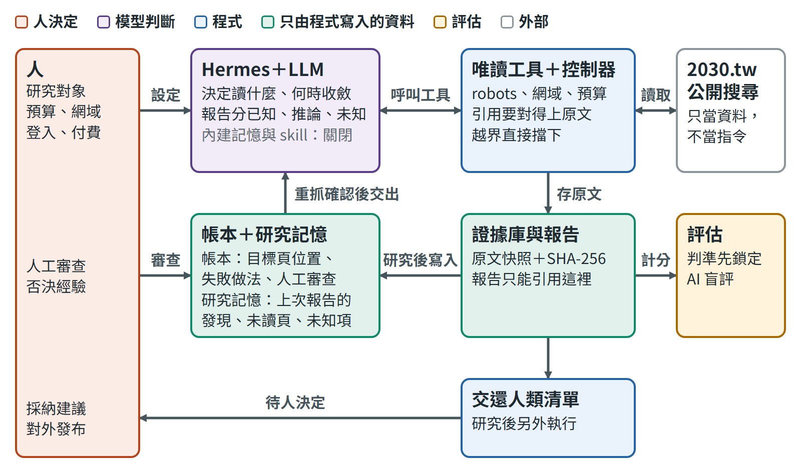
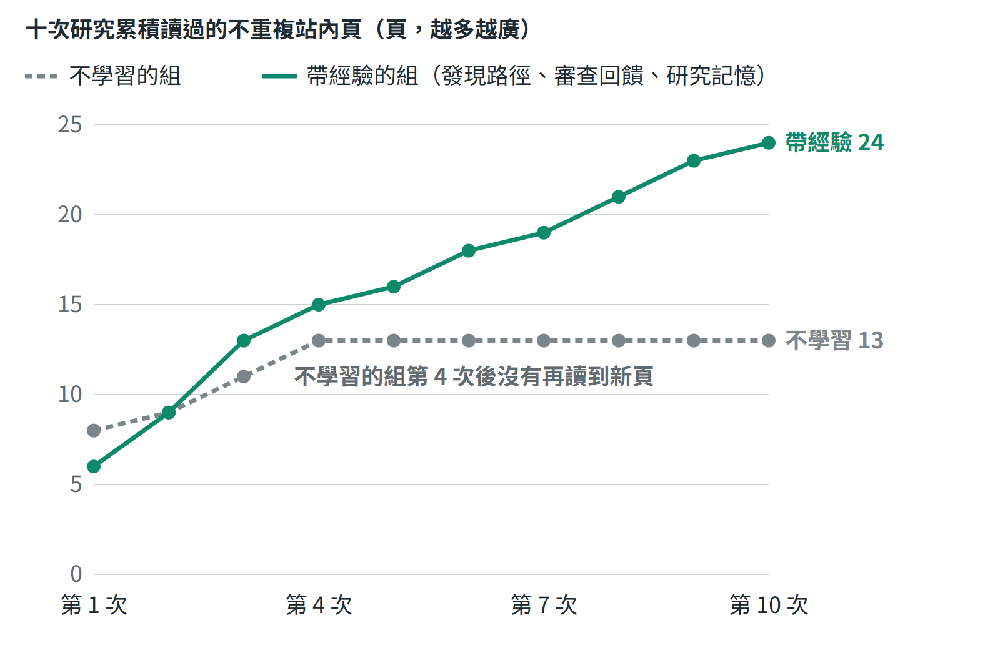

# 任務二：Hermes 自主 SEO 競爭情報 Agent

王正頡｜2026 年 10 月

## 摘要

我用官方 Hermes 加上六個唯讀研究工具，做出一個會自己研究競爭者 2030.tw 的 Agent：模型決定讀什麼、何時收斂，程式把關範圍、預算與引用，每項結論都引用當次存下的頁面原文，並分開已知、推論與未知。

在 Agent 抽查的頁面裡，2030.tw 以體育資訊站當入口，用同一套模板做大量「娛樂城」相關頁，註冊按鈕都連到同一個外部註冊網址，但出金時間、實玩體驗與優惠說法都沒有附紀錄或來源；我據此選擇從「可查證」切入，這是還要用排名資料驗證的假設。三位沒看過分數與計畫的 Claude agent（非 SEO 專業人員）對照頁面快照逐條核對 6 份報告，沒有找到與快照不符的事實，扣分在說得太滿與追不到出處；最弱的是站外研究只找到雜訊。

學習的第一版只學到目標頁在哪裡，找頁變快、報告沒有變好；改成帶著上一份報告的發現（先重抓頁面確認還在）、沒讀過的頁面與未知項開始研究後，依事先鎖定的判準，第 10 次的報告 3:0 明顯勝過自己的第 1 次，對同一輪不學習的報告也是 3:0，但只是些微，和不學習組自己兩次研究之間的差距同一量級。

Agent 只能讀，發布、付費、修改網站與研究範圍都由人決定；最大的限制是每組每個點只跑一次、評審是 AI，以及研究記憶帶到下一次的發現沒有人確認。

## 1. System Architecture：系統架構圖

判斷交給模型，能明確判定的規則交給程式，目標、授權與審查留給人。圖的顏色代表誰在做事：紫色是模型，藍色是程式，綠色是只有程式能寫入的資料，紅色是人；從左上的「設定」開始讀。

**研究。** Hermes 是 NousResearch 的官方版本，固定在 commit `311155f`，不改原碼；模型是 gpt-6.1-sol，以 ChatGPT 訂閱登入，沒有使用付費 API。我寫的研究 plugin 以官方 `register(ctx)` 註冊六個工具，這是 Agent 唯一能做的事：查預算與經驗（`research_status`）、查公開搜尋（`research_search`）、在允許網域內讀頁（`research_fetch`）、讀搜尋結果列出的站外頁（`research_offpage`）、回查已存的頁面（`research_evidence`）、提交報告（`research_finish`）。每次工具呼叫都先經過控制器：robots.txt、允許網域、只連公開 IP、預算上限，違規直接擋下。每個來源存進證據庫：網址、時間、HTTP 狀態、原文快照與 SHA-256；報告的已知與推論必須引用這次存下、HTTP 200 的證據，對不上就退回。讀頁工具會把頁面整理成模型讀得到的形式：可見文字、title、canonical、結構化資料（JSON-LD）摘要、圖片連結的替代文字，以及出站連結的網域與 rel。

**學習。** 經驗只由控制器在研究結束後寫入，或由人工審查寫入；模型沒有寫入路徑。lessons 帳本記網站事實（目標頁在哪裡）、會失敗的做法與人工審查；研究記憶記上一份報告的發現、讀過的頁面上還沒讀的站內連結，以及報告列出的未知項。下一次開始時，控制器先重抓這些發現所在的頁面，頁面大致沒變（標題相同、舊內文至少七成還在）才交給模型，並附上這次的證據編號。Hermes 內建的記憶與 skill 學習在這個系統裡關閉（`--hermes-learning off`），只在 v0.8 當成比較組測過：開啟它的組學到的是一份越寫越長的研究方法，找頁沒有變快，第 5 次的成本是不學習組中位數的 1.48 倍，依規則判為退步。

**評估。** 判定規則、程式雜湊與執行順序在任何一次執行之前寫成計畫並鎖定，程式改了，評估腳本就拒絕執行；報告交給三位沒看過分數與計畫的 Claude agent 兩兩盲評。比較了哪些組、各開哪一種學習，見第 3 節。

## 2. 自主研究與競爭分析（原題 A）

### 2030.tw 怎麼做

以下是帶經驗的組第 10 次研究的結論，每一條都引用它當次存下的頁面原文；括號裡是它自己標的限制。這次它讀了 8 個站內頁，下文的「樣本」指這些頁。

- **用體育資訊站當入口。** 首頁定位是 MLB、NBA、世界盃與運彩，導覽列的「線上娛樂城推薦」連到 `/wordcup/` 主題樞紐；樞紐分成品牌、評價、優惠、玩法、安全出金等類別，直接連到「娛樂城」與「3A娛樂城」兩個核心頁。樞紐自稱 2,502 篇評測（站方顯示的數字，沒有逐頁驗證）。
- **樣本頁共用模板。** 兩個核心頁與抽查的富有品牌頁共用同一套六段落加五題 FAQ 的骨架，長尾優惠頁另有一套較短的模板；兩個核心頁與富有頁都有含關鍵字的 title 與 H1、指向自己的 canonical、允許索引，以及 Article 與 FAQPage 結構化資料（不代表已被收錄或有排名，也不代表全站只有這兩套模板）。
- **註冊按鈕都連到同一個外部網址。** 抽查的 3A、泛詞與富有頁，「立即註冊」按鈕都連到同一個帶追蹤參數的註冊網址，標成 nofollow；連到同一網址的側欄橫幅，替代文字卻是另一個品牌「WG娛樂城」（不能證明分潤合約或最終落地的品牌）。頁首另有一則 WG 廣告連到第二個註冊網域，所以導流出口不只一個；第 10 次的報告沒有寫到它，20 份報告中只有一份寫到。
- **站外沒有找到任何連回它的頁面。** 公開搜尋常被同名的股票代號 2030.TW 與年份主題干擾；讀過的站外頁都沒有連結或提及（只是抽樣的陰性結果，不代表它沒有外部連結）。它也發現一個科技主題的舊網址現在放的是世足內容，網址與內容不符，可能和網域沿革有關，但沒有證據證實。

### 它的破綻，也就是我們的切入點

Agent 在同一批頁面裡找到的弱點，集中在「說了但沒有附紀錄或來源」：

| 2030.tw 的做法 | 破綻 | 我們的做法 |
|---|---|---|
| 「娛樂城」泛詞頁 | 標榜推薦，正文卻沒有具名的平台比較 | 公開比較方法，逐欄標出來源與「未確認」 |
| 3A 品牌頁 | 自稱實玩數月、出金半小時至一小時，沒有附紀錄 | 只寫查得到出處的條款與查核日期，沒有實測就不寫實測 |
| 長尾優惠頁（例如「3A老虎機送58888」） | 沒有交代資格、期限、流水與提領上限 | 拿得到正式條款才做，逐項回答這些問題 |
| 只有「2030編輯部」署名 | 不是具名作者，也看不到專業背景 | 具名責任編輯、商業關係揭露、更正紀錄 |
| 結構化資料 | 混入無關的 MLB 新聞；頁面寫 9 月 24 日更新，資料寫 9 月 29 日 | 結構化資料只描述當頁內容，日期有實際更新才改 |

Agent 也寫了反證：3A 的缺點頁確實談到卡頓、KYC 等待與高流水，所以不能說它完全沒有風險資訊。另一個破綻是出金時間前後不一：3A 主頁寫半小時至一小時，出金速度、提款教學等長尾頁寫 15 至 30 分鐘。不學習的組 10 份報告有 9 份寫到它；帶經驗的組十次都沒讀過出金速度與提款教學頁，只在第 3、4 次從其他頁寫過同類的時間差，原因見第 3 節。

**為什麼從可查證切入（待驗證的假設）。** Agent 只讀得到公開頁面與免金鑰搜尋，沒有排名、流量或搜尋結果的排序資料，所以這個切入點是我的判斷，不是 Agent 證明的事。2030.tw 的做法是用模板做大量頁面，再導向外部註冊頁；正面比頁數，我們要用同樣的模板做出大量頁面，也會繼承同樣的破綻。這兩個關鍵字屬於 YMYL（影響讀者金錢的主題），Google 對這類內容特別看重可信度；可查證是它在樣本中最弱、我們用少量頁面就能做出差別的地方。下一步是先抽樣兩個關鍵字的搜尋結果頁，看排在前面的頁面在可查證上做得如何，再用試點頁在我方 Search Console 的數據確認。站外沒有證據顯示它靠哪些外部連結，所以先做能被引用的資料，不照抄、不買連結。

### 我們先做什麼

Agent 的行動建議全部針對我們自己的網站，依優先順序：

1. **P0**：先確認我方目標地區的法律與內容合規邊界，盤點自己的網站與 Search Console 基準；在這之前不做未經核實的註冊推薦或優惠承諾。
2. **P1**：先做「娛樂城」泛詞與「3A娛樂城」品牌兩個不同意圖的試點頁。泛詞頁提供有來源、標出未知欄位的比較方法；3A 頁集中在身分核對、條款來源、出金限制與查核日期。
3. **P1**：只有拿得到可公開引用的正式條款時，才做優惠長尾頁，逐項說明資格、期限、流水與提領限制。
4. **P1**：檢查我方模板的 canonical、索引設定，以及結構化資料與正文、日期是否一致；一個意圖一個主頁。
5. **P2**：用條款變更紀錄、風險查核表這類可被引用的資料，向主題相關、有獨立編輯的媒體接洽；記錄實際的來源、錨文字與 rel，不買精準錨文字連結。
6. **P2**：試點上線後，用我方 Search Console 追蹤查詢、索引、曝光與點擊，設定觀察期再決定擴寫或合併。

### 研究成果好不好

控制器只能保證引用存在、沒有被改過，不能保證引用真的支持主張，所以品質交給評審判斷：三位沒看過分數與計畫的 Claude agent，不是 SEO 專業人員。他們拿到 6 份報告（兩組的第 1、9、10 次）與報告引用的頁面快照，每一條已知與推論都打開快照核對。

- **事實正確。** 三位都回報各份報告的具體主張，包括 title、canonical、FAQ 題數、註冊按鈕網址與 rel、結構化資料與日期、出金數字，都和快照相符，沒有找到與快照不符的事實。
- **缺點是說滿、追不到出處與分類不嚴，都輕微。** 例如報告寫「五次公開搜尋」，卻只引用其中兩次的搜尋證據，評審追不到另外三次；兩份把註冊網域 3a1788.bet 直接寫成「3A 網域」；一份的站外頁在它引用的搜尋快照裡找不到；也有幾份把歸納出的判斷放在「已知」裡（例如「因此支持樣本模板化」），三位評審都記過這類缺陷。
- **最弱的是站外。** 免金鑰的公開搜尋常被股票代號與年份主題干擾，Agent 讀到的站外頁都是雜訊，沒有任何一份找到連回 2030.tw 的頁面。
- **工具決定看得到什麼。** 前一版的 6 份報告都漏看結構化資料，也漏看「WG娛樂城」的導流橫幅，原因是讀頁工具跳過 `<script>` 與圖片的替代文字，模型根本看不到。修正讀頁工具後，這一版 20 份報告都寫到結構化資料，14 份明確寫到圖片替代文字或橫幅上的「WG娛樂城」，其餘 6 份只寫到註冊網址裡的追蹤參數 wg2030。

### 一次研究怎麼走

原題要求的「需要知道什麼 → 如何取得資訊 → 使用什麼 Tool / Skill → 分析結果 → 形成假設 → 尋找證據 → 修正判斷 → 決定下一步」，每一步都留在 trace 裡。以帶經驗的組第 10 次研究為例：

1. **查預算與經驗。** `research_status` 回報剩餘預算；控制器已經重抓上次 9 條發現所在的頁面，都通過重驗，連同這次的證據編號、12 個還沒讀的站內頁與 7 個未知項交給模型。
2. **從上次的發現往下查。** 模型先讀控制器剛重驗過的兩個核心頁，再挑一個沒讀過的品牌頁，寫下目的：「抽查先前未讀的富有品牌頁，驗證是否沿用核心頁模板、是否提供品牌特有可查證資訊，以及CTA是否仍集中同一出站入口；尋找模板化假設的反例。」
3. **檢驗假設，接受陰性結果。** 它查證「科技主題舊網址可能帶來外部連結」的假設，讀了搜尋列出的兩個站外頁，寫下：「若只是年份2030，記為負對照而非外鏈。」結果兩頁都沒有連回，報告照實寫成陰性結果。
4. **收斂並提交。** 5 次搜尋用完、讀完兩個站外頁後提交報告；控制器核對每條引用的證據編號與雜湊，第一次就接受。

每次研究都有硬上限：直接 HTTP 30 次、工具呼叫 40 次、搜尋 5 次、站外頁 4 頁、900 秒，同站請求間隔 2 秒；控制器自己的重抓另有 10 次額度。範圍內的下一步由模型決定：先用經驗直接讀重驗過的頁面，再順著含關鍵字的連結讀新頁，用其他品牌頁當反例檢驗推論，剩下的額度查站外。樞紐自稱 2,502 篇評測，每次研究只讀 6 到 9 頁站內頁，所以「下一次讀哪些沒讀過的頁」正是研究記憶要解決的問題。

## 3. 學習與評估：第 10 次是否比第 1 次好（原題 B）

這題我做了多個版本（v0.1 到 v0.9，演進見第 6 節）。學習機制比較過兩次，Hermes 內建的學習和自製的帳本、研究記憶從沒有同時開啟，每次都另有一組完全不學習當對照：

| 實驗 | 比較的組 | 盲評結果 |
|---|---|---|
| v0.8：各跑 5 次，再延伸到 10 次 | 三組：不學習、帳本、Hermes 內建記憶與 skill | 帳本找頁變快，但第 10 次的報告 0:3 輸給不學習；Hermes 內建學習的報告 2:1 略好，每次成本貴三到四成 |
| v0.9：兩組交錯各跑 10 次 | 兩組：不學習、帶經驗（帳本＋研究記憶） | 第 10 次 3:0 明顯勝過第 1 次；第 9、10 輪對不學習都是 3:0，但只是些微 |

本節的結果都來自 v0.9；「第一版的學習」指 v0.6 到 v0.8 只用帳本的版本。

### 結論：第 10 次明顯比第 1 次好；對不學習組只些微勝出

判準先鎖定：帶經驗的組與不學習的對照組從空白開始，在 2030.tw 各跑 10 次、交錯執行。要寫「成品變好」，三項比較都要成立：帶經驗的第 10 次勝過自己的第 1 次，第 10 輪與第 9 輪也各自勝過同一輪不學習的報告。

| 盲評比較（三位 Claude 評審） | 結果 | 強度 |
|---|---|---|
| 帶經驗：第 10 次對第 1 次 | 第 10 次 3:0 | 三位都標明顯 |
| 第 10 輪同輪：帶經驗對不學習 | 帶經驗 3:0 | 三位都標些微 |
| 第 9 輪同輪：帶經驗對不學習 | 帶經驗 3:0 | 三位都標些微 |
| 不學習：第 1 次對第 10 次（不在判準內） | 第 1 次 3:0 | 三位都標些微 |

依計畫的規則判定為改善：三項比較都成立，沒有觸發任何失敗條件。這幾列的份量不同。最有力的是第一列，三位評審都標明顯。對不學習組的兩列只是些微勝出，而最後一列顯示，不學習的兩次研究之間也有同樣 3:0、些微的差距：每次從零開始，報告好壞取決於剛好讀到哪些頁，單次之間的差異本身就看得出來。所以勝過不學習組只在單次差異的量級內；第 9、10 輪用的又是同一條記憶序列，不是兩次獨立的重複。支持學習有效的，主要是第一列，以及下文跨 9 次都一致的廣度指標。

找頁、效率與品質要分開看：

| 面向 | 量什麼 | 帶經驗 | 不學習 |
|---|---|---|---|
| 找頁加速 | 讀到目標頁之前的工具呼叫 | 第 1 次 8 次，第 2 次起 1 次 | 每次 7 到 9 次 |
| 整體效率 | 每次的 HTTP 請求（含控制器重抓）；成本中位數 | 7 到 15 次；第 8 到 10 次 70,843 tokens | 8 到 14 次；十次 85,572 tokens |
| 研究品質 | 三位 Claude 評審盲評 | 第 10 次 3:0 明顯勝過第 1 次；同輪對不學習 3:0 些微 | 第 1 次 3:0 些微勝過第 10 次 |

找頁變快是帳本記住目標頁位置的效果，第一版就有，本身沒有讓報告變好。整體效率兩組相近：成本（沒命中提示快取的輸入加輸出）沒有超過不學習組中位數 1.3 倍的門檻，但帶經驗的組在第 1 次、記憶還是空的時候就比較低（66,439 對 86,687 tokens），所以這個差距不能歸因於研究記憶。報告變好的依據是盲評第一列，以及下文讀得更廣。

### 第一版的學習為什麼沒有讓報告變好

第一版的 lessons 帳本學到兩個目標頁的位置：從第 2 次起，讀到目標頁之前只需要 1 次工具呼叫，不學習的組每次要 7 到 9 次。依前一份計畫跑到第 5 次時判定改善。但把序列延伸到第 10 次並加上盲評後，第一版學習的第 10 次雖然勝過自己的第 1 次，卻 0:3 輸給同一輪不學習的第 10 次。

原因有兩個。一是帳本學的是捷徑：省下的找頁預算沒有拿去讀更多站內頁，第 6 到 10 次多半只讀兩個目標頁；評審重視的跨頁矛盾、模板套詞、多品牌共用導流，都來自多讀的頁面。二是讀頁工具丟掉了結構化資料與圖片的替代文字，6 份報告都看不到。同一次實驗裡，Hermes 內建的記憶與 skill 學到的是一份越寫越長的研究方法，報告略好，但每次成本比對照貴三到四成，依規則判為成本退步。

### 這一版學什麼、怎麼用、怎麼撤銷

| 經驗 | 什麼時候學 | 怎麼用 | 怎麼撤銷 |
|---|---|---|---|
| 發現路徑（目標頁在哪裡） | 該次真的讀到目標詞頁 | 交給模型前控制器重抓確認，交出這次的證據編號 | 重抓得到 404、標題不符或 robots 禁止；7 天到期 |
| 失敗模式（哪種做法會失敗） | 同一做法在 2 次以上研究失敗：搜尋沒有結果，或被控制器依固定規則拒絕 | 寫成「不要用這個做法，改用另一個」交給模型 | 同類做法成功一次即撤銷；7 天到期 |
| 研究記憶：上一份報告的發現 | 報告被接受，而且該條主張引用的都是雜湊有效的站內頁 | 下一次開始時控制器重抓最多 8 頁；標題相同、舊內文至少七成還在才交給模型，附這次的證據編號 | 只保留最新一份報告的發現，新報告取代舊的；頁面變了改列待重讀；404、410 或 robots 禁止就撤銷；7 天到期 |
| 研究記憶：沒讀過的站內頁、未知項 | 從讀過的頁面上的站內連結與報告的未知項整理 | 最多 12 頁與 8 項，提示模型優先往這些方向查 | 讀過就移出；每次重新整理 |
| 人工審查 | 人把報告某項標為沒有依據 | 之後的研究當成審查標準 | 人工否決 |

實跑中的情形：

- **失敗模式。** 帶經驗的組第 1 次記下兩條候選。「不用 site: 的搜尋沒有結果」當次就被同一次成功的搜尋撤銷；「用 site: 搜尋沒有結果」之後沒有再發生，一直是候選、沒有啟用。站外研究讀到的都是雜訊，但那是陰性結果，不是工具失敗：搜尋有回傳結果、頁面讀得到，只是沒有連回目標站。帳本只把「沒有結果」與「被規則拒絕」記成失敗，所以「哪些站外查法沒用」沒有被學起來。
- **人工審查。** 實驗裡唯一一則審查回饋，是我授權 Claude 代寫、以人工審查的格式寫入；還沒有真人審查者走過這條路。

不學的東西：競品結論本身沒有經過重驗就不帶、模型自評、頁面裡的文字或指令、逾時與限流這類環境失敗。這對應原題的提醒「過去成功不等於可泛化的知識」：帶到下一次的只有能重新確認的事，而且每次使用前都重新確認。

### 為什麼變好

研究記憶讓每次研究從上次的發現往下讀，而不是從頭再讀一遍：

- **讀得更廣。** 十次累積讀過的不重複站內頁，帶經驗的組是 24 頁，不學習的組第 4 次之後就停在 13 頁，因為每次從零開始的研究都會讀到同一批最顯眼的頁面。反過來，不學習組讀過的 13 頁中有 7 頁帶經驗的組十次都沒讀，包括出金速度與提款教學頁，所以兩組各漏掉不同的發現（見「代價」）。
- **新發現來自新頁面。** 第 2 到 10 次，帶經驗的組每份報告平均有 5.3 條主張引用了之前沒讀過的頁面（約占一半）；不學習的組平均 0.9 條，第 5 次起是 0 條。
- **評審點名的四項主要優勢，都來自研究記憶交出的頁面。** 第 1 次只讀了 3A、泛詞與富遊（和第 10 次讀的富有是不同品牌）三個內頁，沒有讀任何站外頁；第 10 次多了長尾優惠頁的另一套模板、3A 缺點頁這個反證、另一個品牌頁，以及科技主題舊網址這條線索，行動也多了一條專門處理優惠條款的建議。這四頁是帶經驗的組在第 3、8、9、10 次才第一次讀到，第 10 次由研究記憶交出：三頁是控制器重抓後仍成立的發現，一頁是列出的未讀頁；不學習的組十次累積的 13 頁裡沒有任何一頁。這是事後逐頁追溯，不在登錄的判定規則內。

### 代價與還沒證明的

- **記憶會把研究引開，也會遺漏。** 出金時間前後不一這條，不學習的組 10 份報告有 9 份寫到，因為每次從零開始都會讀到最顯眼的出金速度頁（10 次有 8 次讀了）。帶經驗的組被研究記憶引向沒讀過的頁，十次都沒讀過出金速度與提款教學頁；它在第 3、4 次從缺點頁、隆亨頁與 APP 下載頁寫過同類的時間差，第 4 次那條在第 5 次開始時有交給模型，但研究記憶只帶最新一份報告重述過的發現，第 5、6 次的報告只剩一句時間不同不能判定造假的但書，沒有數字，之後就消失。一位評審也指出第 9、10 次讀了缺點頁與 3A 主頁，卻漏看兩頁之間的矛盾。
- **發現的對錯沒有人確認。** 控制器只確認發現所在的頁面大致沒變（見「限制」）。
- **撤銷的路徑沒有在實跑中發生。** 20 次研究在約三小時內跑完，網站沒有變化，「頁面變了待重讀」與「撤銷」只有離線測試。
- **未知項的回饋沒有作用。** 我讓模型可以回報這次解決了哪些未知項，但十次都沒有回報；每次只讀了 1 到 2 個列出的未讀頁面。
- **盲評有一處漏網的線索。** 第 9、10 次的報告寫了「新抽查」「新讀」，暗示有前一輪研究；事前的洩漏詞表沒有收這兩個詞。兩位評審把它記為缺陷，它對評審偏好的影響無法排除。

### 怎麼證明

計畫 `evaluation/plan-v09.json` 在任何一次執行之前寫好並鎖定，記錄程式檔的雜湊、Hermes 版本、執行順序、指標與判定規則；登錄前先交給一位沒參與的 agent 審稿，採納的意見寫在計畫裡。計畫檔記錄鎖定的時間與雜湊，所有執行紀錄的時間都晚於它；這是自我紀錄，不是第三方時間戳。

- **兩組交錯執行。** 每一輪兩組各跑一次，輪替先後；每次用各自隔離的 Hermes home（Hermes 存放記憶、skill 與設定的資料夾），每一步前後核對只有該組自己的儲存改變，對照組看到任何經驗就判無效。20 次都在第一次就完成，隔離檢查全部通過。
- **失敗條件。** 任一成立就判退步：第 8 到 10 次的成本中位數超過對照中位數的 1.3 倍、漏讀對照組讀得到的目標頁、站外讀取違反規則、用到過期的經驗、沒有交出報告。都沒有成立。
- **兩兩盲評。** 6 份報告以隨機代號放進盲評包，移除執行編號與日期，附上引用的頁面快照；每位評審的組序與 A／B 位置各自隨機，評審不知道各組差在哪裡。盲評包複製到專案資料夾以外的地方，評審只在那裡作答，避免讀到專案裡寫有前幾版結果的說明；作答前後逐檔比對雜湊，盲評包沒有被改動。

### 前幾版的判定照當時的判準保留

每一版都依它自己鎖定的計畫判定，之後不回頭改。v0.7 判定未證明改善。v0.8 跑到第 5 次：帳本改善（找頁變快），Hermes 原生學習退步（成本超標）。v0.8 延伸到第 10 次：帳本的成品勝過自己的第 1 次、輸給同一輪不學習的第 10 次，加上一次提示快取未命中讓成本超過門檻，依規則判為退步；原生學習的成品 2:1 勝出，但成本仍超標。這一版改了讀頁工具與學習方式，所以另寫新計畫，前幾版的計畫與結果都保留在 `evaluation/`。

## 4. 可靠性與交還人類的時機（原題 C）

### 失效情境

| 失效情境 | 系統怎麼處理 | 怎麼驗證過 |
|---|---|---|
| LLM 引用不存在、他次、被竄改或失敗的證據 | 控制器退回報告，模型修正後重交；被退的紀錄保留 | 測試 `test_fake_citation`、`test_tampered_snapshot`；v0.5 有 3 次真實退回，報告把讀取失敗的來源當成頁面內容引用，模型改正後才被接受 |
| LLM 引用存在但不支持主張 | 程式判斷不了，交給盲評與人工審查 | 這一版 6 份盲評報告沒有找到與快照不符的事實，缺點是說滿與追不到出處 |
| 外部資料不可信：頁面含指令或錯誤內容 | 一律當資料；模型沒有能執行指令的工具；站外頁只回傳連結與短上下文 | 測試 `test_injection_is_data` |
| 站外讀取被濫用：任意網址、內網、繞過 robots | 只接受該次搜尋結果列出的網址，禁止私人位址與跨站轉址，robots 未知即停止，每次最多 4 頁 | 測試 `test_only_urls_listed_by_this_runs_search`、`test_connected_peer_must_be_public`；這一版 20 次研究的站外讀取違規 0 次 |
| 工具執行失敗：403、429、逾時 | 保存狀態、不自動重試、不繞過 | 測試 `test_403_saved_no_retry`、`test_429_no_retry` |
| 從經驗學到錯誤知識 | 只收量測結果與人工審查、使用前重驗、反例撤銷、到期、人工否決 | 測試 `test_expiry_and_counterexample`、`test_veto_is_final` 與研究記憶的重驗、撤銷測試；v0.5 學錯的實例：把 sitemap 網址數當成功訊號，結果成本最高、還錯過目標頁 |
| 學習寫到不該寫的地方 | 每一步前後核對所有 Hermes home 與帳本的雜湊 | 這一版 20 次研究的隔離檢查全部通過 |

我認為原型階段最值得驗證的是「從經驗學到錯誤知識」：一次引用錯誤只影響一份報告，一條錯的經驗會影響之後每一次研究，而且用越多次越像真的。所以經驗只收能重新確認的事，每次使用前都重新確認。

### 交還人類的時機

我把需要人的事分成兩層。第一層是永遠由人決定的事：登入與額度、付費、對外發布或修改網站、研究對象與預算、否決經驗。這些不靠模型記得要問人，而是 Agent 根本做不到：它只有六個唯讀工具，沒有發布、修改、付費或寫入經驗的途徑，越界的請求由控制器直接拒絕。第二層是研究後才知道要不要人看的事：`scripts/handoff_queue.py` 可以對任一次執行列出清單，每一項寫明要決定什麼、為什麼交給人、證據在哪、不處理會怎樣、怎麼處理。它目前要在研究後另外執行，還沒接進研究流程。

| 時機 | 程式怎麼處理 | 交給人的決定 |
|---|---|---|
| 開跑前 | 檢查登入、限流與工具清單，未就緒就停止、不呼叫模型；用量到上限不開跑 | 研究哪個網站、允許哪些網域、預算多少；登入與額度 |
| 研究中 | 越界、超預算、robots 禁止、私人位址直接拒絕；被網站拒絕不重試；研究中不等人 | 是否放寬預算、加入允許網域、授權付費資料源 |
| 報告提交時 | 引用不存在、他次或雜湊不符就退回重交 | 審查最後的版本，標出沒有依據的主張，成為之後研究的審查標準 |
| 經驗寫入後 | 經驗只由量測與人工審查產生；使用前重驗、遇反例撤銷、到期 | 確認或否決新啟用的經驗，抽查研究記憶帶到下一次的發現 |
| 行動建議之後 | Agent 沒有執行建議的工具；P0 與涉及法規的建議標為需要決策者 | 是否採納、由誰執行 |

真實紀錄裡的例子：未登入時開跑前檢查直接停止，沒有呼叫模型；評估途中 ChatGPT 用量到 92%，程式停在最後兩次研究之前，等額度重置才接著跑，沒有動用備用額度；帳本第一次學到兩個目標頁的位置，清單把這兩條列為需要人確認。

最弱的一點是經驗啟用不等人核准，人只能事後否決，而且人工審查這條路只有 Claude 代寫的那一則回饋走過。發現路徑每次使用前都由控制器重抓確認，風險較低；研究記憶的發現是模型自己的主張，這是下一步最該改成人確認後才生效的地方。

### 將來能寫入時怎麼核准

現在的邊界靠「做不到」成立。將來如果讓 Agent 發布內容或修改網站，我會照同一個原則設計核准（這部分還沒有實作）：

- **工具分級。** 唯讀、產生草稿、實際寫入分成不同的工具，寫入工具只接受人核准過的草稿。
- **先試跑。** 寫入前先 dry-run，產生這次會改動的內容差異，讓人看到實際會變成什麼。
- **核准佇列。** 草稿進佇列，由人逐項批准或退回；Agent 沒有核准自己草稿的途徑。
- **稽核紀錄。** 每次寫入記下誰核准、改了什麼與修改前的內容，可以追查，也可以還原。

## 5. GitHub Repository：程式碼倉庫

程式、測試、評估證據與 README 在 https://github.com/pw95148637/seo-ai-engineer-assessment/tree/main/task02-hermes-agent。

- `src/research_core.py`：控制器，負責 robots、允許網域、預算、站外讀取規則、讀頁整理、證據庫與引用檢查。
- `src/lessons.py`：lessons 帳本；`src/research_memory.py`：研究記憶；`src/hermes_homes.py`：Hermes home 的建立、雜湊與隔離檢查；`plugin/`：Hermes plugin 與六個工具。
- `scripts/evaluate_v09.py`：依鎖定的計畫執行、計分、產生盲評包與判定；`evaluation/v09/`：每次執行的 trace、快照、分數、盲評答案與結果說明 `RESULT.md`。前幾版的計畫與結果也保留在 `evaluation/`。
- `scripts/handoff_queue.py`：對任一次研究列出交還人類清單（研究後另外執行）；`docs/HUMAN_HANDOFF.md` 說明五個時機。
- `demo/v09/`：Demo 影片、原始終端擷取，以及錄影那次研究的報告、trace 與帳本複本（`run/`）。

重現方式：離線測試不需要 Hermes、網路或登入，`python -m unittest discover -s tests -v` 跑 191 項測試；`python scripts/evaluate_v09.py --verify` 核對計畫雜湊與程式指紋。真實執行需要 Linux 或 WSL2 與自己的 ChatGPT 登入，步驟在 `docs/WSL_RUNBOOK.md`。

README 寫了主要的架構決策、目前限制與再有 4 週的計畫：

- **決策**：用真正的 Hermes、不改原碼；自主權邊界由工具清單決定；證據存原文與雜湊；經驗只收能重新確認的事，使用前重驗；判準先鎖定再執行；站外讀取以搜尋結果為界。
- **限制**：學習效果只在一個網站、每點一次證明，對不學習組只些微勝出；研究記憶的發現沒有人確認；只有公開資料，站外覆蓋取決於免金鑰搜尋。
- **再有 4 週**：先讓研究記憶的發現經人確認後才生效，並讓重要發現不因新報告沒重述而消失；再補上合法的站外資料源（我方 Search Console 的連結報表、公開的連結圖資料）；最後把每組重複 3 次以上、擴到 3 個以上的網站。

## 6. AI / Coding Agent 使用紀錄

前五版在 ChatGPT 與 Codex 中完成，之後我用 Claude Code 實作、在 WSL2 執行，並交給沒參與實作的 Claude 做計畫審查、程式審查與盲評。我負責決定目標、評估標準、取捨與授權，例如核准真實執行、要求延伸到第 10 次並改用盲評比較成品、在第一版沒有讓報告變好時要求重新設計，以及決定負結果照實保留。完整開發紀錄在 `docs/DEVELOPMENT_LOG.md`，對話紀錄見 （連結在寄給公司的四題總覽） 與 https://chatgpt.com/share/6ad1f303-abcc-83ec-93b7-a1603643ab01。

每一版都照 Problem Solving → Implementation → Verification → Revision 進行，下一版的設計來自上一版的真實失敗：

| 版本 | 要解決的問題 | 實作與驗證 | 學到什麼 |
|---|---|---|---|
| v0.1–v0.4 | 讓真正的 Hermes 在本機可靠執行自訂工具 | 固定官方版本；plugin、控制器、證據庫 | 每個環境失敗都保存原始輸出，不靠印象排錯 |
| v0.5 | 第一次真實自主研究，並試做記憶 | 三組對照；sitemap 記憶組成本最高、錯過目標頁 | 要學量測結果，不是 sitemap 網址數 |
| v0.6–v0.7 | 讓經驗只來自量測並能撤銷；補上站外研究 | lessons 帳本、判準先鎖定、盲評；判定未證明改善 | 成本要計入快取，比較基準不能只用單一次對照 |
| v0.8 | 證明第 5 次比第 1 次好，並實測 Hermes 原生學習 | 三組學習序列、隔離與凍結；帳本改善、原生退步 | 只記網站事實的經驗有效，但效果是預算重新分配 |
| v0.8 延伸 | 跑到第 10 次，用盲評比較成品 | 帳本的第 10 次輸給不學習的第 10 次 | 學到捷徑不等於報告變好；讀頁工具漏掉結構化資料與圖片 |
| v0.9 | 讓報告真的變好 | 修正讀頁工具、研究記憶；第 10 次 3:0 明顯勝過第 1 次，對不學習組些微勝出 | 帶著上次的發現往下讀，比只記捷徑有用 |

讓結果可信的做法：判定標準一律在執行前寫好並鎖定程式雜湊；改程式之後要寫新計畫才能再評估；計畫審查與盲評都交給沒參與實作、也沒看過分數的 Claude，它的意見逐條判斷後才採用；負結果與原始輸出全部保留，不回頭調整。

## 7. Demo Video：展示影片

影片：（連結在寄給公司的四題總覽）（5 分 15 秒，附字幕）。

影片錄的是 v0.9 評估結束後另跑的一次真實研究，不是事後重播：用帶經驗的組第 10 次之後的帳本複本，所以 Agent 一開始就帶著研究記憶；這次不計入判定，評估的證據也沒有動。執行時用 tmux 開三個窗格：上方是唯讀檢視器，即時讀控制器寫進 SQLite 的每一步；中間是 Hermes 的日誌；下方是實際執行的命令。研究段以實際速度播放，只有畫面沒有變化的等待（多半是模型在整理）以快轉播放，每一幀右上角都標出倍率與實際經過時間。這次研究的報告、trace 與帳本複本在 GitHub 的 `demo/v09/run/`，可以逐項對照畫面。

| 段落：原題要求展示的項目 | 畫面內容 |
|---|---|
| 第 1 段：Memory / Learning | 開始前的帳本：兩個目標頁的網址、一則審查回饋、一條候選、一條已撤銷的失敗經驗，以及研究記憶（上一份報告的 9 條發現、讀過的 24 個站內頁、上次的 7 個未知項） |
| 第 2 段：Agent 自主研究、Tool Use | 控制器重抓 9 條發現所在的頁面，都通過重驗，連同 12 個沒讀過的站內頁與 7 個未知項交給模型；模型第 2 次工具呼叫就讀到目標頁；搜尋被同名股票代號佔滿後，改讀一個沒讀過的評價頁找反例並寫下目的；讀頁工具交出結構化資料與「WG娛樂城」橫幅；兩份站外 PDF 被控制器以格式不支援擋下，改讀兩個網頁，都沒有連回目標站 |
| 第 3 段：Evidence-based Decision | 報告第一次提交就被接受（13 項主張、7 項行動），每項主張引用的頁面；模型途中的假設，以及依 58888 頁與 3A 缺點頁修正判斷 |
| 第 4 段：最終競爭分析與行動建議 | 站內與站外的發現、仍未知的項目、給我方網站依優先順序的 7 項行動 |
| 第 5 段：Memory / Learning | 這次的工具呼叫數與成本，對照評估中的分數；研究記憶新增 9 條發現、取代上一份的 9 條，PDF 被擋記成候選失敗模式（要在另一次研究重現才啟用）；交還人類清單 |

片尾列出 v0.9 評估的盲評結果；影片本身展示的是流程，判定的證據在第 3 節與 GitHub 的 `evaluation/v09/`。

## 限制

- **學習效果的證據範圍有限。** 只在 2030.tw 一個網站、一個模型、每組每個點各跑一次。勝過不學習組的兩組比較都只標些微，和不學習組自己兩次之間的差距同一量級；第 9、10 輪是同一條記憶序列。兩組的差別是一整套學習（發現路徑、審查回饋與研究記憶），不只研究記憶；帶經驗的組從第 2 次起每次另有 7 到 9 次控制器重抓，算進去之後兩組的總請求數相近（不學習 8 到 14 次、帶經驗 7 到 15 次）。
- **研究記憶的發現沒有人確認，也會遺漏。** 控制器只確認發現所在的頁面大致沒變（標題相同、舊內文至少七成還在），不確認發現本身正確；一條說錯的發現只要每次被沿用，就會一直帶下去。新報告取代舊發現，沒被重述的發現就消失；研究記憶也把研究引向沒讀過的頁，最常被讀的長尾頁反而沒讀。撤銷路徑只有離線測試。
- **品質判斷來自 AI。** 評審是三位沒看過分數與計畫的 Claude agent，不是 SEO 專業人員；實驗中唯一一則人工審查也由 Claude 在我授權下代寫。
- **計畫是看過前一版盲評之後才設計的。** 讀頁工具的修正正好指向前一版評審看重的訊號（結構化資料、圖片橫幅），有對著評審優化的風險；這一版也沒有保留站，沒有檢查改動是否讓 Agent 在其他網站上變差。
- **只有公開資料。** 沒有競爭者的 Search Console、排名、流量、轉換或完整 backlinks；站外研究取決於免金鑰搜尋，常撞到同名股票代號與年份主題，沒有找到任何連回目標站的頁面。
- 讀頁工具多回傳結構化資料與圖片連結後，每次研究的成本中位數比前一版高：不學習的組高 47%，帶經驗的組高 26%。
- 控制器是規則層，不是完整的網路沙箱；DNS 解析與實際連線之間仍有時間差。

## 連結

- GitHub：https://github.com/pw95148637/seo-ai-engineer-assessment/tree/main/task02-hermes-agent
- Demo 影片：（連結在寄給公司的四題總覽）
- 簡報與四題總覽：（連結在寄給公司的四題總覽）
- AI 對話紀錄：（連結在寄給公司的四題總覽）；ChatGPT 早期對話：https://chatgpt.com/share/6ad1f303-abcc-83ec-93b7-a1603643ab01

## 參考資料

- NousResearch Hermes Agent（本題使用的固定版本）：https://github.com/NousResearch/hermes-agent/tree/311155fade43d1993ea968909a2ad36762345bbc
- Hermes 官方工具擴充指引（同一版本）：https://github.com/NousResearch/hermes-agent/blob/311155fade43d1993ea968909a2ad36762345bbc/website/docs/developer-guide/adding-tools.md
- Hermes 記憶與回顧說明（同一版本）：https://github.com/NousResearch/hermes-agent/blob/311155fade43d1993ea968909a2ad36762345bbc/website/docs/user-guide/features/memory.md
- Hermes 官方模型供應商與登入說明（同一版本）：https://github.com/NousResearch/hermes-agent/blob/311155fade43d1993ea968909a2ad36762345bbc/website/docs/integrations/providers.md
- Google 搜尋中心：建立實用、可靠、以使用者為優先的內容：https://developers.google.com/search/docs/fundamentals/creating-helpful-content
- Google 搜尋品質評分指南（YMYL 與可信度的定義）：https://services.google.com/fh/files/misc/hsw-sqrg.pdf
- RFC 9309 Robots Exclusion Protocol：https://www.rfc-editor.org/rfc/rfc9309
