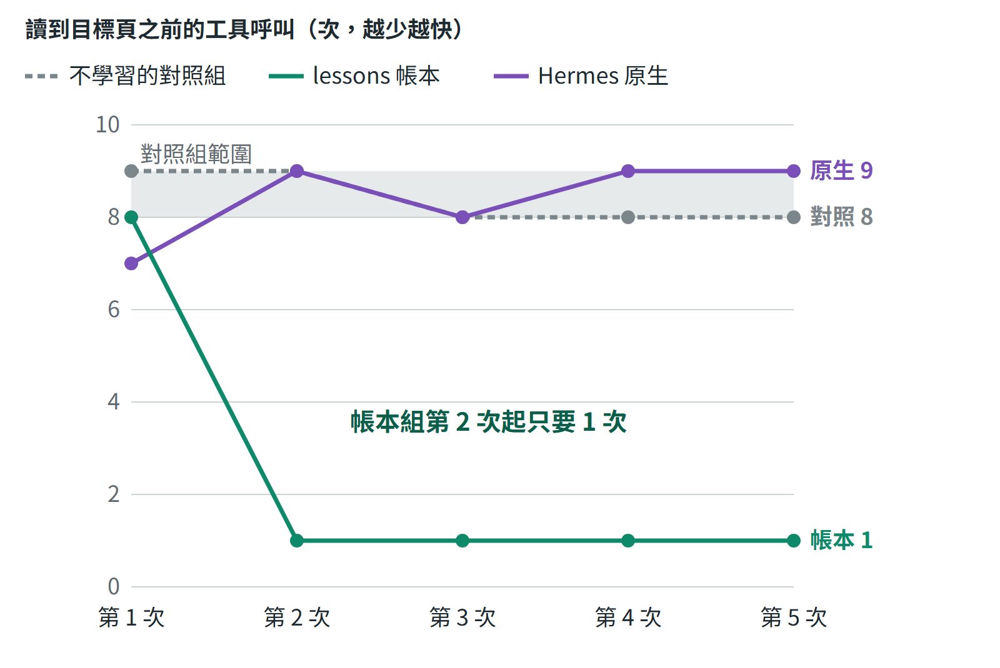
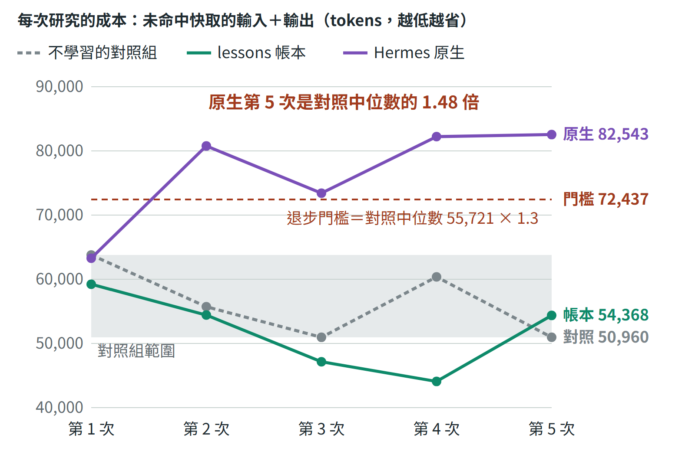

# 任務二：Hermes 自主 SEO 競爭情報 Agent

王正頡｜2026 年 10 月

## 摘要

我用官方 Hermes 的固定版本加上六個唯讀研究工具，做出一個會自己研究競爭者 2030.tw 的 Agent：模型決定查什麼、讀哪頁、何時收斂，程式把關預算、範圍與引用，報告每項結論都引用存檔的原文，並分開已知、推論與未知。

學習用我自己設計的 lessons 帳本，只記程式量到的事實與人工審查，交給模型前先重新確認。我把判準在執行前寫好並鎖定，讓三組從空白狀態各跑 5 次：帳本組學到兩個目標頁的位置，從第 2 次起，讀到目標頁之前只需要 1 次工具呼叫（第 1 次 8 次，不學習的對照組每次 8 到 9 次）；總工具呼叫與耗時沒有減少，省下的找頁呼叫轉去讀證據與站外頁，成本與盲評品質沒有變差，依規則判定改善。

同一實驗裡，Hermes 原生學習學到一個研究方法的 skill，沒有變快，第 5 次成本是對照組中位數的 1.48 倍，超過 1.3 倍的門檻，判定退步。前一版 v0.7 判定未證明改善，照當時的判準保留。

最弱的是站外研究與重複次數：九份盲評報告都沒有找到連到目標站或提及它的站外頁；每組每個點只跑一次，也只比到第 5 次。

## 1. System Architecture：系統架構圖

整個系統分三部分：判斷交給模型，能明確判定的規則交給程式，目標、授權與審查留給人。

**研究（藍）。** Hermes 是 NousResearch 的官方版本，固定在 commit `311155f`，不改原碼；模型是 gpt-6.1-sol，以 ChatGPT 訂閱登入，沒有使用付費 API。我寫的研究 plugin 以官方 `register(ctx)` 註冊六個工具，這是 Agent 唯一能做的事：查預算與經驗（`research_status`）、查公開搜尋摘要（`research_search`）、在允許網域內讀頁（`research_fetch`）、讀搜尋結果列出的站外頁（`research_offpage`）、回查已存的快照（`research_evidence`）、提交報告（`research_finish`）。每次工具呼叫都先經過控制器（程式）：robots.txt、允許網域、只連公開 IP、預算上限，違規直接擋下。每個來源存進證據庫：網址、時間、HTTP 狀態、原文快照與 SHA-256；報告的已知與推論必須引用這次存下、HTTP 200 的證據，雜湊對不上就退回。

**學習（綠）。** 兩種做法在同一個實驗裡比較。lessons 帳本由控制器從量測結果寫入，模型沒有寫入路徑；交給模型之前，控制器先重抓確認。Hermes 原生學習是 Hermes 內建的記憶與 skill，只在比較實驗中開啟：研究結束後，Hermes 讓模型在背景回顧整段對話，自己決定寫進記憶或 skill，下次研究時載入。人工審查把報告中沒有依據的主張標出來，同一則回饋給兩組；這個實驗的審查由 Claude 在我授權下代審。

**評估（橘）。** 判定規則、程式雜湊與執行順序在任何一次執行之前寫成計畫並鎖定，程式改了，評估腳本就拒絕執行。計分程式只讀證據庫與快照；報告與學到的內容交給沒看過分數的 AI 審查者盲評。

## 2. 自主研究與競爭分析（原題 A）

### 一次研究怎麼走

下面是 Demo 錄下的那次執行（v0.7，帶著帳本，約 3 分鐘、18 次工具呼叫）。原題要求的「需要知道什麼 → 如何取得資訊 → 使用什麼 Tool / Skill → 分析結果 → 形成假設 → 尋找證據 → 修正判斷 → 決定下一步」，每一步都留在 trace 裡：

1. **查預算與經驗。** 控制器先重抓帳本記載的兩個目標頁，確認仍有效，再把這次的證據編號交給模型。
2. **寫出待驗假設與要找的反例。** 「『娛樂城』廣義詞與『3A娛樂城』品牌詞可能各有承接頁；需查標題、內容、內鏈與搜尋意圖是否分工，也找重複或互相競爭的反例。」
3. **選工具取證。** 直接讀控制器剛確認的兩個目標頁，同時讀首頁、搜尋網域；每次讀頁都寫出目的，例如「檢驗首頁主題定位與兩個關鍵詞落地頁的內鏈關係；找出是否整站均以娛樂城為主的反例，不據此推斷排名。」
4. **依證據修正。** 「兩個目標頁確實分開，但段落順序與 FAQ 題型高度相似；目前只能判斷採用共用評測格式，不能說已造成關鍵詞互搶。……首輪網域搜尋被『2030.TW』股票代號干擾，改用完整網址與品牌名稱消歧義。」
5. **決定收斂。** 「後續兩個搜尋未提供新來源，搜尋預算也已用完，現在收斂並核對關鍵引用。」提交後控制器核對引用，第一次就接受。

這次帶著帳本，所以第 1 步就拿到目標頁。不帶任何經驗時，Agent 也會自己從首頁的「線上娛樂城推薦」連到 `/wordcup/` 主題樞紐，再讀到兩個目標頁；v0.8 不學習的對照組每次在讀到目標頁之前用 8 到 9 次工具呼叫。

### 有限預算下怎麼決定下一步

每次研究都有硬上限：直接 HTTP 30 次、工具呼叫 40 次、搜尋 5 次、站外頁 4 頁、900 秒，同站請求間隔 2 秒，到限由控制器擋下。範圍內的下一步由模型決定；我在工具與提示裡放的是讓它把預算花在對的地方的條件，實際的優先順序是：

1. **先查已知。** `research_status` 回報剩餘預算與經驗；有控制器剛確認的目標頁，就直接讀證據，不重抓。
2. **順著含關鍵字的連結走，不爬 sitemap。** `research_fetch` 回傳含關鍵字的「錨文字＋網址」，模型從首頁先進主題樞紐，再讀兩個目標頁。v0.8 在 2030.tw 的 15 次研究，sitemap 讀取都是 0。
3. **用對比樣本檢驗推論。** 讀一兩頁其他品牌頁或一般文章當反例，避免把模板當成策略。
4. **剩下的額度查站外。** 搜尋與站外頁有獨立上限，站外頁只能讀搜尋結果列出的網址。
5. **兩步沒有新證據或預算到限就收斂。**

樞紐自稱有 2,502 篇評測；v0.8 每次研究在 2030.tw 只讀 4 到 8 頁（不帶經驗的對照組 5 到 6 頁）。

token 成本也是工具設計的限制。每次模型呼叫都會重送整段對話，所以 `research_fetch` 只回傳前 60 個連結、8,000 字與最多 20 個含關鍵字的「錨文字＋網址」，完整快照另存；需要細節時再用 `research_evidence` 以關鍵字取片段。

### 已知、推論、未知

報告的每項主張都要標成已知、推論或未知，並分成站內與站外兩段。下面節錄自帳本組第 5 次的報告：

- **已知**：「首頁「線上娛樂城推薦」連到/wordcup/；該樞紐直接連到3a娛樂城及娛樂城目標頁，錨文字包含主詞、摘要與詳細。」
- **推論**：「兩個目標頁共同採用特色、遊戲、出金安全、註冊、優惠、客服、FAQ、總結等段落骨架；description亦採近似句型。這支持模板化關鍵字覆蓋的推論，不能確認生成方式、全站重複比例或Google懲罰。」
- **未知**：「2030.tw完整backlink數量、referring domains、錨文字分布、歷史增減、付費連結、其他頁面的提及及其對兩關鍵字排名的貢獻。本輪未確認正向站外提及，不能據此宣稱沒有backlinks。」

控制器只能保證引用存在、沒有被改過，不能保證引用真的支持主張；語意交給盲評，審查者打開每份引用的快照逐項核對。v0.8 的九份盲評報告共 111 項主張（其中 90 項是需要證據支持的已知與推論），找到 1 項無依據的主張。

### 競爭分析與行動建議

Agent 對 2030.tw 的結論（帳本組第 5 次的報告，盲評沒有無依據的主張）：

- **站內**：首頁導覽連到 `/wordcup/` 主題樞紐，樞紐直接連到「娛樂城」與「3A娛樂城」兩頁，3A 頁的麵包屑再連回樞紐；兩頁各有自己的 title、指向自身的 canonical 與 `index, follow`。樞紐顯示 2,502 篇評測與品牌、優惠、出金等分類，這是站方自稱的數字，沒有逐頁驗證。
- **推論**：兩頁共用同一套段落骨架，註冊按鈕都連到同一個帶追蹤參數的外部網域，支持廣泛覆蓋搜尋詞、集中導向註冊的解讀；佣金、轉換與成效無法確認。
- **反證**：3A 頁寫了出金時間、最低入金與客服 FAQ，娛樂城頁提醒洗碼量與提領限制，不能說兩頁沒有實用資訊；但兩頁只有「2030編輯部」團隊署名，看不到支持出金時效的測試紀錄。
- **站外**：讀了兩個搜尋找到的 3A 相關網站首頁，都沒有連到 2030.tw；完整 backlinks 與錨文字分布未知。
- **還不知道**：排名、流量、收錄與轉換都沒有資料，報告明列，不做推估。

行動建議全部針對我們自己的網站，依優先順序：

1. **P0**：先確認我方的適用法域、年齡限制、個資與責任博彩要求，再決定是否承接這兩個詞；評測頁明示商業關係，不把 SSL 或 KYC 當成合法或付款保證。
2. **P1**：若我方適合承接，先做少量證據型頁面。娛樂城頁提供可重現的比較方法、條款與風險矩陣；3A 頁做品牌實體與官方身分查核，分開列出已確認與未確認的欄位。
3. **P1**：審核我方現有網址後，建立「主題樞紐 → 一般指南 → 品牌查核頁」的內鏈，檢查 HTTP 狀態、canonical、robots 與重複網址。
4. **P1**：上線前建立基準，記錄我方 Search Console 的曝光、點擊與落地頁，以 4 到 8 週為第一次檢查。
5. **P2**：公開可引用的原始資料（條款變更追蹤、風險查核表），向有編輯審查的媒體提案，逐頁驗證實際連結；不購買錨文字連結。

## 3. 學習與評估：第 5 次是否比第 1 次好（原題 B）

### 學什麼、不學什麼、學錯了怎麼辦

| 經驗類型 | 什麼時候學 | 怎麼用 | 怎麼撤銷 |
|---|---|---|---|
| 發現路徑（目標頁在哪裡） | 該次真的讀到目標詞頁（HTTP 200，網址或標題等於關鍵字） | 只限同一網站；交給模型前控制器重抓確認，交出這次的證據編號 | 重抓得到 404、標題不符或 robots 禁止即撤銷；7 天到期 |
| 失敗模式（例如某類搜尋沒有結果） | 同一做法在 2 次以上的執行都失敗 | 寫成「不要用某做法，改用……」；換網站時只標為待驗證 | 同類做法成功一次即撤銷；7 天沒有新支持就到期 |
| 人工審查 | 人把報告某項標為沒有依據 | 之後的研究當成審查標準 | 人工否決 |

不學的東西：競品結論本身、網址數量、模型自評、頁面裡的文字或指令、逾時與限流這類環境失敗。這對應原題的提醒：「過去成功」不等於可泛化的知識，所以成功只學成限同一網站、7 天到期、使用前重驗的發現路徑。

學錯的實例與修正：v0.5 的記憶用 sitemap 列出的網址數當採納訊號，兩次沒讀到目標頁的執行仍被判為有效，結果成本最高、還錯過目標頁，我因此改成只學量測結果。v0.8 的五次學習中，帳本記下 3 條候選失敗經驗，沒有一條達到採用門檻：一條是含 `site:` 的搜尋沒有結果，在同一次執行就遇到成功的 `site:` 搜尋而撤銷；另一條在下一次執行遇到反例撤銷。

**為什麼自己做帳本，而不是用 Hermes 原生學習。** 前幾版的 runner 關掉了 Hermes 內建的記憶與回顧，學習只走 lessons 帳本。帳本的設計目標是每條經驗都有程式量測或人工審查當來源，模型沒有寫入路徑；關掉內建學習這件事則沒有經過實測比較。查固定版本的原始碼後還發現，照預設的回顧間隔（記憶每 10 個使用者回合、skill 要一個回合內 10 次工具迭代），本題一次研究只有一個回合、約 7 次迭代，原生學習根本不會觸發。所以 v0.8 把兩個間隔都改成 1，讓每次研究後都回顧，把 Hermes 原生學習當成第三組實測。

### 實驗設計

計畫 `evaluation/plan-v08.json` 在任何一次執行之前寫好並鎖定，記錄 16 個程式檔的雜湊、Hermes 版本、執行順序與判定規則。計畫檔記錄鎖定的時間與雜湊，所有執行紀錄的時間都晚於它；這是自我紀錄，不是第三方時間戳。

- **三組**：不學習的對照組；lessons 帳本組；Hermes 原生學習組（研究工具加上 Hermes 的記憶與 skill 工具）。三組都從空的狀態開始，每次執行用各自隔離的 Hermes home，每一步前後核對只有該組自己的儲存改變。
- **學習序列**：三組在 2030.tw 各跑 5 次，逐輪交錯並輪替順序。第 1 輪後，兩個學習組收到同一則人工審查：「頁面只有2030編輯部團隊署名，不是具名作者，不能當作者資訊或專業背書」（由 Claude 在我授權下代審，紀錄照實標示）。
- **保留站**：三組都沒學過、只用來檢查學習有沒有造成傷害的網站，用的是 casinobase.tw。這個網站在 v0.7 跑過，我看過那次的結果，但 v0.8 三組都沒有在它上面學習。5 輪之後凍結學到的內容，三組在保留站各跑一次。
- **指標**：兩個目標頁有沒有讀到；讀到目標頁之前用了幾次工具呼叫；成本；盲評的無依據主張數與覆蓋分數（站內、站外、行動、已知／推論／未知各 0 到 2 分，滿分 8）。成本只算沒命中提示快取的輸入加輸出：每次模型呼叫都重送整段對話，命中快取的部分不需要重新處理，總 tokens 會把重送的內容一再計入。總 tokens 另外照列。
- **判定**：改善要同時成立四件事。第 5 次對自己的第 1 次至少一項明顯變好、沒有一項變差（呼叫數減半、成本少 10% 以上或多讀到目標頁，而且第 4、5 次都落在對照組 5 次的範圍之外）；第 5 次對對照組也至少一項較好、沒有一項較差；沒有觸發失敗條件；保留站沒有傷害。失敗條件任一成立就判退步，例如成本超過對照組中位數的 1.3 倍、漏讀對照組讀得到的目標頁、無依據的主張變多、用到過期的經驗。

23 個步驟依序執行，每一步第一次就完成，隔離檢查全部通過。

### 結果

每格依序是：讀到目標頁前的呼叫／總呼叫／成本。

| 第幾次 | 對照組 | 帳本組 | 原生組 |
|---:|---|---|---|
| 1 | 9／16／63,792 | 8／13／59,227 | 7／14／63,285 |
| 2 | 9／14／55,721 | 1／18／54,424 | 9／16／80,770 |
| 3 | 8／13／50,956 | 1／16／47,150 | 8／17／73,416 |
| 4 | 8／15／60,368 | 1／17／44,081 | 9／17／82,225 |
| 5 | 8／13／50,960 | 1／16／54,368 | 9／17／82,543 |

總呼叫含 Hermes 的 skill 工具。三組 15 次都讀到兩個目標頁。不學習的對照組在 5 次之間，讀到目標頁前的呼叫只差 1 次，成本最高比最低多 25%，這就是判斷學習效果時的雜訊範圍。

- **帳本組：改善（improved）。** 學到的是兩個目標頁的位置（另有一條審查標準）。第 2 次起先讀控制器剛重抓確認的兩個目標頁，第 2 個工具呼叫就讀到。總工具呼叫沒有減少（第 1 次 13 次，之後 16 到 18 次；對照組 13 到 16 次），耗時也差不多（第 1 次 156 秒，第 5 次 159 秒）：省下的找頁呼叫用在讀證據與站外頁，第 2 次起每次讀 2 到 4 頁站外頁（對照組 1 到 2 頁）。成本落在對照範圍內（第 5 次比第 1 次少 8%，未達 10% 的門檻），第 1、5 次的盲評都沒有無依據的主張、覆蓋 7/8，保留站沒有傷害。所以這是預算的重新分配：找頁變快，研究沒有變短，品質也沒有變好，和 v0.7 看到的一樣。
- **原生組：退步（regression）。** 6 次回顧都完成，但讀到目標頁前的呼叫 7 到 9 次，和對照組一樣。成本依序是 63,285、80,770、73,416、82,225、82,543：第 5 次是對照組中位數 55,721 的 1.48 倍，超過 1.3 倍的退步門檻；和自己的第 1 次比則多 30%。盲評品質沒有變差，保留站也沒有傷害。
- **原生對帳本：帳本較好。** 讀到目標頁前的呼叫與成本都是帳本較好；把原生組回顧的成本加進去，差距更大（89,513 對 54,368）。品質、保留站與學到內容的正確性兩組相同。
- **學到的內容兩組都乾淨。** 另一個沒看過分數的 agent 分類了全部 22 項：帳本 3 項（兩個目標頁的位置、一條審查標準），原生 19 項（17 項研究方法、1 項審查標準、1 項 skill 說明），全部判為有證據支持，沒有過度推廣，也沒有任何一項源自網頁文字或網頁上的指示。

### Hermes 原生學到什麼、為什麼變貴

原生組 6 次回顧都選擇寫 skill：第 1 次建立 `public-evidence-seo-research`，之後 5 次都在修補同一個 skill（4.5 KB 長到 7.8 KB），記憶一條都沒有寫。skill 的內容是通用的研究方法，例如「Follow one relevant category/filter link when testing a hub」，以及把人工審查寫成「Treat editorial-team or organization bylines only as team attribution, not as named authors」；裡面沒有出現 2030.tw，也沒有任何網址。

這是 Hermes 提示的設計方向。固定版本的記憶指引寫「Skills come first」，記憶是「the narrow exception for facts that apply to EVERY session regardless of task」，並說「A fact stale within a week belongs in session history; procedures and workflows belong in skills」；回顧提示要求寫成類別層級的 skill，「the rule must stand without the incident behind it」。所以它學到「怎麼研究」，沒有學「這個網站的目標頁在哪裡」，也就沒有變快；帳本的發現路徑正好是後者。

變貴的來源可以從 transcript 看到：Hermes 的記憶與 skill 工具說明讓每次模型呼叫的固定輸入變大（第一次呼叫 5,497 對對照組的 3,844 tokens）；第 2 次起每次先讀進整個 skill，之後每次呼叫都重送；skill 要求更多查核（類別篩選頁、對比樣本），第 2 次起每次讀 7 到 8 頁、寫 13 到 15 項主張，對照組是 5 到 6 頁、11 到 12 項。報告因此更仔細，但盲評覆蓋分數都是 7/8，沒有提高。

### 已證明、推論、還不知道

- **已證明（依鎖定的判準）**：帳本組學到目標頁的位置後，第 5 次比第 1 次更快讀到目標頁；總呼叫與耗時沒有減少，省下的預算轉去讀證據與站外頁，成本與品質沒有變差，保留站沒有傷害。Hermes 原生學習在這個任務上成本超標。v0.7 發現的中文網址編碼錯誤已修正，v0.8 所有執行的編碼錯誤為 0。
- **盲評判定**：兩組學到的 22 項內容都有證據支持，沒有錯誤、過度推廣或網頁指示。
- **推論**：原生組變貴的三個來源由 transcript 與儲存推得，沒有另外做實驗把它們拆開；帳本的加速來自網站事實，換到沒有目標詞頁的保留站就沒有用。
- **還不知道**：跑到第 10 次是否仍然成立；每組重複多次後差距是否穩定；在其他網站上的效果；Hermes 照預設的回顧頻率與以天為單位的 skill 整理（curator）下表現如何；人工審查標準有沒有效果（對照組的報告也常寫出同樣的判斷）。

### 前一版的判定照當時的判準保留

v0.7 比較「帶著 v0.6 累積帳本的組」與「空帳本的對照組」，各跑一次；成本指標是總 tokens，規則是帶帳本的組不得高於同一次的對照組。帶帳本的組第 2 次工具呼叫就讀到目標頁（對照組第 9 次），但總 tokens 多 15.9%，保留站的覆蓋分數 6/8 也低於對照組的 7/8，判定未證明改善；站外研究判定未達成。判定之後我扣掉快取命中重算：2030.tw 上少 20.3%，保留站上反而多 11.0%；保留站覆蓋分數那一條本來就不過，所以換成計入快取的指標也不會改變判定。

v0.8 改了兩處判準，都在執行前寫進計畫：成本改成計入快取的版本；比較基準從單一次對照改成對照組 5 次的範圍，因為對照組自己 5 次之間的成本就相差約 25%，用單一次當基準，結果會被那一次的波動決定。照 v0.7 的寫法，帳本組第 5 次的 54,368 仍高於同輪對照組的 50,960。

## 4. 可靠性與自主權邊界（原題 C）

| 失效情境 | 系統怎麼處理 | 怎麼驗證過 |
|---|---|---|
| LLM 引用不存在、他次、被竄改或失敗的證據 | 控制器退回報告，模型修正後重交；被退的紀錄保留 | 測試 `test_fake_citation`、`test_tampered_snapshot`；v0.5 有 3 次真實退回：報告把讀取失敗的來源當成頁面內容引用，模型改正後第二次才被接受（`evaluation/v05-rescore.json`）。v0.8 的 18 份報告都一次通過，只說明這個機制沒被觸發 |
| LLM 引用存在但不支持主張 | 程式判斷不了，交給盲評 | v0.8 九份報告共 111 項主張，盲評找到 1 項無依據：把連結的 `rel="noopener"` 讀成空白 |
| 外部資料不可信：頁面含指令或錯誤內容 | 一律當資料；模型沒有可執行指令的工具；站外頁只回傳連結與短上下文 | 測試 `test_injection_is_data`；v0.8 兩組學到的 22 項沒有任何源自網頁的指示 |
| 站外讀取被濫用：任意網址、內網、繞過 robots | 只接受該次搜尋結果列出的網址，禁止目標站、私人位址與跨站轉址，robots 未知即停止，每次最多 4 頁 | 測試 `test_only_urls_listed_by_this_runs_search`、`test_connected_peer_must_be_public`；v0.8 共讀 23 頁站外頁，違規 0 次 |
| 工具執行失敗：403、429、逾時、程式錯誤 | 保存狀態、不自動重試、不繞過 | 測試 `test_403_saved_no_retry`、`test_429_no_retry`；v0.7 實跑遇到中文網址編碼失敗，模型改讀其他候選、不重試，v0.8 修正後 0 次 |
| 從經驗學到錯誤知識 | 只收量測結果、反例撤銷、使用前重驗、7 天到期、人工否決；評估時凍結 | 測試 `test_expiry_and_counterexample`、`test_veto_is_final`；v0.5 學錯的實例；v0.8 三條候選失敗經驗沒有一條被採用，學到的內容另交盲評 |
| 學習寫到不該寫的地方 | 每一步前後核對所有 Hermes home 與帳本的雜湊，對照組看到經驗或執行了記憶工具就判無效 | v0.8 的 23 步隔離檢查全部通過；凍結後的內容在保留站執行後雜湊不變 |

我認為原型階段最值得驗證的是「從經驗學到錯誤知識」：一次引用錯誤只影響一份報告，一條錯的經驗會影響之後每一次研究，而且用越多次越像真的。所以這一項除了測試，還用真實的學習序列、反例撤銷的紀錄與學到內容的盲評來驗證。

Agent 可以自己做的：在允許網域內讀頁、在預算內搜尋與讀站外頁、形成與修正假設、提交報告。程式直接擋下的：超出預算、未允許的網域與私人位址、未經搜尋列出的站外頁、robots 不允許的請求、沒有證據或證據被竄改的報告。一定要人決定的：登入與用量額度、付費、任何對外發布或修改網站、人工審查與否決經驗，以及交付前的審閱。這條邊界由「只給六個唯讀工具」與控制器的規則實現，不靠模型自律。

## 5. GitHub Repository：程式碼倉庫

程式、測試、評估證據與 README 在 https://github.com/pw95148637/seo-ai-engineer-assessment/tree/main/task02-hermes-agent。

- `src/research_core.py`：控制器，負責 robots、允許網域、預算、站外讀取規則、證據庫與引用檢查。
- `src/lessons.py`：lessons 帳本；`src/hermes_homes.py`：Hermes home 的建立、雜湊、快照與隔離檢查；`plugin/`：Hermes plugin 與六個工具。
- `scripts/evaluate_v08.py`：依鎖定的計畫執行、計分、產生盲評包與判定；`evaluation/v08/`：每次執行的 trace、快照、分數、盲評答案與判定說明 `VERDICT.md`。前幾版的計畫與判定也保留在 `evaluation/`。
- `demo/v07/`：Demo 影片、原始終端擷取與轉檔程式。

重現方式：離線測試不需要 Hermes、網路或登入，`python -m unittest discover -s tests -v` 跑 159 項測試；`python scripts/evaluate_v08.py --verify` 核對計畫雜湊與程式指紋。真實執行需要 Linux 或 WSL2 與自己的 ChatGPT 登入，步驟在 `docs/WSL_RUNBOOK.md`。

README 寫了主要的架構決策、目前限制與再有 4 週的計畫：

- **決策**：用真正的 Hermes、不改原碼；自主權邊界由工具清單決定；證據存原文與雜湊；經驗只收量測與人工審查，使用前重驗；判準先鎖定再執行；站外讀取以搜尋結果為界。
- **限制**：學習改善只在一個網站、每點一次、到第 5 次為止證明，而且是預算的重新分配；帳本的加速不會轉移到別的網站；只有公開資料，站外覆蓋取決於免金鑰搜尋。
- **再有 4 週**：先補上合法的站外資料源（我方 Search Console 的連結報表、公開的連結圖資料）；再把每組重複 3 次以上、跑到第 10 次、擴到 3 個以上的網站；最後把可轉移的研究作法（例如失敗的查詢方式）和網站事實分開學習與驗證。

## 6. AI / Coding Agent 使用紀錄

前五版在 ChatGPT 與 Codex 中完成，之後我用 Claude Code 實作、在 WSL2 執行，並交給沒參與實作的 Claude 做設計審查、程式審查與盲評。我負責決定目標、評估標準、取捨與授權，例如核准真實執行、要求改成學習序列、決定負結果照實保留。完整開發紀錄在 `docs/DEVELOPMENT_LOG.md`，對話紀錄見 （連結在寄給公司的四題總覽） 與 https://chatgpt.com/share/6ad1f303-abcc-83ec-93b7-a1603643ab01。

每一版都照 Problem Solving → Implementation → Verification → Revision 進行，下一版的設計來自上一版的真實失敗：

| 版本 | 要解決的問題 | 實作與驗證 | 學到什麼 |
|---|---|---|---|
| v0.1–v0.4 | 讓真正的 Hermes 在本機可靠執行自訂工具 | 固定官方版本；plugin、控制器、證據庫；工具被官方延遲載入包成 bridge，改用明示工具清單 | 每個環境失敗都保存原始輸出，不靠印象排錯 |
| v0.5 | 第一次真實自主研究，並試做記憶 | 三組對照；只有無記憶組讀到目標頁，sitemap 記憶組成本最高 | 採納訊號錯了：要看有沒有讀到目標頁，不是 sitemap 網址數 |
| v0.6 | 讓經驗只來自量測，並能撤銷 | lessons 帳本、判準先鎖定的評估、盲評；判定未證明改善 | 經驗帶著過去的發現，報告又只能引用本次證據，模型因此重抓頁面 |
| v0.7 | 補上站外研究，讓經驗直接交出本次證據 | `research_offpage`、覆蓋分數；找頁變快，總 tokens 多 15.9%，判定未證明改善 | 找頁變快沒有讓研究變短；成本指標要計入快取，比較基準不能只用單一次對照 |
| v0.8 | 證明第 N 次是否比第 1 次好，並實測 Hermes 原生學習 | 三組學習序列、隔離與凍結、學到內容的盲評；兩輪獨立審查全部修正後才鎖定；帳本改善、原生退步 | 只記網站事實並用前重驗的經驗有效，但效果是預算重新分配；Hermes 原生學到的是通用方法，研究更仔細但更貴 |

讓結果可信的做法：判定標準一律在執行前寫好並鎖定程式雜湊；改程式之後要寫新計畫才能再評估；設計與程式審查、盲評都交給沒參與實作、也沒看過分數的 Claude，它的意見逐條判斷後才採用；負結果與原始輸出全部保留，不回頭調整。

## 7. Demo Video：展示影片

影片：（連結在寄給公司的四題總覽）（4 分 50 秒，附字幕）。

影片錄的是 v0.7 評估中帶著帳本的那次真實研究，不是事後重播。執行時用 tmux 開三個窗格：上方是唯讀檢視器，即時讀控制器寫進 SQLite 的每一步；中間是 Hermes 的日誌；下方是實際執行的評估命令。研究段以實際速度播放，只有兩次較長的模型等待以 3 倍、2 倍快轉，每一幀右上角都標出倍率與實際經過時間。影片最後的計分與判定是 v0.7 的結果（未證明改善）；片尾卡列出判定後的快取分析（2030.tw 約少 20%、保留站約多 11%，判定不變），並註明後續 v0.8 的結果見本文件。v0.8 的學習序列在錄影之後執行，沒有錄影，數字與原始紀錄在第 3 節與 GitHub。

| 時間 | 原題要求展示的項目 | 畫面內容 |
|---|---|---|
| 0:11 | Memory / Learning | 開始前帳本裡的經驗，以及哪些由程式量測、哪些來自人工審查 |
| 0:38 | Agent 自主研究、Tool Use | 每次工具呼叫、模型寫的目的、HTTP 結果、何時讀到目標頁 |
| 2:22 | Evidence-based Decision | 報告逐項引用的證據，以及模型途中的假設與修正 |
| 3:08 | 最終競爭分析與行動建議 | 站內與站外發現、仍未知的項目、給我方網站的行動 |
| 3:58 | Memory / Learning | 計分結果、與上一版的對照、同版對照組的結果與判定 |

## 限制

- **學習改善的證據範圍有限。** 只在 2030.tw 一個網站、每組每個點各跑一次、比到第 5 次；原題問的是第 10 次。對照組的 5 次是唯一的雜訊估計。改善的內容是找頁變快、預算轉去讀證據與站外頁，總呼叫、耗時與品質分數都沒有變好。
- **帳本的加速只限同一網站。** 它學到的是這個網站的目標頁在哪裡；保留站沒有目標詞頁，只能確認沒有傷害，不能證明轉移後會變好。
- **兩組條件不完全對等。** 帳本交給模型之前由控制器重抓目標頁，這段不算模型成本，原生組沒有對應的路徑；帳本的呈現方式在前幾版看過 trace 後改寫過，研究 prompt 也明寫要照帳本的經驗行動；Hermes 原生學習用它自己的提示，沒有調整，回顧也被設成每次都執行，比 Hermes 的預設頻繁。
- **品質維度分不出高低。** 九份盲評報告的覆蓋分數都是 7/8，每份只有一位 AI 審查者；人工審查也由 Claude 在我授權下代審，都不是 SEO 專業人員的判斷。
- **只有公開資料。** 沒有競爭者的 Search Console、排名、流量、轉換或完整 backlinks；站外研究取決於免金鑰搜尋，網域字串常撞到同名股票代號 2030.TW，九份報告都沒有找到連到目標站或提及它的站外頁。
- 控制器是規則層，不是完整的網路沙箱；DNS 解析與實際連線之間仍有時間差。

## 連結

- GitHub：https://github.com/pw95148637/seo-ai-engineer-assessment/tree/main/task02-hermes-agent
- Demo 影片：（連結在寄給公司的四題總覽）
- 簡報與四題總覽：（連結在寄給公司的四題總覽）
- AI 對話紀錄：（連結在寄給公司的四題總覽）；ChatGPT 早期對話：https://chatgpt.com/share/6ad1f303-abcc-83ec-93b7-a1603643ab01

## 參考資料

- NousResearch Hermes Agent（本題使用的固定版本）：https://github.com/NousResearch/hermes-agent/tree/311155fade43d1993ea968909a2ad36762345bbc
- Hermes 官方工具擴充指引（同一版本）：https://github.com/NousResearch/hermes-agent/blob/311155fade43d1993ea968909a2ad36762345bbc/website/docs/developer-guide/adding-tools.md
- Hermes 記憶與回顧說明（同一版本）：https://github.com/NousResearch/hermes-agent/blob/311155fade43d1993ea968909a2ad36762345bbc/website/docs/user-guide/features/memory.md
- Hermes skill 說明（同一版本）：https://github.com/NousResearch/hermes-agent/blob/311155fade43d1993ea968909a2ad36762345bbc/website/docs/user-guide/features/skills.md
- Hermes 記憶指引原文（同一版本）：https://github.com/NousResearch/hermes-agent/blob/311155fade43d1993ea968909a2ad36762345bbc/agent/prompt_builder.py
- Hermes 回顧提示原文（同一版本）：https://github.com/NousResearch/hermes-agent/blob/311155fade43d1993ea968909a2ad36762345bbc/agent/background_review.py
- Hermes 官方模型供應商與登入說明（同一版本）：https://github.com/NousResearch/hermes-agent/blob/311155fade43d1993ea968909a2ad36762345bbc/website/docs/integrations/providers.md
- RFC 9309 Robots Exclusion Protocol：https://www.rfc-editor.org/rfc/rfc9309
