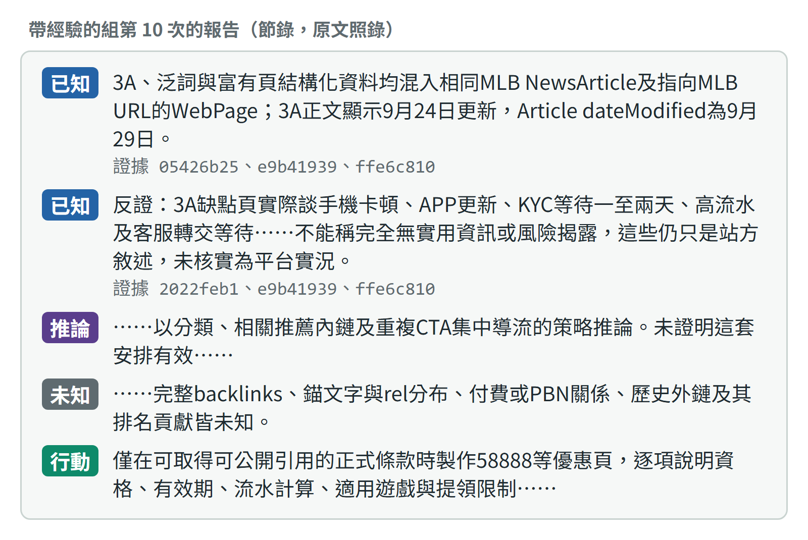

---
## 帶著上次的發現往下讀，第 10 次勝出
- 任務二｜Hermes 自主 SEO 競爭情報 Agent（30%）
- 判準先鎖定，兩組交錯各跑 10 次：帶經驗的第 10 次 3:0 明顯勝過自己的第 1 次；對同一輪不學習的報告也是 3:0，但只是些微
- 王正頡｜2026 年 10 月
Notes: 任務二要做一個會自己研究競爭者 2030.tw 的 SEO Agent，而且第 10 次要比第 1 次好。我用官方 Hermes 加六個唯讀工具，模型決定讀什麼，程式把關範圍和引用。第一版的學習只學到目標頁在哪，找頁變快，報告卻沒有變好。改成帶著上一份報告的發現、還沒讀的頁面和未知項開始研究後，第 10 次的報告 3:0 明顯勝過自己的第 1 次；對同一輪不學習的報告也是 3:0，但只是些微。接下來依序講競爭策略、研究品質、架構、兩次實驗、找頁和品質的區分、交還人類，最後是最弱的地方。

---
## 2030.tw 用模板導流，弱在沒附來源
| 它怎麼做 | 存下的頁面證據 | 我們先做 |
|---|---|---|
| 體育站當入口，用模板量產娛樂城頁 | 樞紐自稱 2,502 篇；抽查的 3 頁共用六段加五題 FAQ | 不比頁數，先做泛詞與 3A 兩個試點頁 |
| 註冊集中導向外站 | 3 頁「立即註冊」都連同一個追蹤網址，標 nofollow；頁首 WG 廣告連到第二個網域 | 不做未核實的註冊推薦 |
| 說法沒附來源 | 3A 頁自稱實玩數月、出金半小時至一小時，沒附紀錄；58888 優惠頁沒寫資格、期限與流水 | 逐欄標來源與查核日期；優惠頁拿到正式條款才做 |
- P0 先確認合規邊界、盤點我方 Search Console 基準。從可查證切入是我的判斷：Agent 沒有排名資料，下一步先抽樣兩個關鍵字的搜尋結果頁。
Notes: 這是 Agent 第 10 次研究的結論，範圍是它讀的 8 個站內頁，每一條都對得到它存下的頁面原文。2030.tw 用體育站當入口，再用同一套模板量產娛樂城頁；三個抽查的品牌頁，立即註冊都連到同一個帶追蹤碼的外站網址，頁首還有一則 WG 廣告連到第二個註冊網域，這一條在存下的頁面裡，但 20 份報告只有一份寫到。它的破綻是說法沒附來源：自稱實玩、出金半小時，卻沒有紀錄；優惠頁沒寫條件。所以我們不比頁數，先確認合規，再做兩個逐欄標來源的試點頁。從可查證切入是我的判斷，下一步先抽樣搜尋結果頁驗證。

---
## 報告逐項附證據，事實都對得上快照
- 每項主張都引用當次存下的頁面原文
- 三位 Claude 評審（非 SEO 專業）逐條核對
- 最弱的是站外：只找到同名股票與年份雜訊

Notes: 這是第 10 次報告的原文節錄。每項主張都要標成已知、推論或未知，已知和推論必須引用這次存下的證據，控制器核對編號和雜湊，對不上就退回。引用是否真的支持主張，程式判斷不了，所以交給三位沒看過分數的 Claude agent 盲評；它們不是 SEO 專業人員，打開快照逐條核對。三位都沒找到與快照不符的事實，扣分在少數說滿、追不到出處，或把歸納判斷放進已知。最弱的是站外：免金鑰搜尋常撞到同名股票代號，讀到的站外頁都是雜訊。

---
## 模型做判斷，程式把關，人決定範圍

Notes: 顏色代表誰在做事：紫色是模型，藍色是程式，綠色是只有程式能寫的資料，紅色是人。從左上開始：人設定研究對象和預算；模型決定讀什麼，每一步都透過唯讀工具，控制器擋下越界和超預算，讀到的原文存進證據庫，報告只能引用這裡。研究結束後，控制器把目標頁位置、失敗做法和報告的發現寫進帳本與研究記憶，下一次先重抓頁面確認，才交給模型。Hermes 內建的記憶與 skill 學習關閉。右邊的評估判準先鎖定，交給 AI 盲評；研究後的清單把要決定的事送回人。

---
## 兩次實驗分開比，內建學習不與帳本同開
| 實驗 | 比較的組 | 盲評結果 |
|---|---|---|
| v0.8：各跑 5 次，延伸到 10 次 | 三組：不學習、帳本、Hermes 內建記憶與 skill | 帳本找頁變快，第 10 次卻 0:3 輸給不學習；Hermes 內建 2:1 略好，但貴三到四成 |
| v0.9：兩組交錯各跑 10 次 | 兩組：不學習、帶經驗（帳本＋研究記憶） | 第 10 次 3:0 明顯勝過第 1 次；第 9、10 輪對不學習都 3:0，但只是些微 |
- 評審是三位沒看過分數與計畫的 Claude agent，不是 SEO 專業人員；實驗用的人工審查只有一則，由 Claude 在我授權下代寫。不學習的第 1 次也 3:0 些微勝過第 10 次，所以對不學習組的勝出只在單次差異的量級內。
Notes: 學習機制我比過兩次，Hermes 內建的學習和我做的帳本從來沒有同時開，每次都另有一組完全不學習當對照，判準都在執行前鎖定。v0.8 比帳本和 Hermes 內建的記憶與 skill：帳本找頁變快，但延伸到第 10 次，報告輸給不學習的那一組；Hermes 內建的報告略好，成本貴三到四成。v0.9 把帳本加上研究記憶，第 10 次 3:0 明顯勝過自己的第 1 次。對同一輪不學習的報告也是 3:0，但只是些微，而不學習的兩次之間本來就有這麼大的差異，所以主要證據是第一項。評審和那一則人工審查都是 Claude，這點要先講清楚。

---
## 找頁變快、效率持平，品質來自多讀
- 找頁：第 2 次起 1 次呼叫，不學習 7 到 9 次
- 效率：請求數相近；成本較低，但第 1 次就如此
- 品質：累積讀 24 頁對 13 頁，優勢來自新頁

Notes: 這三件事要分開看。找頁變快是帳本記住目標頁位置的效果，第一版就有，但它本身沒有讓報告變好。整體效率兩組差不多：算進控制器的重抓，每次的請求數相近；成本沒有超過門檻，但帶經驗的組在第 1 次、記憶還是空的時候就比較便宜，所以不能算在記憶頭上。品質的差別來自讀得更廣：十次累積讀到 24 頁，不學習的組第 4 次後停在 13 頁；評審點名的四項主要優勢，對應的頁都是研究記憶交出的。反過來，不學習組常讀的出金速度頁，這組一次都沒讀。

---
## 發布與付費做不到，其餘列給人決定
| 時機 | 程式怎麼處理 | 交給人的決定 |
|---|---|---|
| 開跑前 | 未登入、額度到上限就停止，不呼叫模型 | 研究對象、允許網域與預算 |
| 研究中 | 越界、超預算直接拒絕，被拒絕不重試 | 是否放寬預算、加入資料源 |
| 報告提交時 | 引用對不上本次原文就退回 | 審查最後版本，標出無依據的主張 |
| 經驗寫入後 | 使用前重抓確認，遇反例撤銷 | 確認或否決經驗，抽查發現 |
| 行動建議之後 | Agent 沒有執行建議的工具 | 是否採納、由誰執行 |
- Agent 只有六個唯讀工具，發布、付費、修改網站根本做不到。研究後要人看的事，可由程式對任一次研究列成清單（目前要另外執行），寫明要決定什麼、證據在哪、怎麼處理。
Notes: 需要人的事分兩層。第一層是永遠由人決定的：登入、付費、發布、研究範圍和否決經驗。這些不靠模型記得要問人，而是 Agent 只有唯讀工具，根本做不到。第二層是研究後才知道要不要人看的事，程式可以從紀錄列出清單，目前要另外執行。失效情境也有處理：引用對不上就退件，頁面裡的指令只當資料，被網站拒絕不重試，學錯的經驗遇反例撤銷。真實例子：評估途中用量到 92%，程式自己停下，等額度重置才接著跑。將來若給寫入能力，我會加上草稿、試跑、核准佇列和稽核紀錄。

---
## 最弱的是發現沒人確認，次數也少
| 弱點 | 現況 | 下一步 |
|---|---|---|
| 發現的對錯 | 程式只確認頁面大致沒變，不確認主張 | 發現經人確認後才生效 |
| 記憶會遺漏 | 引向沒讀過的頁、新報告取代舊發現，漏掉出金矛盾 | 重要發現不因新報告沒重述而消失 |
| 證據強度 | 每點一次、AI 評審；對不學習組只些微 | 每組重複 3 次，擴到 3 個網站 |
| 站外證據 | 免金鑰搜尋只找到雜訊 | 接入我方 Search Console 等合法資料 |
- 網站在三小時內沒有變化，撤銷路徑只有離線測試。這一版是看過前一版盲評才設計的，也沒有保留站檢查其他網站。
Notes: 最弱的是研究記憶的發現沒有人確認。程式只確認頁面大致沒變，不確認主張對不對，一條說錯的發現可能一直被帶下去，所以下一步是讓發現經人確認才生效。第二，記憶會遺漏：它把研究引向沒讀過的頁，最常被讀的出金速度頁一次都沒讀，前幾次寫過的出金時間差，新報告沒重述就被取代；不學習組反而 10 次有 9 次寫到。第三，每點只跑一次、評審是 AI，對不學習組只些微勝出。另外，我是看過前一版盲評才設計這一版的，有對著評審優化的風險，也還沒在其他網站驗證。

---
## 附錄：連結與參考資料
- Google 文件（完整說明：競爭分析、研究品質、學習實驗與判定、交還人類的設計與限制）：（連結在寄給公司的四題總覽）
- GitHub（程式、191 項離線測試、每次執行的原始紀錄、快照、盲評答案與判定；README 含再有 4 週的計畫）：https://github.com/pw95148637/seo-ai-engineer-assessment/tree/main/task02-hermes-agent
- Demo 影片（5 分 15 秒）（v0.9 帶經驗的組在帳本複本上另跑的一次真實研究，終端錄影附字幕）：（連結在寄給公司的四題總覽）
- AI 對話紀錄（開發、驗證與每一版重新設計的過程）：（連結在寄給公司的四題總覽）
- NousResearch Hermes Agent（本題使用的固定版本）：https://github.com/NousResearch/hermes-agent/tree/311155fade43d1993ea968909a2ad36762345bbc
Notes: GitHub 有程式、191 項離線測試、每次執行的原始紀錄、快照、盲評答案和判定，README 寫了架構決策、限制和再有 4 週的優先順序。每一版的計畫都在執行前鎖定，前幾版的負結果也都保留。Demo 是評估之外另跑的一次真實研究，從帶著記憶開始，到報告與交還人類清單。AI 對話紀錄可以看到每一版怎麼從上一版的失敗重新設計，包括第一版學習沒有讓報告變好之後的診斷。
