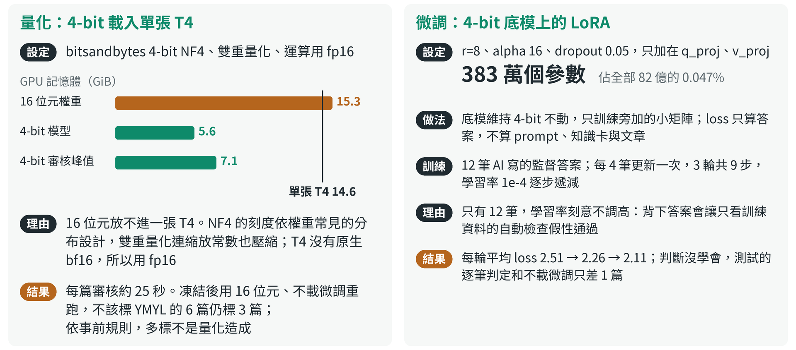
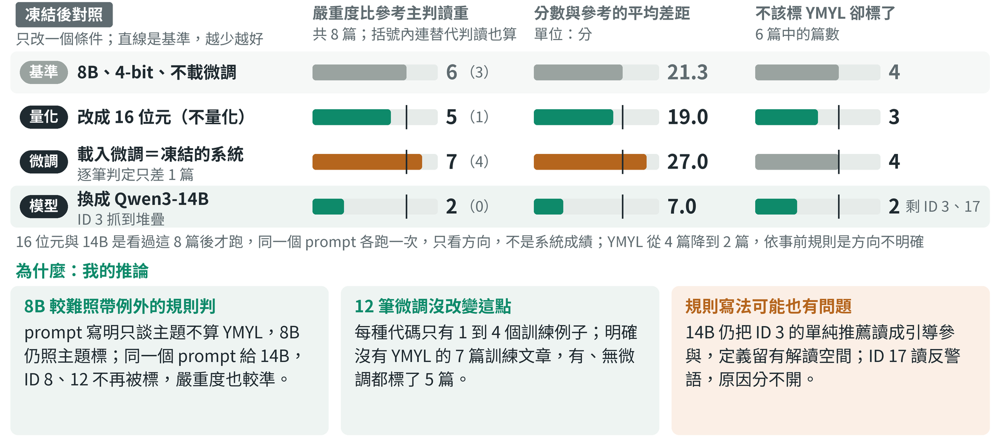
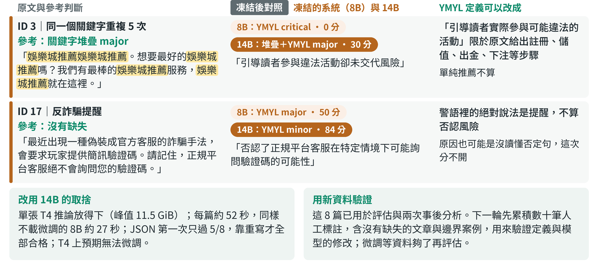

---
## 本地模型抓得到錯誤理論，但判得太嚴
- Qwen3-8B 在 Kaggle 單張 T4 本地推論
- 8 篇凍結後才交給模型：準確 3 篇、部分準確 2 篇、偏差 3 篇，拿掉微調判定只差 1 篇
- 凍結後另做對照：16 位元仍多標 YMYL，換 Qwen3-14B 嚴重度大多與參考一致，YMYL 多標只減半
Notes: 這一題要做一個資料不外流的 SEO 審核機器人：本地模型讀一段文章，挑出虛假經驗、YMYL 風險、錯誤的 SEO 理論和關鍵字堆疊，用 JSON 給分數、原因和建議。我在 Kaggle 單張 T4 上跑 Qwen3-8B。先講答案：植入的錯誤理論都抓到，格式全部合格；最大的問題是判得太嚴：只談到賭博或貸款就標 YMYL，嚴重度也常偏重。凍結之後我每次只改一個條件找原因：不量化仍多標 YMYL；換成 14B，嚴重度和分數較準，但 YMYL 只減半，每篇也慢一倍。所以下一步是改寫 YMYL 的規則，連同 14B 用新的標註資料驗證。

---
## 只有 20 篇文章，我先把 8 篇測試鎖起來
- 難處：沒有標準答案；12 篇資料，微調能學的很少
- 做法：規則寫進 prompt、事實寫成知識卡，格式交給程式
- 看著測試回頭改就不可信，所以 8 篇凍結後才交給模型

Notes: 公司給了 20 篇文章，12 篇拿來訓練，8 篇用來產生審核報告。難處有兩個：沒有標準答案；只有 12 篇資料，微調能學的很少。所以我把判斷規則寫進 prompt、把事實寫成附官方出處的知識卡，能明確檢查的格式交給程式，微調另跑一組不載微調的對照。最關鍵的是測試資料：看著這 8 篇的結果回頭改，它們就變成訓練資料，所以全部凍結後才交給模型。切分前核對來源時看過原文，但沒有用來調整。

---
## 模型做判斷，程式把關格式與凍結
- 模型判斷：找缺失、定嚴重度，先寫理由再給分
- 程式把關：凍結雜湊；格式、引句、分數區間不符就退回重寫
- 參考判斷在 Notebook 外事後比對，不回饋模型

Notes: 主線從左到右。12 篇訓練文章用來調整 prompt、知識卡和微調，訓練 Notebook 不掛載測試資料；調好後凍結，記下 34 個檔案的雜湊。評估 Notebook 載入凍結的系統，雜湊相符才讀 8 篇測試。綠框是模型判斷：Qwen3-8B 先寫理由再給分，因為先給分時，模型還沒寫理由就定了分。黑框是程式把關：格式、引句或分數區間不符就退回重寫一次，程式不改分。下面虛線框在 Notebook 外：參考判斷由另一個 AI 在看到輸出前寫好，報告產生後才拿來比對，由 AI 逐筆判定準確、部分準確或偏差，我再覆核；結果不回饋模型。

---
## 量化讓 8B 放進 T4，微調刻意調得很輕
- 量化：4-bit NF4 載入，16 位元 15.3 GiB 放不進 T4
- 微調：LoRA 只訓練 383 萬個參數（0.047%）
- 學習率不調高以免背答案；loss 有降，判斷沒學會

Notes: 左邊是量化：8B 用 16 位元載入，光權重就 15.3 GiB，超過一張 T4 的 14.6，所以用 bitsandbytes 的 4-bit NF4 載入，模型只佔 5.6 GiB。T4 沒有原生 bf16，運算用 fp16。凍結後用 16 位元、不載微調重跑，YMYL 仍多標 3 篇，依事前規則，多標不是量化造成。右邊是微調：底模維持 4-bit，LoRA 只訓練 383 萬個參數，不到萬分之五。只有 12 筆答案，我刻意不調高學習率，避免模型背答案、讓只看訓練資料的自動檢查假性通過。loss 有降，但判斷沒學會，測試判定和不載微調只差 1 篇。

---
## 原題舉的錯誤理論，模型指出並改正
- ID 4 主張 Meta Keywords 是排名最核心因素
- 模型指出錯誤，寫出 Google 的實際做法
- 判定準確；建議用了「質量、用戶、鏈接」等大陸用語

Notes: 這是 8 篇測試裡 ID 4 的實際輸出，也正是原題舉的例子：文章說 Meta Keywords 在 2026 年是排名的最核心因素。模型標成錯誤 SEO 理論，理由寫出 Google 不使用 meta keywords 排名，並引用對應的知識卡。分數 25 落在 critical 區間；參考判斷主判 major，但 prompt 的 critical 也包含「對排名作無依據的絕對承諾」，所以 critical 說得通，判定準確。不足是建議裡用了「質量、用戶、鏈接」這類中國大陸用語。

---
## 錯誤理論、經驗判斷做對，但判得太嚴
- 做到：錯誤理論 2/2、自述經驗 1/1、JSON 8/8
- 不足：多標 YMYL 4/6、比主判讀重 7/8、堆疊 0/1
- 一致性只測 1 篇訓練文章，三次都 0 分

Notes: 這一頁是正式結果：凍結的系統在 8 篇測試上，對照原題的評核項目。最上面是整體判定，準確 3、部分準確 2、偏差 3。綠色是做到：兩篇植入的錯誤 SEO 理論都判為錯誤；自述經驗那篇只說無法查證，沒有指控造假；保證獲利的廣告判最重等級；JSON 八篇第一次就合格。灰色是證據有限：一致性只用 1 篇訓練文章，三次都是 0 分，已經觸底。橘色是不足：不該標的 6 篇標了 4 篇，包括正確的二胎申請說明；嚴重度以主判讀算 7 篇偏重；關鍵字堆疊也漏標。最下面寫的是誰做判定。

---
## 換 14B 嚴重度與分數較準，YMYL 只減半
- 換 14B：嚴重度偏重 6→2 篇，分數差距 21.3→7.0
- 但 YMYL 多標只 4→2；不量化、不微調，偏差仍在
- 推論：8B 難照帶例外的規則判，規則可能也要改

Notes: 這頁是凍結後的對照，只看方向，不是系統成績。基準是不載微調的 8B，每次只改一個條件。改成 16 位元，YMYL 仍多標 3 篇，嚴重度偏重只少 1 篇；括號裡是連替代判讀也算的篇數。載入微調就是凍結的系統，判定只差 1 篇，嚴重度反而更重。換成 14B，嚴重度偏重從 6 篇降到 2 篇，分數平均差距從 21.3 降到 7.0；但 YMYL 只從 4 篇降到 2 篇，依事前規則是方向不明確。我的推論是 8B 較難照帶例外的規則判，微調也沒改變這點；14B 仍把單純推薦讀成引導參與，規則寫法可能也有問題。

---
## 最弱仍是 YMYL：換成 14B 還錯 2 篇
- 14B 仍錯 2 篇：推薦算引導參與、警語讀成否認風險
- 改用 14B：每篇約 52 秒（8B 27 秒），JSON 首次 5/8
- 定義與模型都要用新的標註資料驗證

Notes: 凍結的系統偏差的 3 篇裡，ID 8 換成 14B 後不再標 YMYL，上面兩篇仍然判錯。ID 3 抓到堆疊，但單純推薦仍被當成引導參與，這是定義可以放寬解讀的地方。ID 17 是反詐提醒，14B 說它否認了客服可能詢問驗證碼，可能是讀反否定句，也可能是套用 prompt 裡「否認」的字面，這次分不開。右欄是定義可以先改的兩處。換 14B 的代價是每篇時間約兩倍、JSON 第一次只過 5 篇，T4 上預期也無法微調。這些都要用新的標註資料驗證。

---
## 附錄：連結與參考資料
- 完整報告（Google 文件）：8 篇逐筆說明、技術反思、參考資料，附錄有 system prompt 全文
- [Kaggle 評估 Notebook](https://www.kaggle.com/code/pw95148637/soulo-work03-v3-eval)：凍結後實際跑出的 8 篇審核與報表；說明格是執行當下的筆記，以報告為準
- [Kaggle 訓練 Notebook](https://www.kaggle.com/code/pw95148637/soulo-work03-v3b-train)：部署、微調、一致性測試，以及凍結時記下的檔案雜湊
- [Kaggle 事後分析 Notebook（Qwen3-14B）](https://www.kaggle.com/code/pw95148637/soulo-work03-posthoc-14b)：凍結後換成 14B 的對照，計畫先存檔再執行；16 位元對照的 Notebook 連結在完整報告
- [GitHub](https://github.com/pw95148637/seo-ai-engineer-assessment/tree/main/task03-local-llm-audit)：程式與評估資料；不需 GPU 即可從原始輸出重算評估指標與圖表
- AI 對話紀錄：我與 Claude Code 的開發與驗證過程
- [參考資料](https://developers.google.com/search/blog/2009/09/google-does-not-use-keywords-meta-tag)：Google 官方：不使用 meta keywords 排名；其餘官方來源與法條在報告末
Notes: 由上到下是建議的查看順序。完整報告是本題的 Google 文件，含逐筆說明、技術反思和 system prompt 全文；評估 Notebook 是凍結後實際跑出 8 篇審核的版本，說明格是執行當下的工程筆記，為了保留輸出沒有修改；訓練 Notebook 有部署、微調和一致性測試。事後分析 Notebook 是凍結後換成 14B 的對照，16 位元對照的連結在完整報告。GitHub 上不需要 GPU 就能從 Kaggle 的原始輸出重算指標和簡報的圖。AI 對話紀錄保留了我和 Claude Code 的開發過程。
