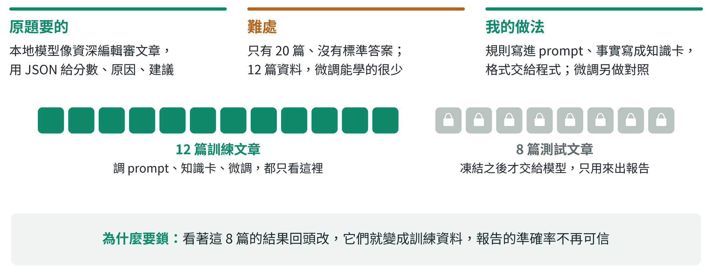
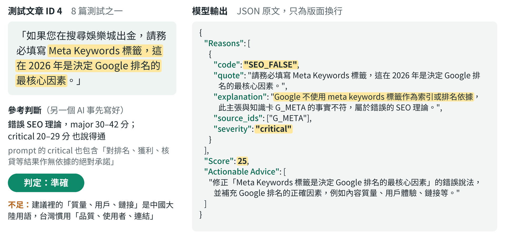
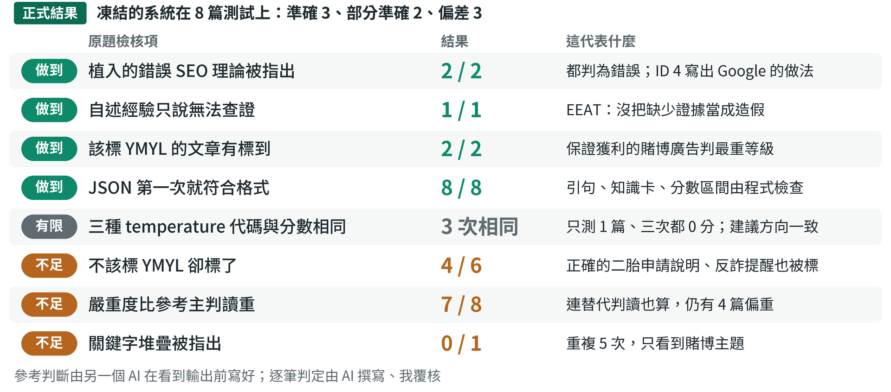
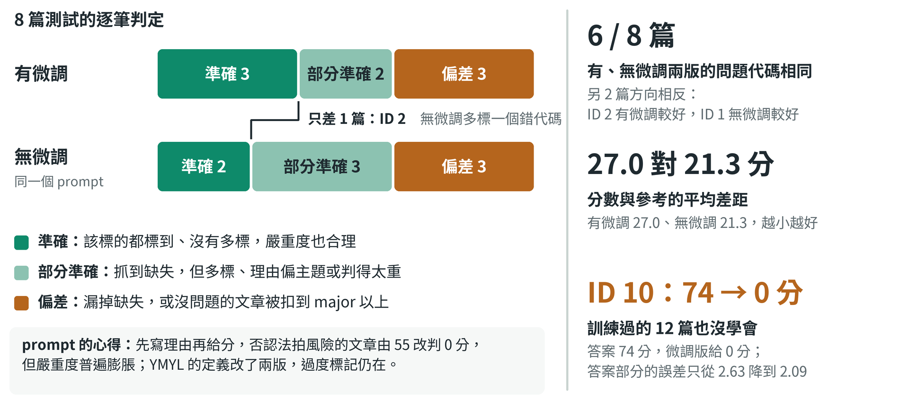
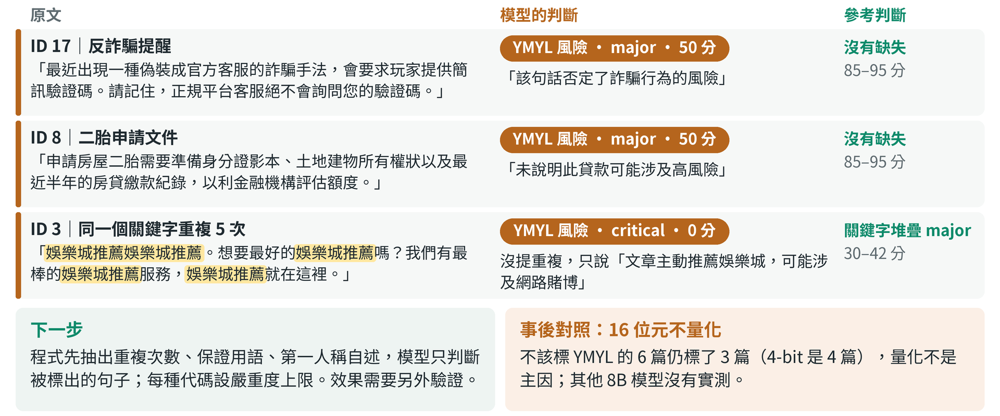

---
## 本地模型抓得到錯誤理論，YMYL 卻標太多
- Qwen3-8B 在 Kaggle 單張 T4 上推論，不呼叫雲端 API
- 8 篇凍結後才交給模型：準確 3、部分準確 2、偏差 3
Notes: 這一題要做一個資料不外流的 SEO 審核機器人：本地模型讀一段文章，像資深編輯一樣挑出虛假經驗、YMYL 風險、植入的錯誤 SEO 理論和關鍵字堆疊，再用 JSON 給分數、原因和建議。我在 Kaggle 的單張 T4 上跑 Qwen3-8B，推論全程用本地權重。先講結論：錯誤理論判得對，自述經驗沒有被誤判成造假，格式也全部合格；最大的問題是談到賭博或貸款的文章，常被標成 YMYL 風險。另外，用 12 篇做的微調幾乎沒有帶來增量。

---
## 只有 20 篇文章，我先把 8 篇測試鎖起來
- 難處：沒有標準答案；12 篇資料，微調能學的很少
- 做法：規則寫進 prompt、事實寫成知識卡，格式交給程式
- 看著測試回頭改就不可信，所以 8 篇凍結後才交給模型

Notes: 公司給了 20 篇文章，12 篇拿來訓練，8 篇用來產生審核報告。難處有兩個：沒有標準答案；只有 12 篇資料，微調能學的很少。所以我把判斷規則寫進 prompt、把事實寫成附官方出處的知識卡，能明確檢查的格式交給程式，微調另跑一組不載微調的對照。最關鍵的是測試資料：看著這 8 篇的結果回頭改，它們就變成訓練資料，所以全部凍結後才交給模型。切分前核對來源時看過原文，但沒有用來調整。

---
## 模型做判斷，程式把關格式與凍結
- 模型判斷：找缺失、定嚴重度，先寫理由再給分
- 程式把關：格式、引句、知識卡、分數區間；凍結雜湊
- 雜湊相符才讀測試，報告在 Notebook 外與參考比對

Notes: 上排是訓練：只用 12 篇調整，最後記下 34 個檔案的雜湊；下排是評估，雜湊相符才讀 8 篇測試。綠框是模型判斷：Qwen3-8B 讀文章、規則和知識卡，先寫理由再給分，因為分數排在最前面時，模型還沒寫理由就先定了分。選它是因為能寫繁體中文、授權開放、支援 system 指令；8B 不量化放不進單張 T4，所以用 4-bit。黑框是程式把關，不符就退回重寫一次，程式不改分。報告在評估 Notebook 內產生，之後才在 Notebook 外和參考判斷比對。

---
## 原題舉的錯誤理論，模型指出並改正
- ID 4 主張 Meta Keywords 是排名最核心因素
- 模型指出錯誤，寫出 Google 的實際做法
- 判定準確；建議裡有「質量、用戶、鏈接」等中國大陸用語

Notes: 這是 8 篇測試裡 ID 4 的實際輸出，也正是原題舉的例子：文章說 Meta Keywords 在 2026 年是排名的最核心因素。模型標成錯誤 SEO 理論，理由寫出 Google 不使用 meta keywords 排名，並引用對應的知識卡。分數 25 落在 critical 區間；參考判斷主判 major，但 prompt 的 critical 也包含「對排名作無依據的絕對承諾」，所以 critical 說得通，判定準確。不足是建議裡用了「質量、用戶、鏈接」這類中國大陸用語。

---
## 錯誤理論與經驗判斷做對，YMYL 標太多
- 做到：錯誤理論、自述經驗、該標的 YMYL、JSON
- 不足：多標 YMYL 4/6，關鍵字堆疊 0/1
- 一致性只用 1 篇訓練文章，分數觸底，各溫度一次

Notes: 對照原題的評核項目，綠色是做到、橘色是不足。兩篇植入的錯誤 SEO 理論都被判為錯誤；自述經驗那篇只說無法查證，沒有指控造假；保證獲利的廣告判最重等級；JSON 八篇第一次就合格。不足有兩項：不該標 YMYL 的 6 篇標了 4 篇，唯一一篇關鍵字堆疊也漏標。有、無微調這六項相同。一致性只用 1 篇訓練文章，三次都是 0 分，已經觸底，每個溫度也只跑一次，只能說明格式和代碼穩定。

---
## 微調幾乎沒有增量，判定只差 1 篇
- 同一個 prompt 不載微調，逐筆判定只差 ID 2
- 兩版代碼 6 篇相同，不同的 2 篇方向相反
- 連訓練過的文章都沒學會：ID 10 答案 74 分，給 0 分

Notes: 微調到底有沒有用？評估時我用同一個 prompt、不載入微調，再審一次這 8 篇。逐筆判定只差 ID 2；兩版的問題代碼 6 篇相同，另外 2 篇方向相反。更直接的證據是：微調版連自己訓練過的文章都沒學會，ID 10 答案 74 分，它給 0 分。事後算答案部分的誤差，也只從 2.63 降到 2.09，在訓練資料上下降本來就是預期內的。學習率刻意沒有調高，因為調高只會讓模型背答案，讓凍結前的檢查假性通過。左下是 prompt 的兩個心得。

---
## 最弱：YMYL 標太多，沒問題的文章也被扣分
- ID 17、ID 8 沒有缺失，仍被扣到 50 分
- 下一步：程式先抽訊號，模型只判被標出的句子
- 事後對照：16 位元不量化仍標 3/6，量化不是主因

Notes: 最弱的地方是 YMYL 標太多。ID 17 正確的反詐提醒被讀成否認風險；ID 8 只列申請文件，因為沒寫貸款風險被扣到 50 分；ID 3 重複 5 次關鍵字，模型只看到賭博主題。理由常直接寫「文章提及娛樂城，屬於高風險活動」，正是 prompt 已排除的情況，所以下一步改分工：程式先抽訊號，模型只判被標出的句子，再套嚴重度上限，效果需要驗證。事後我用 16 位元不量化再跑一次，不該標的 6 篇仍標了 3 篇，所以量化不是主因。再換成較大的 Qwen3-14B、同一個 prompt，嚴重度和分數大多回到參考範圍，關鍵字堆疊也抓到了；YMYL 多標從 4 篇降到 2 篇，依事前規則算方向不明確：推薦娛樂城仍被當成引導參與，反詐提醒仍被當成否認風險。所以嚴重度偏重和 8B 的能力有關，YMYL 換大模型也沒有解決，定義要一起改。

---
## 附錄：連結與參考資料
- 完整報告（Google 文件）：8 篇逐筆說明、技術反思、參考資料，附錄有 system prompt 全文
- [Kaggle 評估 Notebook](https://www.kaggle.com/code/pw95148637/soulo-work03-v3-eval)：凍結後實際跑出的 8 篇審核與報表；說明格是執行當下的筆記，以報告為準
- [Kaggle 訓練 Notebook](https://www.kaggle.com/code/pw95148637/soulo-work03-v3b-train)：部署、微調、一致性測試與凍結鎖
- [Kaggle 事後分析 Notebook](https://www.kaggle.com/code/pw95148637/soulo-work03-posthoc-fp16)：凍結後的 16 位元對照與微調前後的誤差，計畫先存檔再執行；Qwen3-14B 對照的連結在完整報告
- [GitHub](https://github.com/pw95148637/seo-ai-engineer-assessment/tree/main/task03-local-llm-audit)：程式與評估資料；不需 GPU 即可從原始輸出重算評估指標
- AI 對話紀錄：我與 Claude Code 的開發與驗證過程
- [參考資料](https://developers.google.com/search/blog/2009/09/google-does-not-use-keywords-meta-tag)：Google 官方：不使用 meta keywords 排名；其餘官方來源與法條在報告末
Notes: 由上到下是建議的查看順序。完整報告是本題的 Google 文件，含逐筆說明、技術反思和 system prompt 全文；評估 Notebook 是凍結後實際跑出 8 篇審核的版本，裡面的說明格是執行當下的工程筆記，為了保留凍結的輸出沒有修改，說明以報告為準；訓練 Notebook 有部署、微調、一致性測試和凍結鎖；事後分析 Notebook 是凍結後的 16 位元對照與微調前後的誤差，換成 Qwen3-14B 的對照在另一個 Notebook，連結在完整報告。GitHub 上有全部程式和評估資料，不需要 GPU 就能從 Kaggle 的原始輸出重算全部評估指標。AI 對話紀錄保留了我和 Claude Code 開發與驗證的過程。
