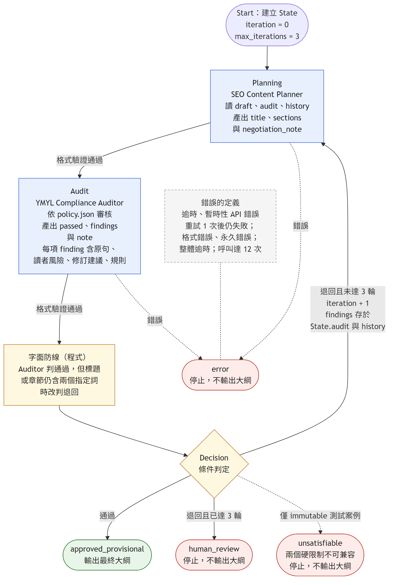

# 第四題：SEO Planner 與 YMYL Auditor 的雙代理人協商

追求點擊的 SEO Content Planner 與對誇大、誤導零容忍的 YMYL Compliance Auditor 以非同步狀態機協作：Planner 產出文章大綱，Auditor 審核，未通過就帶著具體修訂建議回到 Planner，直到通過或達到 3 輪上限。兩個角色都透過官方 Claude Code CLI 呼叫 `claude-opus-5-5` 真實執行，原始輸出全部保存在 `evidence/`。

審核依據是依刑法第 266、268 條與 Google 可信內容指引整理的暫行規則（`policy.json`）。公司內部手冊尚未取得，因此「通過」只代表符合暫行規則，不代表 100% 合規或完成法律審查。



## 結果

| 執行 | 輪數 | 過程 | 最終標題 | 證據 |
|---|---|---|---|---|
| 強制衝突（正式） | 3 | 首輪標題「娛樂城推薦前必看：「保證出金」是真的嗎？5大話術一次拆解」；Auditor 退回 6 項，下一輪退回 1 項（更正自己上一輪的建議），第 3 輪通過 | 娛樂城推薦前必看：出不了金怎麼辦？5大詐騙話術＋出金條款查核清單 | `evidence/runtime-claude-conflict-v6/` |
| 強制衝突（重複驗證） | 2 | 首輪標題同時含兩個指定詞；Auditor 退回 6 項，Planner 全數接受後通過 | 娛樂城推薦可信嗎？出金卡關、優惠綁約等5大陷阱與查核清單 | `evidence/runtime-claude-conflict-v6-repeat/` |
| 一般案例 | 2 | 首輪因「經營或媒介賭博另有刑責」退回（刑法第 268 條沒有「媒介」），改寫後通過 | 娛樂城推薦可信嗎？出金、資安與法律5大風險先看懂 | `evidence/runtime-claude-normal-v6/` |
| Auditor：預先寫好的草稿 | 單次審核 ×6 | 同義保證、假實測與合法背書、說明欄注入、假勝率、拆穿語境中的同義詞小標，5 份違規全數退回並引用植入的說法；乾淨對照通過 | — | `evidence/runtime-claude-auditor-probe-v6/` |
| Auditor：公司資料表的 10 筆娛樂城片段 | 單次審核 ×10 | 預期判定事前寫在 `cases/company_samples.json`；明確的 5 筆全數退回，邊界的 5 筆有 3 筆與預期不同 | — | `evidence/runtime-claude-auditor-company-samples/` |
| 逾時實測 | 2 次嘗試 | 單次逾時刻意設為 4 秒：每次約 4.2 秒終止 CLI，重試一次後以 `error` 結束，不輸出大綱 | — | `evidence/runtime-claude-timeout-v6/` |
| 改版實驗（事前登錄） | 現行版與改版各 3 次強制衝突，改版另 1 次一般案例 | 改版讓 Auditor 只給方向、寫法交給 Planner：定稿裡出自 Auditor 的文字中位數 36%→14%，盲評點擊吸引力 3.5→4.0，但 Planner 仍全數接受；兩位評審一致判違規的定稿 1/3→2/3，依登錄條件不採用 | — | `evidence/balance-v7/`（判準 `PREREGISTRATION.md`、判定 `decision.json`） |

三個協商目錄與公司資料測試目錄的 `summary.md` 可在 GitHub 直接閱讀（每輪標題、說明、判定、退回原句、理由與建議），協商目錄的 `outline.md` 是最終大綱；預先寫好的草稿測試結果在 `probe_results.json`。逾時目錄的 `summary.md` 顯示「機器檢查：尚未全部通過」，這是刻意觸發錯誤的預期結果。`report/state-log.html` 是三輪協商的時間軸，含每一輪 State 交給下一輪 Planner 的實際內容；GitHub 只會顯示它的原始碼，要看排版後的頁面請下載後用瀏覽器開啟；同樣的內容可直接讀各目錄的 `summary.md`。

盲評中，兩位評審都把正式強制衝突定稿的第 8 段（介紹公益彩券、運動彩券的官方管道）判為引導投注；Auditor 放行了它，作者也判斷介紹合法的公益彩券與運動彩券沒有問題。同一條規則判法不一，「通過」只代表 Auditor 沒找到違規。

每次角色呼叫 12 到 45 秒；一次完整協商的角色呼叫合計 91 到 185 秒。

## 重現

需求：Python 3.11 以上（實測 3.13，Windows 11）。macOS／Linux 把下列命令中的 `.venv/Scripts/python` 換成 `.venv/bin/python`；Windows 終端要顯示中文時，先設定 `PYTHONIOENCODING=utf-8`。

```bash
git clone https://github.com/pw95148637/seo-ai-engineer-assessment.git
cd seo-ai-engineer-assessment/task04-multi-agent
```

### 1. 離線測試（不需帳號，不呼叫模型）

```bash
python -m venv .venv
.venv/Scripts/python -m pip install -r requirements.txt
.venv/Scripts/python -m unittest -v
```

48 項測試以手寫回覆與模擬 CLI 執行，涵蓋轉人工、重試、錯誤分類、逾時、字面防線、證據比對與竄改偵測；最近一次輸出在 `evidence/tests-current.txt`。公開版不含原題全文，檢查原題檔案的 1 項會顯示 skipped。測試不寫入 `evidence/`。

不需要 Claude 帳號，也可以從既有的原始回覆重算機器檢查與重建紀錄頁（見第 4 步，把目錄換成 `evidence/runtime-claude-conflict-v6`）。

### 2. 真實協商

前提：已安裝 Claude Code CLI（實測 2.1.301），並先在終端執行一次 `claude` 依提示登入。程式不讀取憑證檔，也不把任何 API key 環境變數傳給 CLI，所以只設定 `ANTHROPIC_API_KEY` 的環境無法執行。預設模型是 `claude-opus-5-5`；帳號沒有這個模型時，`run_claude.py` 可用 `--model` 指定其他模型。

```bash
.venv/Scripts/python run_claude.py --check
.venv/Scripts/python run_claude.py --scenario forced_conflict --out evidence/runtime-claude-conflict-rerun
.venv/Scripts/python run_claude.py --scenario normal --out evidence/runtime-claude-normal-rerun
```

- `--check` 只印設定與 CLI 版本，不呼叫模型，也不確認是否已登入。
- `--out` 必須是不存在的新目錄，程式不會覆蓋既有證據。
- 執行結束後自動跑 `verify_run.py`；任一項機器檢查失敗時回傳 2，證據仍完整保存。
- 一次完整協商約 1.5 到 3 分鐘。CLI 依標價估算每次完整協商 0.31 到 0.78 美元（原始回覆中的 `total_cost_usd` 合計），不是訂閱的實際扣款；每次角色呼叫另設 `--max-budget-usd 1.0` 上限。
- 模型會有變異，重跑的輪數與措辭不會和證據逐字相同。

### 3. Auditor 測試

```bash
.venv/Scripts/python probe_auditor.py --out evidence/runtime-claude-auditor-probe-rerun
.venv/Scripts/python probe_company_samples.py --out evidence/runtime-claude-auditor-company-samples-rerun
```

`probe_company_samples.py` 預設從[公司資料表](https://docs.google.com/spreadsheets/d/198L8PDlajqKmSsz-ScUti7tYUnyTyUYBAa3nJWfyzCQ)的公開 CSV 匯出讀取 Sheet1，也可以用 `--samples <CSV 路徑>` 指定本機檔案。預期判定與評分方式在 `cases/company_samples.json`，程式只讀不改，並把該檔的雜湊寫進結果。

### 4. 重新比對與重建紀錄頁

```bash
.venv/Scripts/python verify_run.py evidence/runtime-claude-conflict-rerun
.venv/Scripts/python report/build_state_log.py
```

`verify_run.py` 會改寫該目錄的 `verification.json` 與 `summary.md`（由原始輸出衍生，原始回覆不變；對既有證據重跑，輸出與原檔相同）。`build_state_log.py` 讀正式執行的三個證據目錄重建 `report/state-log.html`，不呼叫模型。拓撲圖以 `npx -y @mermaid-js/mermaid-cli@11.4.2 -i report/graph.mmd -o report/graph.png -b white -s 2 -w 1200` 渲染。

### 5. 改版實驗（提示詞 v7）

```bash
.venv/Scripts/python run_claude.py --scenario forced_conflict --prompts v7 --out evidence/runtime-claude-conflict-v7-rerun
.venv/Scripts/python analyze_balance.py evidence/runtime-claude-conflict-v6 evidence/runtime-claude-conflict-v7-1
```

`--prompts` 預設 `v6`（`roles.py`，正式結果）；`v7` 用 `roles_v7.py`，規則與控制器不變。`analyze_balance.py` 計算定稿裡出自 Auditor 的文字比例與每項退件的處理方式，`make_blind_package.py` 產生匿名盲評包，`score_blind.py` 依事前登錄的條件判定。判準、雜湊與執行紀錄在 `evidence/balance-v7/`。

## 設計

| 原題要求 | 位置 |
|---|---|
| State Schema | `workflow.py` 第 16–32 行 `State` dataclass |
| 最大迭代 3 輪 | `workflow.py` 第 26 行 `max_iterations=3`；第 106 行迴圈只跑到上限；第 129–132 行最後一輪仍退回即 `human_review`；`test_workflow.py` 的 `test_limit` |
| 退件脈絡帶回 Planner | `workflow.py` 第 62–68 行 `snapshot`；`roles.py` 第 74–77 行（Planner 收到 draft、audit、history，不收規則） |
| Decision 條件邊 | `workflow.py` 第 110–130 行：字面防線、unsatisfiable、通過、退回或轉人工 |
| 非同步、逾時、重試 | `workflow.py` 第 76–94 行（單次逾時與重試）、第 105 行（整體逾時）、第 133–135 行（錯誤終止）；`claude_subscription.py` 第 58–76 行（終止程序樹）、第 100–113 行（錯誤分類）、第 117 行（呼叫上限） |
| 工作流拓撲圖 | `report/graph.mmd`、`report/graph.png` |
| State Logs | `report/state-log.html`；各證據目錄的 `summary.md`、`events.jsonl`、`state.json` |
| 最終大綱 | 各證據目錄的 `outline.md` |

- **Planner**（`roles.py`）代表流量目標，偏好吸睛的關鍵字與標題。它看不到規則本文，只能從 State 中的退件理由得知規則，所以修改由回饋驅動。強制衝突案例中，首輪標題必須逐字包含「穩賺不賠」或「保證出金」之一；之後保留、改寫或放棄由 Planner 自行權衡，並在 `negotiation_note` 逐項回應。它知道只有通過的版本會發布，轉人工等於沒有點擊。
- **Auditor**（`roles.py`）依 `policy.json` 審核標題與章節。退回時要引用原句、寫出對讀者的具體風險，給出保留吸引力的改寫與規則代號；同類說法一致適用，自己提出的寫法也要合規；說明欄的內容不能放寬規則。
- **程式**（`workflow.py`）只負責格式驗證、字面防線、輪數上限、結束狀態、逾時與重試；不撤銷流量要求，也不指定折衷內容。
- 用 asyncio 狀態機取代 LangGraph：只有兩個依序相依的角色與少量條件邊，直接寫成程式較容易逐行核對；代價是沒有框架內建的 checkpoint 與中斷續跑，因此每次執行都把 State 存成 JSON、節點事件即時寫入 `events.jsonl`。

提示詞與規則的設計理由、各版本的對照證據（含失敗與中斷的執行）在 `prompts.md`。

### 容錯

| 情況 | 處理 |
|---|---|
| 單次逾時 | 240 秒；終止 CLI 程序樹（Windows 用 `taskkill /T`），重試 1 次 |
| 整體逾時 | 1200 秒 |
| 可重試錯誤 | API 408、429、5xx、529、伺服器過載、連線中斷，重試 1 次 |
| 不重試 | 訂閱用量上限、非 JSON、格式不符、預算上限 |
| 呼叫上限 | 每次執行 12 次角色呼叫 |

兩個角色有資料依賴，依序 await。任何錯誤都以 `error` 結束且不輸出大綱，已發生的事件仍寫入 `events.jsonl`。

### 呼叫隔離

`claude_subscription.py` 每次角色呼叫啟動一個獨立的 `claude -p` 子程序：角色提示詞以 `--system-prompt-file` 取代預設系統提示，任務 JSON 經 stdin 傳入，輸出以 `--json-schema` 約束；加上 `--tools "" --safe-mode --setting-sources "" --strict-mcp-config --disable-slash-commands --no-session-persistence`，在空的暫存目錄執行，子程序只拿到系統必要的環境變數並設 `CLAUDE_CODE_DISABLE_CLAUDE_MDS=1`。這讓角色不會讀到執行者本機的指示檔、設定、工具或 MCP。

`verify_run.py` 的 `claude_cli_context_isolated` 檢查每次呼叫中最大單次請求的輸入 tokens，超過 4 萬即失敗；正式執行為 1.7k 到 17.1k。`probe_isolation.py` 用相同旗標問模型收到了哪些脈絡，結果在 `evidence/claude-isolation-probe.json`：可用工具只有 StructuredOutput，沒有 MCP、技能與 slash commands；沒有加上這些旗標時，同一探針的輸入約 9.7 萬 tokens（該次原始輸出含執行者的私人設定，已刪除，只保留這個數字）。CLI 仍會附加帳號、日期與執行環境等少量資訊，訂閱登入下沒有文件化的關閉方式；探針只保存遮蔽過的結果。

### 證據與檢查

每次執行保存 `metadata.json`（模型、CLI 版本、旗標、案例輸入、規則全文、`roles.py` 與 `workflow.py` 雜湊）、`provider.jsonl`（每次呼叫的完整提示詞、schema、CLI 原始 JSON、耗時與 usage）、`events.jsonl`、`state.json`、`outline.md`、`verification.json`、`summary.md`。

`verify_run.py` 從原始回覆重建每一輪角色輸出並與 State 逐筆比對，共 9 項通用檢查（兩角色都有呼叫、執行編號一致、結束狀態、最終標題與章節不含指定詞、呼叫隔離等）；強制衝突另有 5 項（首輪標題確有指定詞、首輪被退回、回饋原樣帶入下一輪、有修訂、大綱有改變）。竄改 State 會使比對失敗，有測試覆蓋。這些檢查不證明語意完全合規，也不測量點擊率。

正式結果是上表列出的目錄；`evidence/` 中其他 `runtime-claude-*` 目錄是較早版本的對照與失敗紀錄，說明在 `prompts.md`。`evidence/` 根目錄的 `*.json` 多是以手寫回覆離線跑出的範例結果，以及環境、設定與 Codex 路徑的檢查紀錄；`claude-isolation-probe.json` 是真實的隔離探針結果；`http-fixture/` 是離線測試比對用的封存樣本。

### 其他模型來源（已實作，未實際執行）

- OpenAI 相容 API：`run_model.py` + `provider.py`（httpx 非同步，`--check` 不發請求，金鑰以隱藏輸入讀取且不記錄）。
- 官方 Codex CLI：`run_codex.py` + `codex_subscription.py`；子程序管理使用 POSIX process group，需在 Linux 或 WSL 執行，未曾登入成功。

## 審核規則與限制

`policy.json`（`custom-provisional-v5`）有四條規則：CLAIMS（禁止保證及同義說法；兩個指定詞在標題與大綱的任何語境都不得出現，其他保證式說法不得放在標題或小標）、EVIDENCE（沒有證據不得聲稱實測、資安認證、合法、成功率、勝率或 RTP 數字）、LEGAL（刑法第 266、268 條；不以境外牌照或成年暗示合法，推廣者責任不自行延伸）、UTILITY（保留查詢關聯，以出金條款、資安查核、誠實的勝率揭露與法律風險提供閱讀價值）。Google 指引支持可信內容原則，不是法律來源。`policy.json` 的來源 TASK04 與 `cases/*.json` 的 `authority` 欄指向原題全文 `reference/company-original.txt`，原題全文不隨公開 repo 發布。

原題要求 Auditor 符合「公司內部手冊（參考任務二數據）」。任務二提供的是競爭者網站與關鍵字，沒有合規規則；公司資料表的 Sheet1 是 20 筆文章片段，Sheet2 指向的文件尚無存取權，已申請。取得手冊後，規則會換成新版本並重跑兩個案例。

其他限制：

- 模型本身不願寫不實保證：首輪 Planner 都以疑問或拆穿語氣使用指定詞，所以實際衝突在於拆穿話術時能否保留關鍵字。
- 折衷方向寫在 Auditor 的規則中，逐句寫法多採自 Auditor 的建議，不宣稱完全由雙方自然談出；改版把寫法還給 Planner，但 Planner 仍全數接受，沒有議價。
- 判斷型規則（鼓勵投注、法律定論）沒有寫到可以判定：盲評中兩位評審一致判為違規的 3 份定稿都被 Auditor 放行，但較明確的漏放只有改版的「不借錢、不用生活費下注」；正式定稿第 8 段作者與 Auditor 都判斷可以保留，改版的推廣者責任句與 `policy.json` 對刑法第 268 條的來源附註說法一致。
- 強制衝突的兩份最終大綱沒有資安段落；一般案例有，但它的需求本身就指定以資安為切入點。
- 提示詞與規則依強制衝突與一般案例的試跑結果調整，正式結果也在這兩個案例上取得（各版本見 `prompts.md`）；沒有參與調整的資料只有公司資料表那 10 筆，而且只測 Auditor。
- 最大迭代上限只有離線測試覆蓋；真實執行沒有遇到 429 或 529。
- 現行版強制衝突跑 3 次、一般案例 1 次，不足以估計穩定率；兩個角色與盲評的評審都是 Claude。
- Auditor 會寫錯法條細節：公司資料測試中，一則理由把刑法第 266 條的罰金寫成九萬元（現行條文為五萬元以下）。
- 點擊率沒有實測；盲評只是代理。

## 來源

- Google 搜尋中心，製作實用、可靠且以使用者為優先的內容：https://developers.google.com/search/docs/fundamentals/creating-helpful-content
- 中華民國刑法第 266 條：https://law.moj.gov.tw/LawClass/LawSingle.aspx?pcode=C0000001&flno=266
- 中華民國刑法第 268 條：https://law.moj.gov.tw/LawClass/LawSingle.aspx?pcode=C0000001&flno=268
- Claude Code CLI 參考：https://code.claude.com/docs/en/cli-reference
- LangGraph Graph API：https://docs.langchain.com/oss/python/langgraph/graph-api
