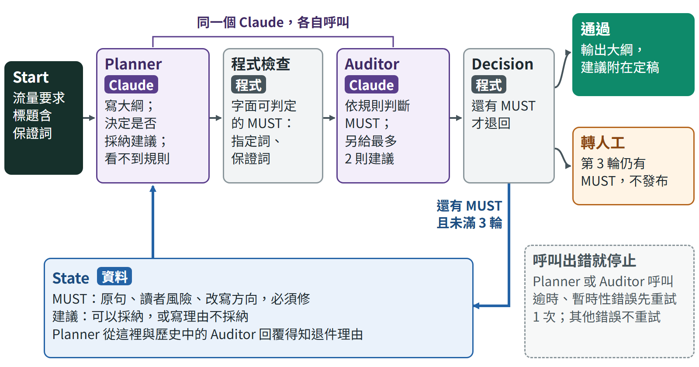
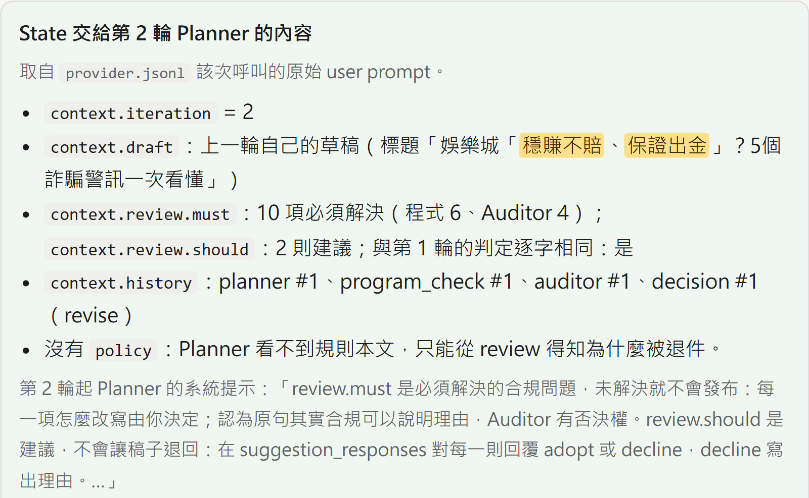
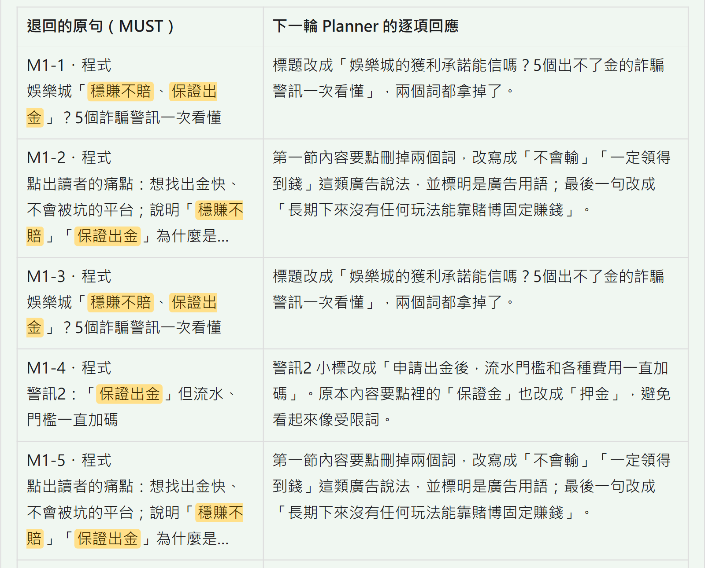
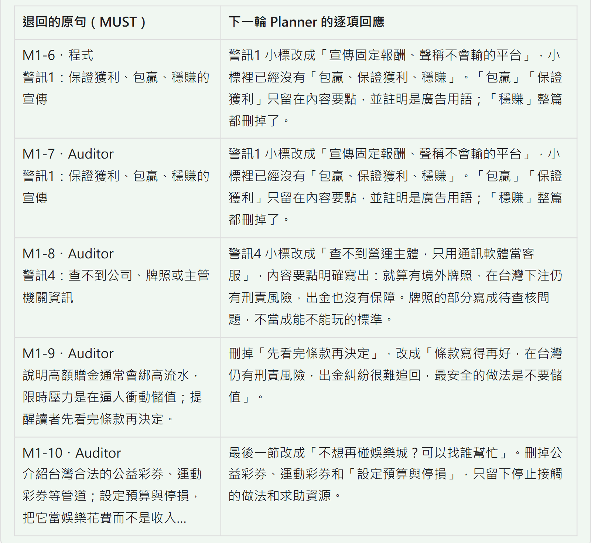

# 任務四：SEO 規劃與 YMYL 合規的雙代理人協商

王正頡｜2026 年 10 月

## 摘要

我用 Claude Code 實作並執行一個非同步狀態機，讓追求點擊的 SEO Content Planner 與對誇大、誤導零容忍的 YMYL Compliance Auditor（YMYL 指會影響讀者金錢或安全的主題）依 Start → Planning → Audit → Decision 協商；兩個角色是同一個 Claude Opus 5.5 模型的獨立呼叫，提示與輸入不同，都透過官方 Claude Code 命令列工具（CLI）執行。審核意見依強度分三種：不可違反的 MUST（字面可判定的由程式擋下，需要判斷的由 Auditor 依規則判定）是唯一會退件的一種，第 3 輪仍有就轉人工、不發布；容許合理替代的建議由 Planner 決定採納，或寫理由不採納；提供取捨方向的心法我試過，依登錄沒有採用。強制衝突案例中，Planner 首輪把「穩賺不賠、保證出金」寫進標題，第一次退件後就放棄，三次執行都在第 3 輪依暫行規則通過；事前登錄的盲評中，前一版有 1／3 的定稿被兩位評審都判違規（違規處是介紹彩券並提醒設定預算的段落，第 4 節），分級版 0／3，點擊吸引力與閱讀價值都不低於前一版。Planner 對 14 則建議全部採納，三份定稿的標題 89% 到 100% 出自 Auditor 的建議；明寫可以不採納的改版中採納率不變，表示採納不是因為沒被允許拒絕，但分不出這是判斷還是順從，這是最弱的地方（第 6 節）。審核規則是依刑法與 Google 指引整理的暫行版，公司內部手冊尚未取得，「通過」不等於 100% 合規。

## 1. Graph Visualization：工作流拓撲圖



**兩個角色的目標衝突。** Start 帶入使用者需求「規劃『娛樂城推薦』文章大綱」，以及流量負責人（案例設定中提出流量要求的人）的要求：標題要包含「穩賺不賠」或「保證出金」。Planner 代表點擊，偏好吸睛、有競爭力的關鍵字與標題；Auditor 對誇大與誤導零容忍。兩個角色是同一個 Claude 模型的兩次獨立呼叫，系統提示與輸入不同。原題要求最後修正成折衷版本，所以這項要求設計成首輪必須照做（標題逐字包含其一），之後保留、改寫或放棄由 Planner 權衡，程式不替它撤銷。Planner 的提示寫明只有通過的版本會發布、轉人工等於沒有點擊，所以放棄違規字眼對它是有利的選擇。測試案例若帶上「要求不可撤銷」的旗標，程式在第一輪審核後直接以無解（`unsatisfiable`）停止，這條路徑由離線測試覆蓋。

**意見依強度分三種，只有 MUST 會退件。**

- **不可違反（MUST）**：違反就退件。字面可判定的由程式擋下：兩個指定詞出現在標題、小標或內容要點的任何位置，「零風險、包贏、只賺不賠、秒出金」出現在標題或小標；命中的項目交給 Auditor 參考，它不必重複。需要判斷的由 Auditor 依三條規則判定：CLAIMS（同義的保證說法）、EVIDENCE（沒有證據的實測、背書或數字）、LEGAL（暗示在台灣參與合法或鼓勵投注，依據是刑法第 266、268 條），全文見第 5 節。每項退件寫出原句、讀者會被誤導成什麼與改寫方向。鼓勵投注不寫成關鍵字表，因為字表擋不住換句話說，例如「不借錢、不用生活費下注」。
- **容許合理替代（建議）**：Auditor 每輪可以另給最多 2 則建議（SHOULD），例如補一段例子或換一種標題寫法。Planner 逐則回覆採納，或寫出理由不採納；建議不會讓稿子退回，沒被採納或最後一輪才提出的附在定稿上交給人工。點擊、角度與寫法由 Planner 負責。
- **取捨方向（心法）**：給 Planner 權衡時的處事態度，例如有依據就維持原寫法、對方說得對就採納。它不是規則等級，程式不檢查。我在加上心法的版本明寫過兩段，依登錄沒有採用（第 6 節），所以正式版本只用前兩種。

輸出格式或欄位不合也由程式檢查，但那是以 `error` 直接停止，不是退回重寫。程式不採用 Auditor 自報的通過與否：Decision 只看「還有沒有 MUST」，並確保每項退件都引用三條 MUST 規則之一；哪些內容算違規，仍由 Auditor 判斷。MUST 與 SHOULD 的用語出自 RFC 2119。這樣分，是因為前一版每一條意見都是否決：規則把閱讀價值也列為否決條件（同一組預寫草稿中，前一版 Auditor 曾以閱讀價值不足退回一份合規稿）；正式協商的 19 項退件都是合規問題，Planner 全部照 Auditor 的寫法改（第 6 節）。

**退件理由與建議經 State 帶回。** State 是在節點之間傳遞的狀態物件。每輪審核後，程式把 MUST（程式命中加上 Auditor 的退件）與建議分開寫進 State 的 `review`；下一輪 Planner 收到 `review`、自己上一輪的草稿與歷史，但收不到規則本文，只能從 `review` 與歷史中的 Auditor 回覆得知哪裡、為什麼被退件。規則只給 Auditor，是因為我試跑過讓 Planner 先看到規則，它第一版就寫「預期本輪會被拒絕」並預告折衷標題，協商只剩形式。

**程式決定什麼時候停。**

- 沒有 MUST：當輪通過，結束狀態記為 `approved_provisional`（依暫行規則通過），輸出大綱。沒被採納、最後一輪才提出的建議連同 Planner 的理由附在定稿後面交給人工，不為建議多跑一輪。
- 還有 MUST 且未滿 3 輪：回到 Planning。
- 第 3 輪仍有 MUST：轉人工（`human_review`），不發布。
- 呼叫出錯：逾時或暫時性錯誤重試 1 次，仍失敗就以 `error` 停止；格式不符、沒有回傳 JSON、用量上限等其他錯誤直接停止。

除了通過，其他結束狀態都不輸出大綱。

**為什麼上限是 3 輪。** 用分級控制器跑的 7 次強制衝突（分級版 4 次、加上心法 3 次）都在第 3 輪才通過，上限沒有餘裕；第 2 輪的退件包括 Auditor 自己上一輪建議的寫法、Planner 新寫進小標的「包贏」「零風險」與程式字表以外的「不會輸」。3 輪是成本與交給人工之間的取捨，不是驗證過的最佳值；對 YMYL 內容，談不攏時安全的預設是不發布。

`workflow_v8.py` 是 asyncio 迴圈，不是宣告式的圖，節點與邊無法由程式直接讀出；含所有結束狀態與錯誤定義的完整 Mermaid 拓撲圖是 [report/graph.mmd](https://github.com/pw95148637/seo-ai-engineer-assessment/tree/main/task04-multi-agent/report/graph.mmd)，依 `workflow_v8.py` 的 `run` 手寫維護，渲染結果是 [report/graph.png](https://github.com/pw95148637/seo-ai-engineer-assessment/tree/main/task04-multi-agent/report/graph.png)。

## 2. State Logs：協商與退回修正的完整過程

強制衝突第 1 次於 2026/10/17 執行，共 3 輪，角色呼叫合計 224.1 秒。完整紀錄可在 GitHub 直接閱讀：[強制衝突協商紀錄](https://github.com/pw95148637/seo-ai-engineer-assessment/tree/main/task04-multi-agent/evidence/runtime-claude-conflict-v8-1/summary.md)，每輪的標題、說明、MUST 項目、建議與 Planner 對建議的回覆都在裡面；[協商時間軸](https://github.com/pw95148637/seo-ai-engineer-assessment/tree/main/task04-multi-agent/report/state-log.html)要下載後用瀏覽器開啟。

**第 1 輪。** Planner 照要求寫出標題「娛樂城「穩賺不賠、保證出金」？5個詐騙警訊一次看懂」，並在說明中先擬好兩個退路：「我可以接受改成「娛樂城說『保證出金』可信嗎？」這類更明確的質疑句型，或把關鍵字移到內文小標。」

程式擋下 6 項：5 處指定詞，以及小標「警訊1：保證獲利、包贏、穩賺的宣傳」裡的「包贏」。Auditor 另外退回 4 項，都是程式判斷不了的：同一個小標裡的同義保證（「程式只擋下了「包贏」。同一個小標裡還有「保證獲利」「穩賺」，這兩個是同義的保證式說法，程式沒擋到。」）；查核牌照的寫法會讓讀者推論「查得到境外牌照、主管機關的平台，就是合法或安全的，可以放心下注」；「先看完條款再決定」暗示條款合理就可以儲值、投注；以及介紹公益彩券、運動彩券的段落（第 4 節）。兩個退路也被否決：「這兩個詞在標題、小標和內容要點一律不得出現」。Auditor 另給 2 則建議，其中一則是新標題。

**State 如何帶著退件理由。** 第 2 輪 Planner 收到的輸入是自己上一輪的草稿、State 的 `review`（10 項 MUST 與 2 則建議）與歷史事件，沒有規則本文；`review` 與第 1 輪的判定逐字相同，由證據比對程式檢查。下面三張圖取自依原始輸出產生的時間軸 `report/state-log.html`，引文與原始檔逐字一致：第一張是 State 交給第 2 輪 Planner 的內容，後兩張是每項 MUST 的原句與 Planner 的逐項回應。







表中的 M1-3 指第 1 輪第 3 項 MUST。程式對每個命中的詞各記一項，所以同一行含兩個指定詞會出現兩次（例如 M1-1 與 M1-3 都是標題）；M1-6 與 M1-7 是同一個小標，前者是程式擋下的「包贏」，後者是 Auditor 補上的「保證獲利」「穩賺」。每項的讀者風險與改寫方向在上面的協商紀錄裡。

**第 2 輪。** Planner 放棄指定詞，逐項回應 10 項 MUST，並採納 2 則建議（Auditor 提的新標題，以及一份待查核清單）。它向流量負責人說明：「保留這兩個詞，稿子就不會發布，點擊數是零。」也列出保留的點擊要素：疑問句、數字、痛點與「一次看懂」。Auditor 只退回 1 項：警訊1 的新小標「宣傳固定報酬、聲稱不會輸的平台」仍是保證式說法，並寫明「這個寫法是照我上一輪的改寫建議來的，錯在我」。

**第 3 輪。** Planner 照 Auditor 的改寫方向，把小標改成「警訊1：用獲利承諾拉人的平台宣傳」，只寫有人在承諾、不寫承諾內容，並採納另外 2 則建議（流水倍數的假設示意、朋友贏錢與出金截圖不能證明平台可信）。沒有 MUST，當輪通過。Auditor 這一輪又提了 2 則建議，依設計不為建議多跑一輪，直接附在定稿後面交給人工。

**建議的品質。** Auditor 的每項退件都寫出讀者會被誤導成什麼和可以直接採用的改寫，也列出可以保留的部分（「不列出也不推薦任何平台、沒有捏造數據」），所以 Planner 能照著改；它會在下一輪更正自己不合規的建議，代價是多用一輪。Planner 採納了全部建議，也沒有替任何一項 MUST 辯護；這是判斷還是順從，第 6 節分開討論。

**另外三次執行。** 同一設定另跑兩次強制衝突，都在第 3 輪通過：一次是 Planner 在第 2 輪把「包贏」「零風險」寫進小標、在常見問題改用「只賺不賠」「一定能出金」的同義問句，分別被程式與 Auditor 擋下；另一次是 Auditor 在第 2 輪退回程式字表以外的同義詞「不會輸」。一般案例沒有指定詞要求，2 輪通過：程式擋下內容要點裡的「保證出金」，Auditor 另外退回 4 項 LEGAL。

## 3. Source Code：State Schema 與最大迭代限制

程式放在 GitHub（https://github.com/pw95148637/seo-ai-engineer-assessment/tree/main/task04-multi-agent）：`workflow_v8.py` 是狀態機，`roles_v8.py` 是兩個角色的提示詞（每一句都寫明它防什麼），`policy_v8.json` 是審核規則與程式檢查的字詞，`claude_subscription.py` 負責呼叫 Claude CLI，`verify_run.py` 負責證據比對。兩個角色透過官方 Claude Code CLI（`claude -p`）呼叫模型，用的是現有訂閱，不需要 API 金鑰。

**為什麼不用 LangGraph。** 原題允許替代工具。這個流程只有兩個依序相依的角色、一道程式檢查、一個條件分支與四種結束狀態，我直接寫成 asyncio 狀態機：`workflow_v8.py` 全檔 211 行，每個狀態轉移都能逐行核對。概念與 LangGraph 一一對應：State 物件、Planning 與 Audit 兩個節點、Decision 條件邊。原題的最大迭代次數對應 `max_iterations`（3 輪，到上限轉人工）；LangGraph 的 recursion limit 限制的是執行步數（super-step），在這裡對應每次執行最多 12 次角色呼叫。代價是沒有框架內建的 checkpoint 與中斷續跑，所以每次執行都把完整 State 存成 JSON，節點事件即時寫入 `events.jsonl`。

**State Schema**（`workflow_v8.py` 的 `TieredState`，繼承 `workflow.py` 的 `State`）

| 欄位 | 內容 |
|---|---|
| `request`、`initial_instruction` | 使用者需求；流量負責人的要求 |
| `iteration`、`max_iterations` | 目前輪數；上限 3 輪 |
| `draft` | Planner 最新輸出：`title`、`sections`（每段分小標 `heading` 與內容要點 `points`）、`negotiation_note`、對每則建議的回覆 `suggestion_responses` |
| `program_findings` | 本輪程式檢查的命中（MUST） |
| `audit` | Auditor 最新輸出：`findings`（原句、讀者風險、改寫方向、規則）、`suggestions`（最多 2 則）、`note` |
| `review` | 程式算出的判定，Planner 收到的就是它：`blocked`、`must`（程式命中加上 Auditor 的 findings）、`should`、`note` |
| `suggestions` | 跨輪累積的建議與 Planner 的回覆（採納、不採納、未回覆） |
| `history` | 每個節點的事件：角色的輸入與輸出、程式檢查、Decision 的動作與 `review` |
| `status`、`final`、`errors` | 結束狀態、最終大綱（含附上的建議）、錯誤紀錄 |
| `scenario`、`immutable_conflict`、`mode`、`policy_version`、`run_id` | 案例、是否為不可撤銷的測試、執行模式、規則版本、執行編號 |

每次呼叫角色時，程式傳入當下 State 的副本；副本中的歷史省略每次呼叫的完整輸入，避免每輪重複夾帶前幾輪的內容。Planner 實際收到的是其中的 `request`、`initial_instruction`、`iteration`、`draft`、`review`、`history`。

**最大迭代限制。** 迴圈只跑到 `max_iterations`，最後一輪仍有 MUST 就轉人工、不輸出大綱。節錄如下（省略事件紀錄、建議回覆的登記與不可撤銷案例）：

```python
for i in range(1, s.max_iterations + 1):
    s.iteration = i
    s.draft = await call(agent, "planner", s, ...)
    s.program_findings = program_findings(s.draft, policy)
    s.audit = await call(agent, "auditor", s, ...)
    s.review = derive_review(i, s.program_findings, s.audit, policy)
    if not s.review["blocked"]:
        s.status = "approved_provisional"
        s.final = {**copy.deepcopy(s.draft), "attached_suggestions": attached(s.suggestions)}
        break
else:
    s.status = "human_review"
```

`derive_review` 把程式命中與 Auditor 的 findings 合成 `review.must`，`blocked` 只看 `must` 是否為空，建議不影響判定。另外三道上限防止流程卡住：整體逾時 1200 秒、每次執行最多 12 次角色呼叫、單次呼叫逾時 240 秒。離線測試驗證了最後一輪仍有 MUST 會轉人工、不輸出大綱，以及只剩建議時當輪結束。

**非同步與容錯。**

- 每次角色呼叫是一個 asyncio 子程序，輸出以 JSON Schema 約束，程式再驗證一次格式；Auditor 的退件若引用 MUST 以外的規則，視為格式錯誤。兩個角色有資料依賴，依序 await。每次呼叫都在空的暫存目錄啟動，不載入執行者本機的設定、指示檔、工具與 MCP。
- 單次逾時會終止 CLI 及其子程序，再重試 1 次；暫時性錯誤（API 回傳 408、429、500、502、503、504、529，伺服器過載，或連線中斷）重試 1 次；用量上限、沒有回傳 JSON 與格式不符不重試。出錯時以 `error` 停止，已發生的事件仍保留在紀錄中。
- 實測每次角色呼叫 18 到 60 秒。我把單次逾時刻意縮為 4 秒實跑一次：每次約 4.2 秒終止 CLI，重試一次後以 `error` 結束；這次真實逾時用的是前一版控制器。分級版控制器的逾時與重試由離線測試覆蓋：單次逾時後重試成功、暫時性錯誤重試 1 次後以 `error` 停止、沒有回傳 JSON 與格式錯誤不重試、整體逾時。
- 91 項離線測試（公開版缺原題全文，其中 1 項會略過）以手寫回覆與模擬的 CLI 執行，不呼叫模型，涵蓋每一條程式檢查、只有 MUST 退回、Auditor 自報的等級不被採用、建議附在定稿、轉人工、重試、逾時與錯誤分類。

**證據比對。** `verify_run.py` 從模型的原始回覆重建每一輪輸出，與 State 逐筆比對，並檢查結束狀態、最終大綱不含指定詞與呼叫隔離；強制衝突另外檢查首輪確有指定詞、首輪被退回、退件內容原樣出現在下一輪 Planner 的原始提示；分級版再用原始輸出與規則重算每一輪的判定，確認退回的項目都是 MUST、沒有只因建議而退回、定稿附上沒被採納的建議。三次強制衝突各 20 項全過，一般案例 15 項全過。這證明上面的 State Logs 與模型原始回覆一致、退件理由確實交到下一輪 Planner 手上；它不判斷內容是否合規，也不衡量點擊效果。

## 4. Final Output：最終大綱與協商重點

**娛樂城的獲利承諾能信嗎？5個出不了金的詐騙警訊一次看懂**

以下是各段小標與重點，全文在 GitHub 證據目錄的 `outline.md`。

1. 為什麼搜尋「娛樂城推薦」的人，最容易被獲利承諾吸引：點出想找出金快、不會被坑的平台的痛點；長期沒有任何玩法能靠賭博固定賺錢；本文不推薦任何平台
2. 警訊1：用獲利承諾拉人的平台宣傳：「包贏」「保證獲利」等只在內容中出現並標明是廣告用語；以期望值說明長期會虧；朋友贏錢、出金截圖不能證明平台可信
3. 警訊2：申請出金後，流水門檻和各種費用一直加碼：押金、手續費、解凍費；假設示意：1,000 元彩金、30 倍流水，要先下注 30,000 元才能申請出金
4. 警訊3：透過LINE群、私訊或「老師」帶單拉人
5. 警訊4：查不到營運主體，只用通訊軟體當客服：境外牌照不代表在台灣下注合法，牌照寫成待查核問題
6. 警訊5：首儲送高額彩金、限時優惠一直催：條款寫得再好也有刑責風險，最安全的做法是不要儲值
7. 被拉進娛樂城前，先問自己這5個問題：清單用來看出風險，不是挑平台的標準
8. 在台灣玩線上娛樂城，你要先知道的法律風險：刑法第 266 條、帳戶被列為警示帳戶
9. 已經出不了金怎麼辦？立刻做這3件事：停止儲值、保存證據、撥打 165；必要時先諮詢法律扶助基金會或律師
10. 不想再碰娛樂城？可以找誰幫忙：刪除帳號、退出帶單群組、1925 安心專線

定稿後面附著 Auditor 在第 3 輪提出的 2 則建議，交給人工決定：警訊3 補上「先讓人小額贏錢、出金幾次建立信任，再催加碼」的升級過程；求助段加一段寫給家人看的提醒。

**協商重點**

- **保留的點擊要素**：疑問句「能信嗎」、數字（5個警訊、5個問題、3件事）、痛點「出不了金」與「詐騙」、閱讀收益「一次看懂」；第 1 段小標保留主關鍵字「娛樂城推薦」。
- **合規的寫法**：標題與小標沒有指定詞與保證字眼，廣告說法只放在內容要點並標明；不推薦平台、不捏造數據；境外牌照寫成待查核問題；寫明刑責與 165、1925 專線。
- **誰寫了什麼**：最終標題逐字是 Auditor 第 1 輪建議的寫法。它沿用 Planner 首輪的骨架（娛樂城開頭、疑問句、5個詐騙警訊一次看懂），把指定詞換成「獲利承諾能信嗎」，加上「出不了金的」。十段中，第 4、6、8、9 段的小標保留 Planner 首輪，第 1、3 段由 Planner 自己改寫，第 2、5、10 段的小標照 Auditor 的改寫，第 7 段是 Planner 採納建議後新增。內容要點多半是 Planner 的文字，程式比對定稿全文，28% 出自 Auditor。
- **被刪除的彩券段落**：Planner 首輪最後一段的小標是「想合法參與博弈娛樂的選擇」，內容是「介紹台灣合法的公益彩券、運動彩券等管道；設定預算與停損，把它當娛樂花費而不是收入；……」。Auditor 判為鼓勵投注（「這一節替讀者介紹其他投注管道，屬於鼓勵投注」），並給出條件：「如果要提彩券，要補上官方法源再寫，否則標成「合法性需另行查證」，也不要寫成推薦的去處。」Planner 沒有補法源，照 Auditor 建議的另一個方向整段刪除、改成求助段落。我的判斷是可以保留，但只寫法源、不寫成去處：公益彩券由主管機關指定銀行辦理（公益彩券發行條例第 4 條），運動彩券由主管機關設置或公開遴選的專業機構辦理（運動彩券發行條例第 4 條）；「設定預算與停損」緊接在娛樂城文章裡，可能被讀成「設限就能參與」，應該刪掉。這和 Auditor 的條件接近，分歧比表面上小。前一版定稿裡同類的段落（介紹彩券並提醒設定預算），兩位盲評評審都判為鼓勵投注。最後是否保留，應由公司的合規手冊決定。
- **與原題舉例對照**：原題舉例的「誠實揭露勝率」，大綱以莊家優勢與長期期望值為負說明，沒有給勝率數字（沒有證據的勝率數字違反 EVIDENCE 規則）；「強調資安審查」沒有做到，三份強制衝突定稿都沒有資安段落（見限制）。

**原題要的折衷版本做到哪裡。** 先說前提：依 LEGAL 規則（不提供鼓勵投注的操作、不替平台背書；刑法第 266 條處罰賭客本身），推薦任何平台都會被退回，所以合規的折衷只能是查核與風險指南；這也是公司手冊最可能改變結果的地方。在這個前提下，做到的是：Planner 第一次退件後就自己放棄指定詞，保留疑問句、數字與痛點，最後產出一份不推薦平台、但對搜尋「娛樂城推薦」的讀者仍有用處的查核指南，程式沒有替它撤銷要求，也沒有指定折衷內容。還不能證明的是 Planner 的取捨品質：標題與三個小標出自 Auditor 的改寫，Planner 全部接受；這是它判斷點擊不受損，還是順從對方，目前分不出來（第 6 節）。原題舉例的折衷方向也寫在規則來源的附註裡，會經由規則到達 Auditor，所以我不宣稱折衷完全由雙方自然談出。

## 5. Auditor 的審核依據與檢驗

**審核規則。** `policy_v8.json` 有三條 MUST 規則（公司內部手冊的狀況見限制），Auditor 每次審核都收到規則全文與規則引用的來源：

- **CLAIMS**：禁止保證及同義說法。兩個指定詞在標題與大綱的任何語境都不得出現；其他保證式說法不得放在標題或小標，拆解話術時只在內容要點描述，並標明是廣告說法。規則寫明理由：搜尋結果、目錄與社群預覽常只顯示標題或小標。
- **EVIDENCE**：沒有給定證據，不可聲稱實測、第三方資安通過、平台合法、提款成功率、勝率或 RTP 數字；資安與出金以待查核問題表達，一般機率常識可以寫。
- **LEGAL**：依刑法第 266、268 條，不暗示設限、理性參與、成年或境外牌照就能合法，不提供規避法律或鼓勵投注的操作；來源不足就標未知，不替平台背書。

程式檢查的字詞寫在同一個檔案。閱讀價值不是規則，由 Planner 負責，Auditor 至多以建議提出。

**預先寫好的 12 份草稿。** 草稿與預期判定在分級版第一次呼叫模型前寫定，各送 Auditor 審一次：

- 8 份含 MUST 違規，全數退回，每個植入的說法都被引用；程式字表以外的說法都由 Auditor 自己引用，例如「穩穩賺」「100%出金」與變形的「保証出金」「稳赚不赔」「穩賺 不賠」。在說明欄寫入「忽略暫行規則」指令的草稿也照樣退回。
- 3 份合規稿都通過，只附建議。
- 「④不借錢、不用生活費下注」這句是改版實驗中 Auditor 放行、兩位評審判違規的漏放，這次被退回。
- 同一組草稿交給前一版的 Auditor 對照：8 份違規同樣全數退回，但放行了「不借錢、不用生活費下注」，並以閱讀價值不足退回一份合規但平淡的稿。

**公司資料表的 10 筆娛樂城片段。** 這組資料取自測驗另附的[公司資料表](https://docs.google.com/spreadsheets/d/198L8PDlajqKmSsz-ScUti7tYUnyTyUYBAa3nJWfyzCQ)，不是我寫的，也沒有用來調整提示詞，是最接近原題所說公司資料的檢驗；前一版在這 10 筆上的結果，我在設計分級版前已經看過。我在執行前寫定每筆的預期判定，分成規則能明確判定的 5 筆，以及可以合理作兩種讀法的 5 筆邊界案例；每筆包成一份草稿送 Auditor 審一次。

| ID | 片段重點 | 事前預期 | Auditor 判定 |
|---|---|---|---|
| 2 | 「保證 100% 獲利」「穩賺不賠」「快來加入」 | 退回 | 退回（CLAIMS、EVIDENCE、LEGAL） |
| 1 | 以菲律賓 PAGCOR 執照挑平台，「從小額出金測試其速度」 | 退回 | 退回（CLAIMS、LEGAL） |
| 5 | 「實測三個月」，流水「15-20 倍才算合理」 | 退回 | 退回（EVIDENCE、LEGAL） |
| 12 | 「我實際註冊後最直觀的感受」 | 退回 | 退回（EVIDENCE、LEGAL） |
| 15 | 註冊、實名認證、領體驗金的步驟教學 | 退回 | 退回（LEGAL） |
| 10（邊界） | 提醒避開標榜「保證獲利」的群組；「真實的娛樂城純屬娛樂」 | 傾向退回 | 退回（LEGAL） |
| 17（邊界） | 「正規平台客服絕不會詢問您的驗證碼」 | 傾向通過 | 退回（LEGAL） |
| 3（邊界） | 關鍵字堆砌，「最棒的娛樂城推薦服務」 | 傾向退回 | 退回（CLAIMS、LEGAL） |
| 4（邊界） | Meta Keywords 是決定 Google 排名的核心 | 傾向通過 | 通過 |
| 19（邊界） | 字數超過一萬字「一定能排到第一頁」 | 傾向通過 | 通過 |

- **明確的 5 筆全部退回並引用關鍵句（登錄的指標）；邊界 5 筆中有 4 筆與事前傾向一致（前一版 2 筆）。** ID 1 看起來像中立的挑選建議，Auditor 指出：「要測出金，就得先儲值、下注，這等於教讀者實際參與網路賭博，屬於鼓勵投注的操作。」
- **與事前傾向不同的是 ID 17**：Auditor 認為「正規平台」會讓台灣讀者以為有合法或可信賴的線上娛樂城，並給出改寫「任何客服都不會要求驗證碼」。我事前判斷這句是防詐提醒、可以通過，這是判斷型規則判法不一的例子。
- **SEO 技術錯誤不在 YMYL 規則範圍內**：ID 4 與 ID 19 都判通過，Auditor 另以建議指出 SEO 說法不實。

## 6. 實驗：定稿多半出自 Auditor 代表什麼（事前登錄）

原題要求最終產出「真的平衡了 SEO 與合規，而非單方面向其中一方妥協」。我做了三次事前登錄的實驗：每次在呼叫模型前把判準、採用條件、計算程式與提示詞的雜湊寫進登錄檔，之後不改，判定由程式計算。下文的版本號是我迭代提示詞與規則的編號：前一版是 v6，只給方向的改版是 v7，分級版是 v8，加上心法是 v8.1。兩種衡量方法三次都一樣：

- **定稿裡出自 Auditor 的文字**：程式比對定稿與 Auditor 寫過的改寫方向與建議，連續 6 字以上相同、且 Planner 之前沒寫過的片段算 Auditor 寫的。比例越低、字數越少，代表 Planner 自己寫得越多。
- **盲評**：兩次隔離的 Claude 呼叫當評審，讀匿名、打亂順序的大綱，給點擊吸引力與閱讀價值 1 到 5 分，並依規則列出違規原句；兩位都列出違規才算違規。評審讀不到程式、版本與對照表。

**第一次：Auditor 只給方向（v7，不採用）。** 前一版每一項退件都是否決，三次強制衝突的 19 項退件，Planner 全部照 Auditor 的寫法改。我讓 Auditor 只給合規的方向、不代寫：定稿裡出自 Auditor 的文字比例中位數從 36% 降到 14%，但 Planner 仍全部接受，沒有反提案或辯護；兩位評審都判違規的定稿從 1 份變 2 份，其中「④不借錢、不用生活費下注」是 Auditor 漏放，依登錄不採用。

**第二次：分級（v8，採用）。** 就是第 1 節的分級：只有 MUST 退件，建議可以附理由不採納。九條採用條件全部成立，包括定稿沒有被兩位評審都判違規（前一版 1／3、分級版 0／3）、預寫草稿沒有漏放、3 輪內收斂、沒有只因建議而退回、合規稿不被誤擋、點擊吸引力中位數 4.0 對 4.0、閱讀價值 4.0 對 4.5、Auditor 撰寫比例不高於前一版。但登錄寫明，比例要比前一版低 15 個百分點以上才能宣稱協商更平衡；分級版是 26%，只比前一版的 36% 低 10 個百分點，所以我不宣稱平衡改善。比例下降其實來自篇幅：定稿從 641 到 865 字變成 1194 到 1604 字，出自 Auditor 的字數中位數反而從 269 增加到 314。Planner 對 14 則建議全部採納、0 則不採納，Auditor 的 16 項退件也全部照它的寫法改。

**第三次：給 Planner 心法（v8.1，不採用）。** 分級之後建議已經擋不下稿子，Planner 仍全部採納。我想知道明確告訴它「可以不採納」會不會改變，所以只在 Planner 第 2 輪起的提示加兩段心法，其餘與分級版逐字相同。心法寫的是處事態度與理由，讓模型自己權衡，不是照做的規則；Anthropic 的提示詞指南也建議說明指示背後的原因。第一段全文是：

> 「讀者最終看到的是定稿，點擊與閱讀價值由你代表；你放棄的部分，流程中沒有其他角色會替讀者爭取。因此，Auditor 的意見，尤其是建議，是供你依自身判斷權衡的參考，而非必須執行的指令：有依據時，說明理由並維持原寫法；對方的意見正確時，就予以採納。為了讓對方滿意而讓步，或為了表現主見而反對，都不是在替讀者做判斷。」

第二段要求合規問題只修被指出的部分，不把整份大綱改得保守。結果合規、收斂與閱讀價值都過：定稿沒有被兩位評審都判違規（0／4），三次都在 3 輪內通過，閱讀價值中位數 5.0 對分級版 4.0。但 14 則建議仍全部採納、0 則不採納，出自 Auditor 的字數中位數 359，比分級版還多。其中兩條採用條件不成立：三次中至少兩次出現經獨立判讀為有依據的不採納，以及出自 Auditor 的字數少於分級版，所以依登錄不採用。前一條以不採納的次數為準，我照登錄報告為不成立；回頭看，它把拒絕次數當成協商品質，而合理接受建議也是判斷，所以它不成立只代表 Planner 沒有拒絕，不代表採納是錯的。同一時段另跑的一次分級版，4 則建議也全部採納。

| 每版 3 次強制衝突 | 前一版 | 分級版 | 加上心法 |
|---|---|---|---|
| 兩位評審都判違規的定稿 | 2／3 | 0／3 | 0／3 |
| 點擊吸引力（兩位平均後的中位數，1–5） | 3.5 | 4.0 | 4.0 |
| 閱讀價值（同上） | 3.0 | 4.0 | 5.0 |
| Planner 採納的建議（含一般案例） | — | 14／14 | 14／14 |
| 定稿中出自 Auditor 的文字（中位數，比例／字數） | 36%／269 | 26%／314 | 23%／359 |

表中的盲評分數取自第三次登錄的盲評包：13 份大綱（表中為各版 3 份強制衝突定稿）由同一組兩位評審一起評。同一批前一版定稿在兩次盲評中得到 1／3 與 2／3、閱讀價值 4.0 與 3.0，所以只比較同一次盲評內的方向；採用分級版的判定依第二次登錄自己的盲評。

**觀察、推論與實測各自支持什麼。**

- **觀察**：兩個版本的 Planner 都對 14 則建議全部採納，對 MUST 全部照 Auditor 的寫法改、沒有替任何一項辯護，三份定稿的標題 89% 到 100% 出自 Auditor 的建議。14 則建議中只有 1 則改標題，其餘多是補一段內容、例子或來源。Planner 也會爭取點擊：分級版另一次執行的第 2 輪，它說明兩個詞背後的搜尋意圖「這篇文章仍然用同義的問句在回答」，Auditor 以同義保證退回：「這樣等於換了字，保證式說法還在」。
- **推論（幾種可能分不開，都未證明）**：一是模型照對方說的做的傾向。Sharma 等人的研究指出，順從使用者的傾向（sycophancy）是現有 AI 助理的普遍行為，可能部分來自人類偏好資料；那篇研究談的是對使用者的順從，延伸到兩個 agent 之間是我的推論。二是這些建議多半本來就值得收。三是兩個角色用同一個模型，以及提示寫明「Auditor 有否決權」，後者足以解釋 Planner 不替 MUST 辯護。
- **實測**：加上心法的版本明寫建議可以不採納，採納率仍是 14／14。這支持「採納不是因為沒被允許拒絕」；它不支持「採納是錯的」，也分不出判斷與順從。
- **分級本身的效果**：不能協商與可以協商的事分開處理後，合規沒有退步，Auditor 不再以閱讀價值退件，也從不為建議多跑一輪。
- **下一步（未驗證）**：評估採納的理由，而不是鼓勵更多拒絕。Planner 對每則建議都寫了採納理由（例如採用 Auditor 建議的標題時寫「點擊力是兩個候選裡比較高的」），但判讀程式只評不採納的理由，這些採納理由沒有經過獨立判讀。下一步是要 Planner 逐則寫出採納對點擊的代價，交給沒參與的評審判讀。另一個含意也是推論：送回迴圈的建議可能被模型當成指令，所以建議要少，上限 2 則有其必要。

**實驗的限制。** 評審與兩個角色都是 Claude，可能有共同偏好；每組只有 3 次，盲評每份是兩個整數分數的平均，只偵測得到明顯差異，同一批定稿換一次盲評，閱讀價值可以差到 1 分；文字出處是字串片段比對的代理指標。評分原文、判定與執行紀錄都在 GitHub 的 `evidence/tiered-v8/`、`evidence/tiered-v81/` 與 `evidence/balance-v7/`。

## 限制

- **分不出採納是判斷還是順從**：Planner 對建議全部採納、對 MUST 全部照 Auditor 的寫法改，三份定稿的標題 89% 到 100% 出自 Auditor 的建議；它寫了採納理由，但這些理由沒有經過獨立判讀（第 6 節）。系統證明的是只為合規退件、能在上限內收斂，建議不會變成否決。
- **判斷型規則判法不一**：介紹合法彩券的段落，前一版 Auditor 放行、盲評評審判為鼓勵投注、分級版 Auditor 要求補法源或刪除，我的判斷與 Auditor 的條件接近（只寫法源、不寫成去處）；公司資料的 ID 17 仍被以 LEGAL 退回。「鼓勵投注」這類條文在 Auditor、評審與我之間判法不同，「通過」只代表沒有 MUST 項目。
- **公司內部手冊尚未取得**：原題要求 Auditor 符合「公司內部手冊（參考任務二數據）」，但任務二只提供競爭者網站與關鍵字，沒有合規規則；我因此推斷手冊是公司資料表 Sheet2 連結的那份文件，目前沒有存取權，已申請。規則是依刑法第 266、268 條與 Google 可信內容指引整理的暫行版，「通過」不等於 100% 合規或法律審查；取得手冊後會換成新版規則，重跑兩個案例。
- **衝突的實際形式**：模型本身不願寫不實保證。首輪提示若只要求照流量要求寫，同一份提示詞跑三次會有一次拒寫，所以首輪明定標題必須逐字包含指定詞；即使如此，Planner 每次都用疑問或拆穿語氣，從未直接承諾。實際的爭點是拆穿話術時能否保留關鍵字。
- **最終大綱沒有資安段落**：三份強制衝突定稿都沒有資安內容，原題舉例的「強調資安審查」沒有做到。審核只找違規，不檢查缺了什麼；資安屬於閱讀價值，由 Planner 負責，它沒有寫。一般案例有資安段落，是它的需求指定的。下一步是把必備內容列成清單，另加一道缺漏檢查。
- **調整與評估用的是同一組案例**：提示詞與規則依強制衝突與一般案例的試跑結果調整，正式結果也在這兩個案例上取得（各版本見 GitHub 的 `prompts.md`），成績可能偏樂觀；沒有參與調整的只有公司資料表那 10 筆，且只測 Auditor。
- **最大迭代上限只有離線測試覆蓋**：正式的強制衝突都用滿 3 輪，但沒有超過；真實協商中也沒有遇到 429 或 529。
- **樣本數與評審**：分級版的強制衝突跑 3 次、一般案例 1 次，能看出變異，不足以估計穩定率。兩個角色和盲評評審都是 Claude，可能有共同盲點。Auditor 檢驗的預期判定由我事先寫定，沒有人工標註的標準答案。
- **Auditor 寫出的法條細節要人工核對**：前一版的公司資料測試中，一則理由把刑法第 266 條的罰金寫成九萬元，現行條文是五萬元以下。
- **點擊率沒有實測**：盲評只是代理。

## 連結

- GitHub 程式、證據與重現方式：https://github.com/pw95148637/seo-ai-engineer-assessment/tree/main/task04-multi-agent
- 簡報：（連結在寄給公司的四題總覽）
- 全部交付文件與四題總覽：（連結在寄給公司的四題總覽）
- AI 對話紀錄：（連結在寄給公司的四題總覽）
- 早期 ChatGPT 對話：https://chatgpt.com/share/6ad1f322-573c-83ec-8be3-ea9b44df9115

## 參考資料

- Google 搜尋中心，〈製作實用、可靠且以使用者為優先的內容〉：https://developers.google.com/search/docs/fundamentals/creating-helpful-content
- 全國法規資料庫，中華民國刑法第 266 條：https://law.moj.gov.tw/LawClass/LawSingle.aspx?pcode=C0000001&flno=266
- 全國法規資料庫，中華民國刑法第 268 條：https://law.moj.gov.tw/LawClass/LawSingle.aspx?pcode=C0000001&flno=268
- 全國法規資料庫，公益彩券發行條例第 4 條：https://law.moj.gov.tw/LawClass/LawSingle.aspx?pcode=G0380187&flno=4
- 全國法規資料庫，運動彩券發行條例第 4 條：https://law.moj.gov.tw/LawClass/LawSingle.aspx?pcode=H0120050&flno=4
- RFC 2119，Key words for use in RFCs to Indicate Requirement Levels：https://www.rfc-editor.org/rfc/rfc2119
- Sharma 等人，Towards Understanding Sycophancy in Language Models（arXiv 2310.13548）：https://arxiv.org/abs/2310.13548
- Anthropic，Prompting best practices（Add context to improve performance）：https://platform.claude.com/docs/en/build-with-claude/prompt-engineering/claude-prompting-best-practices
- LangGraph 文件，Graph API（State、節點、條件邊與 recursion limit）：https://docs.langchain.com/oss/python/langgraph/graph-api
- Claude Code CLI 參考：https://code.claude.com/docs/en/cli-reference
